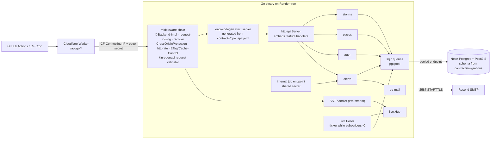
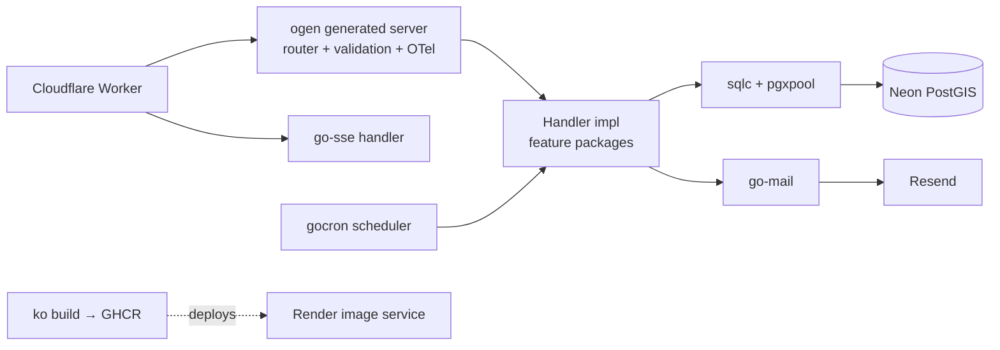
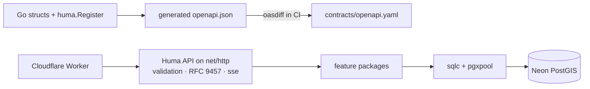

# Replay: Go backend architecture research

Status: research only, nothing implemented yet. Written 2026-10-21; versions checked that day against the Go module proxy, GitHub releases and official docs.
Scope: `api/go/`, one of four interchangeable backends. It implements the OpenAPI 3.1 contract in `contracts/` on the shared PostGIS schema and must pass the shared conformance suite.

---

## 0. TL;DR

| Area | Pick | One-line reason |
|---|---|---|
| Go version | **Go 1.27** (1.27.3, 2026-10-19) | Current release; adds `encoding/json/v2` (GA), std `uuid` and `httptest.NewTestServer` with `synctest` (see §1). |
| Router | **`net/http.ServeMux`** (method + wildcard patterns) | No router dependency; the generator targets it directly. |
| Contract-first | **oapi-codegen v2.8.0** (`std-http-server` + `strict-server` + `models` + `embedded-spec`) plus **kin-openapi v0.151.0** request validation via `oapi-codegen/nethttp-middleware` v1.2.0 | Keeps the contract as source of truth; both tools support OpenAPI 3.1 (2026). |
| Layout | `cmd/` + `internal/<feature>` + one `internal/httpapi` adapter. Manual wiring in `run()`. | Idiomatic and easy to grep and explain. `google/wire` was archived in 2025-08. |
| Data | **pgx v5.11 + pgxpool + sqlc v1.31.1**. PostGIS work stays in SQL, which returns GeoJSON/scalars. `twpayne/go-geom` + `pgx-geom` only where a geometry must cross into Go. | Type-safe SQL, no ORM. Pure Go keeps the static binary (go-geos would need cgo). |
| Neon | Pooled endpoint for the app, pgx default exec mode (Neon's PgBouncer supports protocol-level prepared statements, `max_prepared_statements=1000`), `MaxConns` ≈ 4 | Fits 0.1 CPU and 512 MB on Render. |
| Auth | `golang.org/x/oauth2` v0.37 (PKCE) + `coreos/go-oidc/v3` for Google + a **small in-house session package over the shared Postgres `sessions` table** (scs is the fallback) | A shared table lets a user switch backends and stay signed in. scs's default gob codec isn't language-neutral. |
| CSRF | **`http.CrossOriginProtection`** (std, Go 1.25+) + `SameSite=Lax` cookie | Token-free, built on Fetch metadata. |
| Rate limit | **`go-chi/httprate` v0.16** (works with any `net/http` handler) with a custom key and a problem+json 429 | Single instance, so in-memory is enough. |
| SSE | Hand-written ~120-line hub (`http.ResponseController.Flush`, heartbeats, `Last-Event-ID`) | Idiomatic Go with no dependency; testable with `synctest`. |
| Scheduling | `time.Ticker` loops under `errgroup`, **plus** an authenticated `POST /internal/tick` for an external cron, because Render free sleeps | robfig/cron's last push was 2024-07, and the job count doesn't justify gocron. |
| Email | **`wneessen/go-mail` v0.8.1** → Mailpit locally and **Resend SMTP on port 2587** in prod | Render free blocks outbound 25/465/587. Resend also listens on 2465/2587. |
| Tests | `go test`, `httptest`, `testing/synctest`, **testcontainers-go v0.44** (`postgis/postgis`, Snapshot/Restore), response validation in tests via kin-openapi, plus the shared conformance suite | |
| Observability | `log/slog` JSON to stdout. OpenTelemetry (otelhttp + `exaring/otelpgx` v0.13 + `otelslog` bridge) is **off unless `OTEL_EXPORTER_OTLP_ENDPOINT` is set**. | Sized for one small instance. |
| Container | Multi-stage **Dockerfile** → `CGO_ENABLED=0`, `-trimpath -ldflags="-s -w"` → **`gcr.io/distroless/static-debian12:nonroot`**. Set `GOMEMLIMIT`. | Render builds Dockerfiles natively; ko would need a registry push. |
| Sessions vs tokens | **Prefer server-side sessions in the shared Postgres table** | See §5.1. |

**Overall pick: Stack A, "stdlib-first, contract-generated"** (§9).

---

## 1. Constraints that shape the design (verified)

| Fact | Source | Consequence for Go |
|---|---|---|
| Go 1.27.0 released 2026-08-19; 1.27.3 and 1.26.10 on 2026-10-19 | [go.dev release history](https://go.dev/doc/devel/release) | Target `go 1.27` in `go.mod`. 1.26 is still supported if a tool lags. |
| Go 1.25: container-aware GOMAXPROCS (cgroup CPU limit, updated periodically) | [Go 1.25 notes](https://go.dev/doc/go1.25) | Go respects Render's 0.1 CPU limit automatically; no GOMAXPROCS tuning. |
| Go 1.25: `net/http.CrossOriginProtection` | [Go 1.25 notes](https://go.dev/doc/go1.25), [pkg.go.dev](https://pkg.go.dev/net/http#CrossOriginProtection) | Std CSRF defence. |
| Go 1.26: Green Tea GC default, `errors.AsType`, `slog.NewMultiHandler`, `new(expr)` | [Go 1.26 notes](https://go.dev/doc/go1.26) | Cleaner error mapping (`errors.AsType[*NotFound](err)`). |
| Go 1.27: `encoding/json/v2` GA (v1 now backed by v2), new `uuid` package, `httptest.NewTestServer` with synctest, generic methods | [Go 1.27 notes](https://go.dev/doc/go1.27) | No third-party UUID dependency. JSON stays std. |
| Render free web service: **512 MB RAM, 0.1 CPU**; spins down after **15 min** without inbound traffic; spin-up "about one minute"; **750 free instance-hours per workspace per month**; ephemeral FS; may restart at any time; **outbound 25/465/587 blocked** | [Render free docs](https://render.com/docs/free), [compute plans](https://render.com/docs/compute-plans.md) | The in-process scheduler doesn't run while asleep. SMTP has to use port 2587/2465 or an HTTP API. Four backends cannot all stay awake (4 × 744 h > 750 h). |
| Render builds Dockerfiles (BuildKit, multi-stage) and can also pull prebuilt `linux/amd64` images from GHCR | [Render Docker](https://render.com/docs/docker), [deploying an image](https://render.com/docs/deploying-an-image) | Dockerfile is the simplest path. ko needs a registry. |
| Neon free: **100 CU-hours/project/month**, autoscale to 2 CU, **1 GB storage/project**, scale-to-zero after **5 min (cannot disable)**, 5 GB egress | [Neon plans](https://neon.com/docs/introduction/plans) | No continuous DB polling; keep wake-ups rare. |
| Neon pooler: PgBouncer transaction mode, `max_client_conn=10000`, protocol-level prepared statements supported (`max_prepared_statements=1000`); **no `LISTEN/NOTIFY`, session advisory locks, `SET`, SQL `PREPARE`** on the pooled endpoint | [Neon pooling](https://neon.com/docs/connect/connection-pooling) | pgx defaults work. No LISTEN-based fan-out and no advisory-lock leader election through the pooler. |
| PostGIS available on any Neon project | [Neon PostGIS](https://neon.com/docs/extensions/postgis) | |
| Resend free: 3,000/month, **100/day**; SMTP on 25/465/587/**2465/2587** | [Resend pricing](https://resend.com/pricing), [Resend SMTP](https://resend.com/docs/send-with-smtp) | go-mail can reach Resend on 2587 (STARTTLS) from Render free. |
| GitHub OAuth apps: exact match unless wildcard matching is enabled per callback URL; the path must be a subdirectory; PKCE S256 supported; apps created after 2026-08-03 have no automatic wildcard | [GitHub docs](https://docs.github.com/en/apps/oauth-apps/building-oauth-apps/authorizing-oauth-apps) | Register `/api/go/auth/github/callback` explicitly, or one `/api/` callback with wildcard matching. |

---

## 2. Router / framework

| Option | Version (2026-10) | Pros | Cons |
|---|---|---|---|
| **`net/http.ServeMux`** (Go 1.22+ patterns: `GET /v1/storms/{id}`, `r.PathValue`) | Go 1.27 | Zero dependencies. Every Go developer knows it. oapi-codegen has a `std-http-server` target (Go 1.24+). Middleware is just `func(http.Handler) http.Handler`. Go 1.26 changed trailing-slash redirects to 307. | No route groups or sub-router ergonomics (not needed when routes are generated). |
| **chi** v5.5.0 (2026-10-14) | active | 100% `net/http` compatible. Groups, `Mount`, and a middleware set (RequestID, Recoverer, Timeout). httprate is from the same org. | Mostly duplicates std since 1.22; an extra dependency. |
| **Echo** v5.4.0 (2026-09-27) | active, v5 is new | Batteries included, with an oapi-codegen `echo5-server` target. | Its own `echo.Context`, so handlers aren't plain `net/http`. The v4→v5 churn is recent. |
| **Gin** v1.12.0 (2026-02-28) | active, most stars | Popular and fast. | Own `gin.Context`, error and binding model; less portable middleware. |
| **Huma** v2.39.1 (2026-07-29) | active | Generates OpenAPI 3.1 from Go types, RFC 9457 errors by default, validation, an `sse` package and conditional-request helpers. Runs on `humago` (std) or `humachi`. | **Code-first**: Go code would author the spec, against the contract-first rule. Reflection-heavy. |

Sources: [chi releases](https://github.com/go-chi/chi/releases), [echo](https://github.com/labstack/echo/releases), [gin](https://github.com/gin-gonic/gin/releases), [huma](https://github.com/danielgtaylor/huma), [oapi-codegen support table](https://github.com/oapi-codegen/oapi-codegen).

**Recommendation: std `net/http`.** Generated code owns routing, so a router library adds nothing; the middleware chain is about six small functions. If route grouping is ever needed, chi is a drop-in swap (`chi-server: true`) with no handler changes, because strict handlers don't see the router.

---

## 3. Contract-first code generation and validation

### Options

| | **oapi-codegen v2.8.0** (2026-07-17) | **ogen v1.24.0** (2026-08-07) | **Huma v2 code-first + contract tests** |
|---|---|---|---|
| Source of truth | `contracts/openapi.yaml` | `contracts/openapi.yaml` | Go structs. The spec is exported and then diffed against the contract. |
| OpenAPI 3.1 | Yes. "Initial OpenAPI 3.1 support landed with #2336", including webhooks and `type: [T, "null"]`. Multi-type unions become `any`. | README says "OpenAPI v3"; **3.1 support unclear**. Third-party `ogen-tools` ships `ogen-fixnull31` to pre-process 3.1 specs, a sign of gaps. | Native 3.1 output. |
| Server style | Strict: `func (s *Server) GetStorm(ctx, GetStormRequestObject) (GetStormResponseObject, error)`. Typed responses per status code; undeclared statuses don't compile. | Typed handler interface. Generated radix router. Generated (reflection-free) JSON via `go-faster/jx`. | `huma.Register(api, op, func(ctx, *Input) (*Output, error))` |
| Request validation | **Not in strict mode itself.** Added via kin-openapi middleware (`oapi-codegen/nethttp-middleware` v1.2.0): params, body and JSON Schema 2020-12 for 3.1 docs. | Generated validation built in (fast). | Built in. |
| Response validation | Not via middleware (README: "not currently possible"). Do it in tests with `openapi3filter.ValidateResponse`. | Encoding is typed, so mostly guaranteed. | Typed. |
| SSE endpoint | Mount the hand-written handler on the same mux, outside the strict wrapper. The operation still lives in the spec. | "Only SSE client generation is supported". The server side has to be hand-written. | `sse.Register` documents event types. |
| OTel | Bring your own (`otelhttp`) | Built-in tracing and metrics | Bring your own |
| Problem+json | `StrictHTTPServerOptions{RequestErrorHandlerFunc, ResponseErrorHandlerFunc}` plus the validator's `ErrorHandlerWithOpts` | `ErrorHandler` hook | Default |
| Explainability | Generated code is readable. Handlers are plain Go. | Generated code is large and unfamiliar (`OptString`, `jx`). | Very readable, but the contract's location is unclear. |

Sources: [oapi-codegen README/FAQ](https://github.com/oapi-codegen/oapi-codegen), [nethttp-middleware](https://github.com/oapi-codegen/nethttp-middleware), [kin-openapi](https://github.com/getkin/kin-openapi) (changelog: 3.1 documents validated by a JSON Schema 2020-12 validator in `openapi3filter`; partial 3.2), [ogen](https://github.com/ogen-go/ogen), [ogen-tools](https://pkg.go.dev/github.com/plexusone/ogen-tools), [Huma SSE](https://huma.rocks/features/server-sent-events-sse/), [jvt.me on 3.1 + oapi-codegen (2025, pre-#2336)](https://www.jvt.me/posts/2025/05/04/oapi-codegen-trick-openapi-3-1/).

### Recommendation

**oapi-codegen strict server on `std-http-server`, with kin-openapi request validation in front.**

- Config: `generate: {std-http-server: true, strict-server: true, models: true, embedded-spec: true}`. With `embedded-spec`, `GetSwagger()` gives the validator the exact spec the code was built from, with no runtime file read. This also avoids `go:embed`, which can't reach `../../contracts` from the Go module.
- Pin the generator with Go's `tool` directive (`go get -tool github.com/oapi-codegen/oapi-codegen/v2/cmd/oapi-codegen@v2.8.0`) and `//go:generate go tool oapi-codegen -config oapi-codegen.yaml ../../contracts/openapi.yaml`. Do the same for sqlc. CI runs `go generate ./... && git diff --exit-code` to catch contract drift.
- Validator setup: `OapiRequestValidatorWithOptions(spec, &Options{ErrorHandlerWithOpts: problem.FromValidation, SilenceServersWarning: true, Options: openapi3filter.Options{AuthenticationFunc: …}})`. Since kin-openapi v0.144 `AuthenticationFunc` has no no-op default, so set it: check the session cookie (if the contract declares `cookieAuth`) or pass through when handlers enforce auth. Clear or rewrite `spec.Servers` to match the path prefix the edge forwards (open question Q2).
- Strict mode returns only declared statuses and bodies: the strongest compile-time tie to the contract of the three options.
- Risk: oapi-codegen calls its 3.1 support "initial", so spike the real contract on day 1. If a construct breaks codegen, apply an OpenAPI Overlay (oapi-codegen supports it) on the Go side only; never edit the contract for one language. Fallback: ogen, which has its own 3.1 uncertainty.
- Not Huma: best Go DX here, but Go would author the spec. `oasdiff` breaking-change checks could be added, yet "which file is the API?" would have two answers.

---

## 4. Architecture, wiring, errors, config

### Layout principles

- `cmd/typhoon-api/main.go` holds only `func main() { if err := run(ctx, os.Args, os.Getenv, os.Stdout); err != nil {…} }`. The [Mat Ryer pattern](https://grafana.com/blog/2024/02/09/how-i-write-http-services-in-go-after-13-years/) makes the whole server testable from `httptest`.
- `internal/<feature>` packages (`storms`, `places`, `live`, `auth`, `alerts`) each own their SQL queries, service logic and the strict handler methods for their operations.
- **Ports are small consumer-side interfaces**, declared where they're used, e.g. `type stormStore interface { StormsNear(ctx, lon, lat, radiusM float64, page Cursor) ([]Storm, error) }`. No `repository` layer, `usecase`/`interactor`, `domain/entities` or `IStormRepository` mirror interfaces (Go: "accept interfaces, return structs").
- `internal/httpapi` assembles the generated `StrictServerInterface` by **struct embedding** the feature handlers (`type Server struct { *storms.Handler; *places.Handler; *auth.Handler; … }`), so each feature implements only its own methods. It also holds the middleware chain, problem mapper and ETag/caching helpers.
- `internal/platform/{config,db,logging,telemetry,mail}` holds cross-cutting adapters.

### Dependency wiring

| Option | Status | Verdict |
|---|---|---|
| **Manual** in `run()` | n/a | **Pick.** About 40 lines, explicit and readable top to bottom (idiomatic Go). |
| google/wire | **archived 2025-08-22** (v0.7.0) | Don't use. |
| uber-go/fx | v1.24.0 (2025-05) | Reflection-driven lifecycle; overkill for one binary and hides control flow. |

Concurrency lifecycle: `signal.NotifyContext` → `errgroup.WithContext` (x/sync v0.24.0) runs the HTTP server, the SSE hub and the scheduler loops. Graceful `srv.Shutdown`, with SSE streams closing on `ctx.Done()`.

### Error handling → RFC 9457

- A single `internal/httpapi/problem.go` with `type Problem struct{Type, Title string; Status int; Detail, Instance string; Extensions map[string]any}` writes `application/problem+json`. Type URIs and any extension members (e.g. `errors[]` for validation) come **from the contract** so all four backends match byte-for-byte where the conformance suite checks.
- Domain errors are sentinel values or small types in feature packages (`storms.ErrNotFound`). The mapper uses `errors.Is` / `errors.AsType` (Go 1.26). Unknown errors become 500 with a generic detail, and the cause is logged with the request ID.
- Every error source routes to the same writer: strict `RequestErrorHandlerFunc` (bad params), `ResponseErrorHandlerFunc` (handler errors), the validator `ErrorHandlerWithOpts`, httprate's limit handler (429 + `Retry-After`) and the `CrossOriginProtection.SetDenyHandler` (403). Add `http.NotFound` for unknown routes and recover() middleware.

### Config

A hand-written `config.Load(getenv func(string) string) (Config, error)` (~60 lines) parses the 12-factor environment, validates required keys and is testable without the process environment. `caarlos0/env` v11.4.1 if the field count grows. No Viper (too heavy for env-only config).

---

## 5. Data access (PostGIS on Neon)

| Option | Version | PostGIS fit | Verdict |
|---|---|---|---|
| **pgx v5 + sqlc** | pgx v5.11.0 (2026-09-07), sqlc v1.31.1 (2026-04-22) | SQL is written by hand, so `ST_DWithin(geog, ST_MakePoint($1,$2)::geography, $3)` and KNN `<->` are first-class. sqlc type-checks the queries against the **contract's migrations** (`schema: ../../contracts/migrations`). | **Pick.** |
| GORM | v1.31.2 | Spatial work needs raw SQL or custom types anyway; the ORM fights an externally owned schema. | No |
| Bun | v1.3.0 | Good query builder, but duplicates migration ownership held by contracts/. | No |
| sqlx | v1.4.0, last push 2024-08 | Stagnant; no compile-time query checks. | No |

Source: [sqlc data types / PostGIS overrides](https://docs.sqlc.dev/en/latest/reference/datatypes.html), [pgx docs](https://pkg.go.dev/github.com/jackc/pgx/v5).

### Geometry types: keep PostGIS in SQL

- The API mostly returns **GeoJSON** and scalars. Let PostGIS produce it: `ST_AsGeoJSON(track)::json AS track`, mapped by a sqlc override (`db_type: json` → `encoding/json.RawMessage`). Go never parses the geometry; the bytes pass straight to the response.
- Where Go must hold geometry (e.g. the forecast-cone vs saved-place test, if it isn't done in SQL), use **`twpayne/go-geom` v1.7 + `twpayne/pgx-geom` v1.0.0**, which register EWKB codecs on pgx v5 in pure Go. Avoid **go-geos** (also in the sqlc docs): it needs **cgo + libgeos**, which breaks `CGO_ENABLED=0` + distroless/static.
- Prefer doing the "is a saved place within N km of the forecast track" test in SQL (`ST_DWithin(place.geog, forecast.track_geog, radius)`) so all four backends share identical semantics.

### Pooling against Neon

- App uses the **pooled endpoint** (`-pooler` host). Neon's PgBouncer supports protocol-level prepared statements (`max_prepared_statements=1000`); per pgx docs, PgBouncer ≥ 1.21 with that setting works with the default `QueryExecModeCacheStatement`. On `prepared statement … already exists` errors, set `default_query_exec_mode=exec` in the DSN (pgx prefers `exec` over `simple_protocol`; never `describe_exec` behind transaction pooling).
- `pgxpool`: `MaxConns=4`, `MinConns=0` so Neon can scale to zero, `MaxConnIdleTime=2m`, `HealthCheckPeriod=1m`. Set connect timeouts long enough for Neon's cold resume (a few seconds).
- Migrations belong to `contracts/`; the Go service **does not migrate at boot**. Compose runs the contracts migration container locally; tests apply the migration files to testcontainers. Migrations use the direct (non-pooled) URL, as Neon recommends.
- No `LISTEN/NOTIFY` or session advisory locks over the pooler (unsupported); a direct connection for them keeps a Neon compute awake.

### 5.1 Sessions vs signed tokens: **prefer server-side sessions in the shared table**

1. **Cross-backend continuity.** The same-origin edge proxy routes `/api/<lang>/*`, so a `Path=/api` cookie reaches all four backends and a shared `sessions` row keeps a visitor signed in when switching from Go to Rust. This demonstrates interchangeability.
2. **Logout and revocation are a `DELETE`**, with no deny-list. Signed tokens would need a cross-language format (JWT/PASETO), a key shared by four services and a revocation scheme.
3. Cost: one indexed primary-key lookup per authenticated request; negligible, as most traffic is anonymous public reads.
4. **Store a SHA-256 of the token, not the token** (DB leak ≠ session hijack). The `__Host-` prefix requires `Path=/`, so with `Path=/api` use a plain name plus `Secure; HttpOnly; SameSite=Lax`.

**Go implementation.** `alexedwards/scs` v2.9 + `pgxstore` expects `sessions(token TEXT PK, data BYTEA, expiry TIMESTAMPTZ)` and **gob-encodes** `data` by default (Go-only). scs offers `Codec` (JSON possible) and `HashTokenInStore`, but the contract's table will likely have typed columns (`user_id`, `created_at`, `expires_at`, `user_agent`). Recommendation: a **small `internal/auth/session.go` (~150 lines) over sqlc queries against the contract's table**, which stays explainable and language-neutral. gorilla/sessions v1.4.0 (last push 2024-08) is cookie-store-oriented; not a fit. Fallback: scs with a JSON codec, only if the architect adopts an scs-shaped table.

---

## 6. Auth, CSRF, rate limiting

- **OAuth2**: `golang.org/x/oauth2` v0.37.0 (2026-08-25) with `oauth2.GenerateVerifier()` / `S256ChallengeOption` (PKCE) and a `state` + verifier stored in a short-lived signed cookie or in a pre-session row.
  - **Google**: `coreos/go-oidc/v3` v3.21.0 verifies the ID token (issuer, audience, nonce). Use the `sub` claim as the stable ID.
  - **GitHub**: plain OAuth2, then `GET /user` and `GET /user/emails` (primary + verified). GitHub's redirect rules changed in 2026 (exact match unless wildcard matching is enabled per callback), so register the Go callback explicitly.
  - Account-linking rules (same verified email across providers?) belong in the contract, since all four must agree (Q7).
- **CSRF**: `http.NewCrossOriginProtection()` wraps the mux and rejects non-safe cross-origin browser requests via `Sec-Fetch-Site`/`Origin`, with no tokens. `AddTrustedOrigin` for the local dev front-end origin only; `SetDenyHandler` → problem+json 403. Keep `SameSite=Lax`; the OAuth callback is a GET, so it's unaffected.
- **Rate limiting**: `go-chi/httprate` v0.16.0 works on plain `net/http`.
  - The key comes from `CF-Connecting-IP`, **trusted only when** the request carries the edge's shared-secret header (otherwise use `r.RemoteAddr`).
  - Separate buckets for anonymous vs session-authenticated users, and a stricter one for `/auth/*` and the spatial search.
  - `WithLimitHandler` emits problem+json 429 with `Retry-After`.
  - Header names (`RateLimit-*` IETF draft vs `X-RateLimit-*`) must follow the contract (Q4).
  - `x/time/rate` v0.16.0 is the hand-rolled alternative (token bucket per key + map cleanup); httprate is less code.
- **Caching**: a middleware buffers 2xx GET JSON responses and sets a **strong ETag = base64(SHA-256(body))[:22]**, answering `If-None-Match` with 304. Historical data is immutable between ingestions, so catalogue and town-search routes get `Cache-Control: public, max-age=300, stale-while-revalidate=86400`, and `/me/*` gets `private, no-store`. If the contract exposes a data version (latest ingestion ID), use it as the ETag and skip the query.
- `X-Backend-Impl: go` (and maybe `go/<git-sha>`) is set by the outermost middleware.

---

## 7. SSE, scheduling, email

### SSE

| Option | Verdict |
|---|---|
| **Hand-written hub on `net/http`** | **Pick.** `http.NewResponseController(w).Flush()` flushes through wrapped writers (it unwraps via `Unwrap()`, so middleware wrappers must implement it). `SetWriteDeadline(time.Time{})` disables the server's `WriteTimeout` for the stream. Send `retry:` and a `: ping` heartbeat every 20 s; honour `Last-Event-ID` from a small ring buffer of recent events. Hub: `map[chan Event]struct{}` behind a mutex, or a single-goroutine select loop, with non-blocking send that drops slow clients. Cap concurrent streams to stay within 512 MB. Test it with `testing/synctest` + Go 1.27's `httptest.NewTestServer`. |
| tmaxmax/go-sse v0.11.0 (2025-05) | Spec-complete with replay providers, but hides the interesting part. |
| r3labs/sse v2 | Last push 2024-06. No. |

Live events come from a shared `active_storms`/`forecast_tracks` table that ingestion fills. The hub **polls a cheap version row only while ≥1 subscriber is connected** (e.g. every 60 s), because Neon bills CU-hours and suspends after 5 min. `LISTEN/NOTIFY` isn't available on the pooled endpoint.

### Scheduling

- Render free **sleeps after 15 min without inbound traffic**, so an in-process ticker can't be the only trigger:
  - `internal/live/poller.go` runs a `time.Ticker` loop while the process is awake and works only when needed.
  - An **authenticated `POST /internal/jobs/{name}`** (shared-secret header; outside the public contract or in an `x-internal` section) lets an external scheduler (GitHub Actions cron or Cloudflare Worker Cron Trigger) drive ingestion and alert fan-out and wake the service only when needed.
  - **Which backend ingests?** Ideally one shared job (the pipeline or one designated backend), not four duplicates (Q3).
- robfig/cron v3.0.1 (last push 2024-07) is dormant. go-co-op/gocron v2.22.0 is active but unnecessary for 1–3 fixed-interval jobs.

### Email

- `net/smtp` is frozen, so use **`wneessen/go-mail` v0.8.1** (2026-07-09): STARTTLS/implicit TLS, context-aware `DialAndSendWithContext`, multipart text+HTML via `html/template`.
- Local: Mailpit SMTP `:1025`, no TLS.
- Prod on Render free: **Resend SMTP `smtp.resend.com:2587` (STARTTLS)**, because Render blocks 25/465/587. Free plan: 3,000/month, 100/day. Resend's HTTP API (`resend-go` v4.9.0) could sit behind the same `Mailer` interface, but SMTP keeps one code path for local and prod.
- Idempotency: insert a unique `alert_deliveries(user_id, storm_id, advisory_id)` row **before** sending (`INSERT … ON CONFLICT DO NOTHING RETURNING`), so a retried or duplicated job never double-mails (more so if several backends can run the job).

---

## 8. Testing, observability, build

### Testing pyramid

1. **Unit**: feature services with fake ports (hand-written fakes, no mocking framework). Use table-driven tests, and `synctest` for hub, poller and ticker timing.
2. **HTTP**: `run()` + `httptest.NewServer`. In test builds a middleware validates **responses** with `openapi3filter.ValidateResponse` against the embedded spec, to cover what request-only validation misses.
3. **DB integration**: testcontainers-go v0.44.0 `postgres.Run(ctx, "postgis/postgis:<same tag as compose>", postgres.WithSQLDriver("pgx"), postgres.BasicWaitStrategies())`. Apply `contracts/migrations` plus a small fixture (a few storms, a few ADM3 polygons), take a `Snapshot()`, and `Restore()` per test. Gate it with `testing.Short()` or a build tag so `go test ./...` stays fast. Alternative: `peterldowns/pgtestdb` (template DBs).
4. **Conformance**: the shared language-neutral suite runs against the built container in CI (Compose: PostGIS + Mailpit + the Go image).
5. `go vet`, `staticcheck` or `golangci-lint` (v2), `govulncheck`, and `go test -race`.

### Observability

- `log/slog` with a `JSONHandler` to stdout (Render captures stdout). A request-ID middleware (honour `CF-Ray`/`X-Request-Id` from the edge) puts the ID into the context, and a `slog.Handler` wrapper adds `request_id`, `trace_id`.
- OpenTelemetry: `go.opentelemetry.io/otel` v1.47.0, `otelhttp`, `exaring/otelpgx` v0.13.0, `contrib/bridges/otelslog` v0.21.0. **Initialise it only when `OTEL_EXPORTER_OTLP_ENDPOINT` is set.** On 0.1 CPU and a sleeping instance, exporting is optional; the instrumented code path is what matters.
- `/healthz` (process) and `/readyz` (DB ping with a short timeout; don't wake Neon from Render health checks too often, see Q6).

### Build and container

```dockerfile
# syntax=docker/dockerfile:1
FROM --platform=$BUILDPLATFORM golang:1.27-alpine AS build
WORKDIR /src
COPY go.mod go.sum ./
RUN --mount=type=cache,target=/go/pkg/mod go mod download
COPY . .
ARG TARGETOS=linux TARGETARCH=amd64 VERSION=dev
RUN --mount=type=cache,target=/root/.cache/go-build \
    CGO_ENABLED=0 GOOS=$TARGETOS GOARCH=$TARGETARCH \
    go build -trimpath -ldflags="-s -w -X main.version=$VERSION" -o /out/api ./cmd/typhoon-api

FROM gcr.io/distroless/static-debian12:nonroot
COPY --from=build /out/api /api
ENV GOMEMLIMIT=400MiB
USER nonroot:nonroot
ENTRYPOINT ["/api"]
```

(Illustrative. Generated code is committed, so the image build doesn't need the contracts folder; alternatively, the build context is the repo root.)

- **distroless/static** over **scratch**: distroless includes CA certificates (needed for Google/GitHub/Resend TLS), tzdata and a nonroot user, which scratch would need copied in. Go's `time/tzdata` embed is an option for JST/PHT formatting in emails.
- **ko** v0.19.1: no Dockerfile, SBOM by default, no Docker daemon, but Render would pull from GHCR (a token for private images, `linux/amd64`), adding a CI push step. The README can note "also builds with ko"; the Dockerfile is primary because Render builds it from the repo with no registry.
- **Footprint (estimate, to measure in the spike)**: image ~15–25 MB, idle RSS a few tens of MB, start in milliseconds. On Render free the **~1 min cold start is Render's spin-up, not Go's**; Go's gain there is memory headroom under 512 MB and less work per request on 0.1 CPU. `GOMEMLIMIT=400MiB` makes the GC work harder before an OOM kill.

---

## 9. Three coherent Go stacks

### Stack A: "Stdlib-first, contract-generated" (recommended)

`net/http` ServeMux · oapi-codegen strict (std-http) · kin-openapi request validation · pgx v5 + sqlc · in-house sessions (shared table) · x/oauth2 + go-oidc · CrossOriginProtection · httprate · hand-written SSE hub · ticker + external cron hook · go-mail · slog (+ optional OTel) · testcontainers · distroless.



- Pros: ≈10 direct dependencies, contract enforced at compile time (strict) and at runtime (validator), plain Go throughout.
- Cons: the strict server's typed response objects are verbose, and the 3.1 support is "initial" (spike needed).
- **What a recruiter sees**: modern Go (1.22 routing, 1.25 CSRF, 1.27 json/v2), no framework, the OpenAPI file as law, and hand-written SQL, all visible in a short `go.mod`.

### Stack B: "Generated-everything, performance" (ogen)

ogen server (its own router, validation and jx JSON, OTel built in) · pgx + sqlc · scs + JSON codec · x/oauth2 · httprate · go-sse library · gocron · go-mail · OTel on by default · ko → GHCR → Render image deploy.



- Pros: fastest JSON path, the strongest generated validation, tracing for free.
- Cons: unclear OpenAPI 3.1 support (may need spec pre-processing, weakening "contract is law"), no server-side SSE generation, large and unusual generated code, and a registry step to deploy.
- **What a recruiter sees**: a focus on performance and tooling, but reviewers must learn ogen's `Opt*` types to read handlers, so the code is harder to explain.

### Stack C: "Huma code-first + contract diff"

Huma v2 on `humago` · Go types → OpenAPI 3.1 → `oasdiff` against `contracts/openapi.yaml` in CI · built-in problem+json, validation, SSE · pgx + sqlc · same auth, mail and container as A.



- Pros: least boilerplate, excellent built-in docs, RFC 9457 by default.
- Cons: two sources of truth (code and contract) reconciled by a diff tool, which contradicts the project's contract-first rule and is the weakest story in a four-language contract demo.
- **What a recruiter sees**: productive and pragmatic, but in a polyglot contract-first portfolio the Go backend appears to opt out of the rule.

### Comparison

| | A (pick) | B | C |
|---|---|---|---|
| Contract is the source of truth | ✅ | ⚠️ 3.1 gaps | ❌ (diffed) |
| Runtime request validation | ✅ kin-openapi | ✅ generated | ✅ |
| Direct dependencies | ~10 | ~12 | ~10 |
| Readability for reviewers | High | Medium | High |
| Risk | oapi-codegen 3.1 "initial" | ogen 3.1 + SSE | Spec drift |

---

## 10. Recommended project layout

```text
api/go/
├── go.mod                      # module …/typhoon-replay/api/go ; go 1.27 ; tool (oapi-codegen, sqlc)
├── go.sum
├── oapi-codegen.yaml           # std-http-server + strict-server + models + embedded-spec
├── sqlc.yaml                   # engine postgresql, sql_package pgx/v5, schema ../../contracts/migrations
├── Dockerfile
├── Makefile                    # generate · lint · test · test-integration · run (thin wrappers only)
├── README.md                   # how to run, how it maps to the contract, design notes
├── docs/                       # this research
├── cmd/
│   └── typhoon-api/
│       └── main.go             # main → run(ctx, args, getenv, stdout)
├── sql/
│   └── queries/                # storms.sql · places.sql · sessions.sql · alerts.sql · live.sql
└── internal/
    ├── api/                    # GENERATED by oapi-codegen (types, strict iface, embedded spec) — do not edit
    ├── db/                     # GENERATED by sqlc — do not edit
    ├── httpapi/                # server.go (embeds feature handlers) · routes.go · middleware.go
    │                           # problem.go (RFC 9457) · cache.go (ETag) · ratelimit.go · validate.go
    ├── storms/                 # handler.go · service.go · store.go (small port iface) · *_test.go
    ├── places/                 # town search: ST_DWithin / exposure tables
    ├── live/                   # hub.go · sse.go · poller.go
    ├── auth/                   # oauth.go (Google OIDC, GitHub) · session.go (shared table) · middleware.go
    ├── alerts/                 # matcher.go (SQL proximity) · jobs.go · templates/ · mailer.go (port)
    ├── platform/
    │   ├── config/             # Load(getenv)
    │   ├── database/           # pgxpool setup, pgx-geom registration if used
    │   ├── logging/            # slog setup, request-id handler
    │   ├── telemetry/          # optional OTel
    │   └── mail/               # go-mail adapter implementing alerts.Mailer
    └── testutil/               # testcontainers PostGIS + fixtures, response-validating middleware
```

No `pkg/` (nothing is for external import) and no `domain/`, `usecase/` or `repository/` layers. Generated code is committed so `go build` works without generators; CI checks it is fresh.

---

## 11. Overall pick

**Stack A.** Go 1.27 std `net/http` + oapi-codegen v2.8 strict server generated from `contracts/openapi.yaml`, with kin-openapi v0.151 request validation, pgx v5.11 + sqlc v1.31 against the contract's migrations, server-side sessions in the shared Postgres table, std `CrossOriginProtection`, httprate, a hand-written SSE hub, an external-cron-friendly job endpoint, go-mail via Resend on port 2587, slog with optional OTel, testcontainers PostGIS, and a distroless static image built by Render from a Dockerfile.

Chosen because the contract stays the single source of truth, the code is idiomatic and small, and each non-std dependency has a one-line justification.

**Day-1 spike** (before committing):
1. Run oapi-codegen on the real 3.1 contract; check the strict interface compiles.
2. Validate the contract's examples with kin-openapi.
3. Run sqlc on the contract migrations with one `ST_DWithin` query.
4. Measure image size, RSS and p95 latency on Render free with Neon pooled.

## Frozen showcase policy (decided 2026-10-21)

Applies once this backend is built (`docs/architecture/DECISIONS.md`, "Frozen showcase policy"; example: the Java
backend's README). After its first conformant release it receives security fixes only.

- **Pinned:** `go.mod` with exact module versions and the `go` / `toolchain` directives, plus the committed `go.sum` (`-mod=readonly` in CI); base images by digest; CI actions by commit SHA.
- **Security fixes:** Renovate (`renovate.json`) opens no routine updates under `api/go/`. Vulnerability fixes
  (GitHub advisories / OSV) and base-image digest refreshes arrive as one grouped PR ("go backend security
  fixes", branch `renovate/go/security-fixes`) that auto-merges only when this backend's own tests and the
  shared conformance suite against its image pass.
- **Unfreezing** for a deliberate upgrade: change the pins (`go get <module>@<version>` + `go mod tidy`, or the `toolchain` directive), regenerate the lockfile, re-measure
  startup/RSS, and open a PR labelled `unfreeze`; the same tests and conformance gate it.
