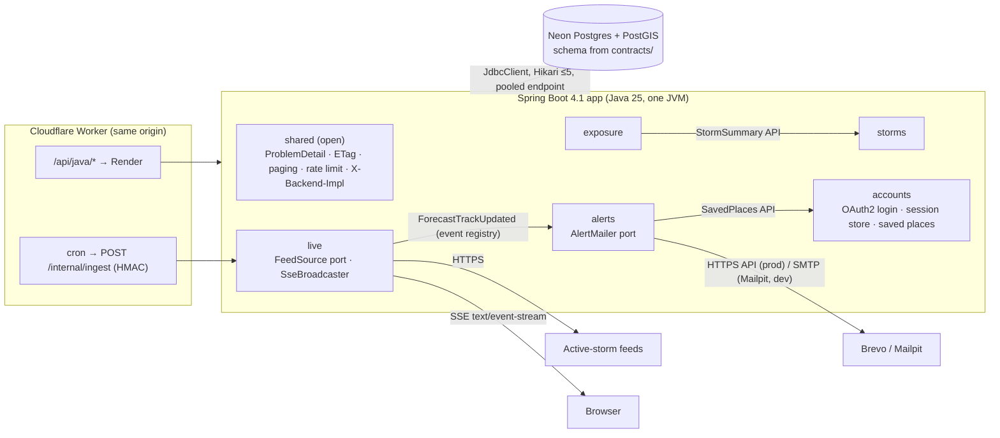
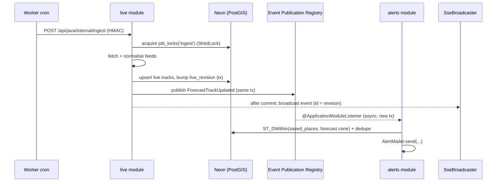
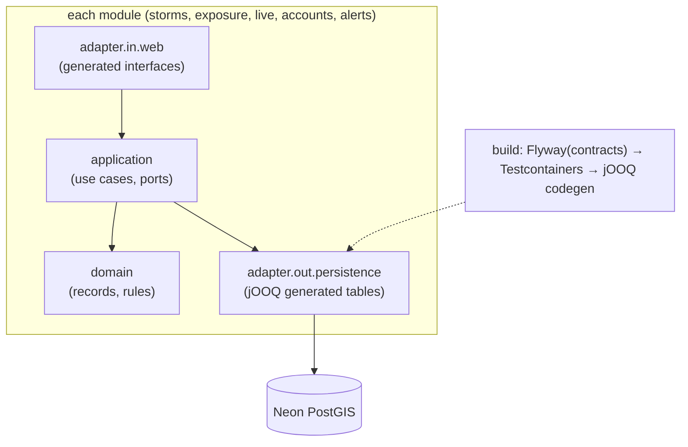
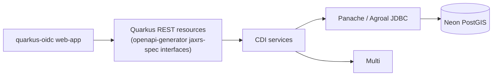

# Typhoon Replay: Java backend architecture research

Status: research only (no code yet). Verified on 2026-10-21 unless a line says otherwise.

> **Update 2026-10-21:** contract 2.0.0 removed accounts, so the Spring Security, OAuth2 client, session store and
> CSRF parts below are history; the implementation (see `../README.md`) has none of them. Once built, the backend is
> a frozen showcase (`docs/architecture/DECISIONS.md`).
Scope: the Java implementation of the shared OpenAPI 3.1 contract, deployed at `/api/java/*` behind the same-origin edge proxy.

**TL;DR.** Use **Spring Boot 4.1 on Java 25**, built as a **Spring Modulith modular monolith**. Pair **Spring MVC plus virtual threads** with **`SseEmitter`**, and use **`JdbcClient` with PostGIS SQL** for data access. Generate **`interfaceOnly` controllers** with openapi-generator 7.26 from `contracts/`. Build with **Gradle (Kotlin DSL)** and ship a **JVM image with the Java 25 AOT cache** (Project Leyden). GraalVM native image stays as a measured fallback, not the default. This is Stack A in §12.

---

## 0. Facts that shape everything (verified)

| Fact | Value | Source |
|---|---|---|
| Render free web service | **512 MB RAM, 0.1 CPU**, spins down after **15 min** with no inbound traffic, spin-up "about one minute", **750 free instance hours per workspace per month**, Docker supported | [Render compute plans](https://render.com/docs/compute-plans), [Render free](https://render.com/docs/free) |
| Render free outbound SMTP | **Blocked on ports 25, 465 and 587** | [Render free](https://render.com/docs/free) |
| Render free, other limits | Ephemeral filesystem, one instance, no shell, may be restarted at any time | [Render free](https://render.com/docs/free) |
| Neon free | 100 CU-hours per project per month (about 400 h at 0.25 CU), **1 GB storage per project**, scale to zero after **5 min** (cannot be disabled) | [Neon plans](https://neon.com/docs/introduction/plans) |
| Neon pooled endpoint | PgBouncer in **transaction mode**; `max_prepared_statements=1000` (protocol-level prepared statements work); **no** session `SET`, `LISTEN/NOTIFY`, **session advisory locks**, or SQL `PREPARE`. Migrations should use the direct endpoint. | [Neon pooling](https://neon.com/docs/connect/connection-pooling) |
| Spring Boot lines | **4.1.1** (GA 2026-06-30, OSS support to **2027-07-31**); 4.0.8 (OSS to 2026-12-31); 3.5 OSS ended 2026-06-30; 4.2.0-M2 in progress | [endoflife.date](https://endoflife.date/spring-boot), [spring.io](https://spring.io/projects/spring-boot), Maven Central |
| Boot 4.1.1 BOM | Spring Framework 7.0.9, Security 7.1.1, Session 4.1.1, Hibernate 7.4.5, Jackson **3.1.5**, Tomcat 11.0.24, HikariCP 7.0.2, Flyway 12.4, jOOQ 3.21.7, Testcontainers 2.0.5, JUnit Jupiter **6.0.3**, Micrometer 1.17, OpenTelemetry 1.62 | `spring-boot-dependencies-4.1.1.pom` on Maven Central |
| Java | **25 LTS** (Sep 2025), latest Oracle update seen: 25.0.4.1 (2026-08-18). The Oct 2026 CPU was due 2026-10-20 (not yet checked). | [Oracle 25.0.4.1 notes](https://www.oracle.com/java/technologies/javase/25-0-4-1-relnotes.html), [InfoQ](https://www.infoq.com/news/2025/09/java25-released) |
| GraalVM | Oracle **discontinued Native Image for Java SE product customers** and moved the team's focus to GraalJS/GraalPy. Startup and footprint goals go to OpenJDK **Project Leyden**. Community builds continue: Liberica NIK 25.0.4 (Jul 2026), Mandrel 25. | [InfoWorld](https://www.infoworld.com/article/4061937/graalvm-25-arrives-backed-by-jdk-25.html), [Liberica NIK](https://docs.bell-sw.com/liberica-nik/25.0.4b1-25.0.4b10/general/release-notes/), [Quarkus/Mandrel](https://quarkus.io/blog/tag/mandrel) |
| GitHub Actions (public repo) | Linux runner 4 vCPU / 16 GB / 14 GB SSD, free | [GitHub docs](https://docs.github.com/en/actions/reference/runners/github-hosted-runners) |

**Three consequences that the other backends share** (flag these to the system architect):
1. **750 h per workspace cannot keep four backends warm.** One always-on service uses about 744 h a month. If all four backends sit in one Render workspace, at most one can be kept warm. The others must accept cold starts, or each must live in its own workspace (check the ToS; see OPEN-QUESTIONS).
2. **Email cannot use SMTP on 587/465/25 from Render free.** Use the provider's HTTPS API, or an alternative SMTP port such as 2525 or 2587 if the provider offers one (unverified per provider).
3. **The schedulers live inside sleeping processes.** In-process `@Scheduled` jobs do not run while Render has the service spun down, so ingestion needs an **external trigger** (see §8).

---

## 1. Framework and Java version

### Options

| | Spring Boot 4.1 | Quarkus 3.33 LTS (3.40 current) | Micronaut 5.2 |
|---|---|---|---|
| Status | 4.1.1, OSS to Jul 2027 | 3.33 LTS supported to 2027-03-25; 3.40.1 current; 4.0.0.Beta1 out | 5.0 GA 2026-05-20; 5.2.2 current |
| Startup / RSS (same simple JDBC app, M2 Pro, Oct 2025) | JVM 1.91 s / 389 MB; native 0.10 s / 149 MB | JVM 1.15 s / 271 MB; native 0.049 s / 71 MB | JVM 0.66 s / 253 MB; native 0.050 s / 84 MB |
| OAuth2 login plus server sessions | Spring Security `oauth2Login` is the reference implementation | `quarkus-oidc` web-app flow; sessions are encrypted cookie tokens by default | `micronaut-security-oauth2`; session or cookie JWT |
| Modularity verification | **Spring Modulith** (module tests, event registry, docs) | none built in (ArchUnit) | none built in (ArchUnit) |
| Hiring signal (JP/PH enterprise, IBM) | Highest | Growing (Red Hat shops) | Niche |
| Fit with user's background | Direct (Spring at IBM) | New learning | New learning |

Benchmark numbers: [gillius.org, "Java 25 Startup Performance for Spring Boot, Quarkus, and Micronaut"](https://gillius.org/blog/2025/10/java-25-framework-startup.html) (Boot 3.5.6, Quarkus 3.28.1, Micronaut 4.5.4, GraalVM 25). The direction agrees with [MadDevs](https://maddevs.io/blog/spring-boot-vs-quarkus) and [JavaCodeGeeks](https://www.javacodegeeks.com/2025/12/spring-boot-vs-quarkus-vs-micronaut-the-ultimate-2026-showdown.html). Absolute numbers differ between sources. Versions: [Quarkus releases](https://quarkus.io/releases), [Micronaut announcements](https://micronaut.io/category/release-announcements/), Maven Central.

**Pros of Quarkus and Micronaut:** about 30–40% less RSS on the JVM and about 2× less in native mode. Build-time DI means native builds need fewer hints.
**Cons:** both are weaker portfolio signals for this user and this market. The "senior Java" story is mostly about Spring Security, transactions, modularity and testing, which are the user's daily tools. The memory gap is real, but on 512 MB the JVM fits Spring Boot with tuning (§2).

### Java 21 vs 25

Java 25 wins here. It is LTS like 21, Boot 4.1 supports 17–26, and four of its features matter for this app:
- **AOT cache (JEP 483 + 514 + 515, Leyden):** Spring Boot supports it only on 25+ ([Spring Boot AOT cache](https://docs.spring.io/spring-boot/reference/packaging/aot-cache.html)). Leyden measured 42% faster PetClinic startup with JEP 483 and a further warm-up gain of about 19% with JEP 515 ([happycoders](https://www.happycoders.eu/java/ahead-of-time-class-loading-and-linking/)).
- **JEP 491** (JDK 24+): `synchronized` no longer pins virtual threads ([InfoQ](https://infoq.com/articles/virtual-threads-after-jdk24)). That removes the main virtual-thread caveat for JDBC drivers and libraries such as mail.
- **Compact object headers (JEP 519)**, a product feature in 25 and opt-in via `-XX:+UseCompactObjectHeaders`, shrink the heap, which is cheap headroom on 512 MB. *(Typical savings are not measured for this app.)*
- Scoped values and flexible constructor bodies help style and are not essential.

**Recommendation:** Spring Boot **4.1.x** on **Java 25** (Temurin or Liberica). Plan the move to 4.2 when it goes GA (expected Nov 2026, not verified). Quarkus is documented as Stack C for comparison.

---

## 2. JVM vs GraalVM native vs CRaC vs Leyden AOT cache on Render free

### Memory budget on 512 MB (estimates, to be measured in the spike)

| Component | JVM (tuned) | Native |
|---|---|---|
| Heap | 160–220 MB (`-XX:MaxRAMPercentage=60`) | 40–100 MB |
| Metaspace + code cache + threads + direct buffers | 110–150 MB (`-XX:ReservedCodeCacheSize=48m`, `-Xss512k`) | small |
| Expected steady RSS | **about 300–380 MB** | **about 120–180 MB** |

Basis: Boot 3.5 JVM measured 389 MB max RSS untuned and 149 MB native ([gillius.org](https://gillius.org/blog/2025/10/java-25-framework-startup.html)). This app adds Security, OAuth2 client, Modulith and Actuator, but trims Tomcat threads (virtual threads make the platform pool irrelevant), uses SerialGC and disables JMX. Container tuning advice: [snapdeploy (512 MB Boot guide)](https://snapdeploy.dev/blog/spring-boot-512mb-container). **Verdict: the JVM fits 512 MB with about 130 MB headroom if tuned. Native is comfortable.**

### Cold start on 0.1 CPU (estimates, the riskiest number in this document)

Render throttles to a tenth of a core, and JVM startup is CPU-bound (class loading, JIT, Spring context refresh).
- **Plain JVM:** about 1.9 s on an M2 Pro becomes **roughly 20–45 s** on 0.1 CPU. The snapdeploy guide estimates 15–40 s on 0.25 vCPU.
- **JVM with the AOT cache (Java 25, Spring AOT on):** about 40–50% less, so **roughly 10–25 s**. One anecdote measured 2.9 s → 1.4 s on an M4 with CDS, the AOT cache and Spring AOT ([itnext](https://itnext.io/optimizing-spring-boot-app-ready-50-faster-48-less-cpu-16-less-memory-zero-code-changes-de15a12fb398)).
- **Native:** about 0.1 s on an M2 Pro becomes **roughly 1–3 s** on 0.1 CPU.
- **Render's own spin-up adds "about one minute"** ([Render free](https://render.com/docs/free)), mostly scheduling and image pull, whatever the app does. A smaller image (native about 100 MB vs JVM about 250 MB) helps a little.

So a user-visible cold start is about **60–100 s on the JVM, 70–85 s with the AOT cache, and 60–65 s native**. Native saves 10–40 s on a path that is already about a minute. The edge proxy's "waking the Java backend" UX matters more than the runtime choice.

### Native image costs

- **Build:** a Spring Boot native compile typically takes several minutes and needs roughly 6–10 GB RAM. That fits the 16 GB GitHub runner. *(Not measured; spike item.)* Builds are not cached the way Gradle builds are.
- **Reflection hints:** Spring Security, OAuth2 client and Spring Session ship AOT hints. Spring Security still says some features need app-provided hints ([Spring Security native](https://docs.spring.io/spring-security/reference/native-image/index.html)). Your own Jackson DTOs, generated OpenAPI models and any JTS/PostGIS types need `@RegisterReflectionForBinding`. Hibernate Spatial is not needed in the recommended stack, which removes the worst hint surface.
- **Ecosystem risk:** Oracle stepped back from Native Image for Java SE (§0). Spring still documents native support, but the strategic direction of OpenJDK is Leyden. A portfolio that uses the platform's direction (the AOT cache) is easier to defend in an interview.
- **Dev loop:** native-only bugs (missing hints) appear only in CI, so tests must also run against the native binary (`nativeTest`).

### CRaC

CRIU-based checkpoint/restore needs Linux checkpoint capabilities (`CAP_CHECKPOINT_RESTORE` or `CAP_SYS_ADMIN`) in the container. Render does not document granting them, and Azul's unprivileged "Warp" engine is Azul-JDK-specific. *(Not verified on Render; treat it as unavailable.)* **Rejected.**

### Recommendation

**JVM + Java 25 AOT cache** is the default. Build it either with Paketo Buildpacks (`BP_JVM_AOTCACHE_ENABLED=true` runs the training run inside the image build; [Spring how-to](https://docs.spring.io/spring-boot/how-to/aot-cache.html)) or with a multi-stage Dockerfile running `-XX:AOTCacheOutput=app.aot -Dspring.context.exit=onRefresh`. Runtime flags:

```
JAVA_TOOL_OPTIONS=-XX:MaxRAMPercentage=60 -XX:+UseSerialGC -XX:+UseCompactObjectHeaders \
  -Xss512k -XX:ReservedCodeCacheSize=48m -XX:TieredStopAtLevel=1(optional, measure)
spring.threads.virtual.enabled=true, spring.jmx.enabled=false
```

Keep a **`native` Gradle profile** built weekly in CI as proof that it works. Switch the deploy to native **only if** the spike shows RSS above 420 MB or OOM kills under load. The AOT training run must not touch Neon; disable DataSource initialization during the training run ([training-run notes](https://github.com/spring-projects/spring-lifecycle-smoke-tests/blob/main/README.adoc#training-run-configuration)).

---

## 3. Architecture style

### Options

- **Classic layered** (controller → service → repository packages at the top level). Familiar, but feature boundaries blur. With five domains, a `service` package of 30 classes reads as junior work.
- **Hexagonal (ports and adapters) everywhere.** Strong for domains with rich logic and many adapters. Here, three of five modules are read-only SQL projections; ports for them are ceremony (an interface with one implementation that forwards a SQL query).
- **Spring Modulith modular monolith.** It packages by feature (`storms`, `exposure`, `live`, `accounts`, `alerts`). Each top-level package under the main package is a module, and its sub-packages are internal by default. `ApplicationModules.of(App.class).verify()` fails the build on cycles or illegal access. `@ApplicationModuleTest` boots one module, and `Scenario` tests events. `Documenter` generates PlantUML/C4 diagrams and module canvases. Cross-module communication uses application events with the **Event Publication Registry** (JDBC: `spring-modulith-starter-jdbc`, an outbox-like table, `@ApplicationModuleListener` = async + `REQUIRES_NEW` + after-commit; `republish-outstanding-events-on-restart`; `completion-mode=DELETE`). Source: [Modulith events reference](https://docs.spring.io/spring-modulith/reference/events.html). Current version 2.1.1 ([spring.io](https://spring.io/projects/spring-modulith)).

### Recommendation

**Use Spring Modulith, with hexagonal structure only where it pays off.**

| Module | Responsibility | Internal style |
|---|---|---|
| `storms` | storm catalogue, track GeoJSON, search by name/season | thin: generated API → query service → `JdbcClient` |
| `exposure` | "typhoons that hit my town", place lookup, per-place exposure | thin read model (PostGIS SQL) |
| `live` | active-storm feed ingestion, normalisation, SSE broadcast | **hexagonal**: `FeedSource` port (JMA/JTWC/… adapters), `LiveStormStore`, `SseBroadcaster` |
| `accounts` | OAuth2 login, user, saved places, sessions | Spring Security config + small domain |
| `alerts` | proximity check of forecast tracks against saved places, email dispatch | **hexagonal**: `AlertMailer` port (SMTP adapter for Mailpit, HTTPS API adapter for production) |
| `shared` (open module) | ProblemDetail mapping, pagination, ETag helpers, `X-Backend-Impl` filter, rate limiting | `@ApplicationModule(type = OPEN)` |

Event flow: `live` publishes `ForecastTrackUpdated` → `alerts` listens (`@ApplicationModuleListener`), queries `accounts`' public API for saved places within the radius, and sends deduplicated email. `live` also pushes the update to the SSE broadcaster in-process. **ArchUnit** adds the few rules Modulith does not cover: generated `api` packages are used only by `web` adapters, there is no `java.util.Date`, and `@Transactional` is never on controllers.

---

## 4. Web stack: Spring MVC + virtual threads vs WebFlux; SSE

- **MVC + virtual threads** (`spring.threads.virtual.enabled=true`): blocking JDBC on cheap threads, ordinary stack traces, ordinary `@Transactional`, and Spring Security's servlet stack (the best-documented OAuth2 login). On Java 25, `synchronized` pinning is gone (JEP 491). Every SSE client holds a servlet async context rather than a platform thread, so hundreds of idle SSE clients cost KBs each.
- **WebFlux + Reactor:** natural for streaming. But JDBC is blocking (R2DBC has no PostGIS type story, and r2dbc-postgres is less mature against PgBouncer). Reactive Security and sessions are a parallel API, and debugging is harder. Nothing here needs backpressure; a typhoon update arrives every few minutes.
- **SSE via `SseEmitter`:** a `SseBroadcaster` keeps a `CopyOnWriteArraySet<SseEmitter>`, sends a `: keep-alive` comment every **25 s** (proxies, including Cloudflare and Render's load balancer, kill quiet streams; there is a [Render forum report of drops past 5 min](https://community.render.com/t/long-server-sent-events-disconnected/12402)), sets `id:` for `Last-Event-ID` resume and `retry:` for the client back-off, and sets the emitter timeout to about 30 min so clients reconnect cleanly. `Flux<ServerSentEvent>` also works in MVC, but adding Reactor only for this is unnecessary.
- **Cross-backend fan-out:** `LISTEN/NOTIFY` does not work through Neon's pooler, and a direct connection would keep Neon awake. Each backend instead holds the latest `live_revision` in memory. Ingestion in this process broadcasts immediately. When the edge proxy triggers ingestion on another backend, a cheap 30–60 s poll of `SELECT max(revision)` runs **only while SSE clients are connected**, so Neon can still sleep.

**Recommendation:** MVC + virtual threads + `SseEmitter`. The SSE endpoint is hand-written, because generated interfaces model `text/event-stream` poorly.

---

## 5. Data access for PostGIS

| Option | Pros | Cons for this app |
|---|---|---|
| **JPA + Hibernate Spatial 7.4** | Familiar; geography types supported (`PostgisGeography` descriptors in 7.x; [javadoc](https://docs.hibernate.org/orm/7.1/javadocs/org/hibernate/spatial/dialect/postgis/package-summary.html)) | The schema is owned by `contracts/` (so `ddl-auto=validate` at most). Queries are spatial reads returning GeoJSON, which JPQL cannot express well, so you end up writing native SQL anyway. Adds JTS types, a large native-image hint surface and memory cost. |
| **jOOQ 3.21 (OSS)** | Type-safe SQL, codegen from the real schema (run contracts migrations in Testcontainers, then generate). Excellent portfolio signal. | **Spatial types and functions are commercial-only** ([jOOQ GEOMETRY](https://www.jooq.org/doc/dev/manual/reference/reference-data-types/data-types-geospatial/), [commercial-only list](https://jooq.org/doc/3.17/manual/reference/commercial-only-features)), so PostGIS predicates become `DSL.field("ST_DWithin(...)")` templates. Codegen adds build complexity. |
| **`JdbcClient` (Spring 6.1+)** | Plain SQL, which is exactly what PostGIS needs. Fluent API, record mapping, zero magic, smallest footprint, works trivially in native. SQL can live in `.sql` resources next to each module. | You write mapping by hand (records and `DataClassRowMapper`) and must discipline yourself to test SQL against real PostGIS (Testcontainers). |
| **MyBatis (starter 4.1.0 supports Boot 4.1)** | The user's daily tool. XML mappers keep SQL out of Java, and dynamic SQL is convenient for search filters. | Reads as "bank legacy" to some reviewers. XML mappers plus annotation config add a second mapping language. Less idiomatic in a 2026 Spring showcase. |

**Pattern regardless of tool:** let PostGIS do the geometry. Return `ST_AsGeoJSON(track)::json` or `jsonb_build_object(...)` from SQL and stream it as raw JSON. Java never instantiates JTS geometry. Inputs are `ST_SetSRID(ST_MakePoint(:lon,:lat),4326)::geography` with `ST_DWithin(geog, :pt, :radius_m)` on a GiST index.

**Recommendation:** **`JdbcClient`** with SQL files per module (Stack A). Use **Spring Data JDBC** only for the `accounts` aggregates (user, saved places), where simple CRUD repositories help. Stack B shows jOOQ. Mention MyBatis in the README as "what I use at work, and why I chose JdbcClient here": that shows judgement, not unfamiliarity.

### Connection pooling against Neon

- Use the **pooled endpoint** (`-pooler` host) for the app. Protocol-level prepared statements work (PgBouncer ≥1.22, `max_prepared_statements=1000`; [Neon](https://neon.com/docs/connect/connection-pooling)), so pgjdbc's default `prepareThreshold=5` is fine. Older "set `prepareThreshold=0`" advice is outdated for Neon. **Avoid:** `SET search_path` (set it on the role or qualify `public.`), session advisory locks, and `LISTEN`.
- **HikariCP:** `maximumPoolSize=5`, `minimumIdle=0`, `idleTimeout=60s`, `maxLifetime=10m`, `keepaliveTime=0`. Idle connections must close so **Neon can scale to zero after 5 min** (100 CU-h/month is about 400 h at 0.25 CU, **shared by four backends**). Also set `connectionTimeout=15s` (Neon cold resume) and `initializationFailTimeout=-1` so the app boots even if Neon is waking.
- **Migrations:** the app does **not** run migrations in production (`spring.flyway.enabled=false`). `contracts/` owns them and CI applies them over the **direct** endpoint, because Flyway takes advisory locks. In tests, Flyway 12 runs the same `contracts/db/migrations` folder against Testcontainers PostGIS.

---

## 6. Contract-first

### Options

1. **openapi-generator `spring`** (7.26.0, Oct 2026) with `interfaceOnly=true`, `useSpringBoot4=true` (since 7.16), `useJackson3=true`, `useTags=true`, `skipDefaultInterface=true`, `documentationProvider=none`, `annotationLibrary=none`, `openApiNullable=false`, `useResponseEntity=true`, `useBeanValidation=true`. Controllers `implements StormsApi`. Option list: [openapi-generator spring docs](https://openapi-generator.tech/docs/generators/spring/); `useSpringBoot4`: [OpenRewrite recipe note](https://docs.openrewrite.org/recipes/java/spring/boot4/migrateopenapigeneratortospringboot4).
   - Pros: a contract change breaks compilation, and validation annotations come for free.
   - Cons: **OAS 3.1 support is still labelled beta**. The generator's feature matrix lists `oneOf`/`anyOf`/`null` type unions as unsupported or partial, so the architect should keep 3.1 schemas in a "generator-friendly" subset (no `type: [string, "null"]` unions in shared models, discriminators for polymorphism). SSE and RFC 9457 `application/problem+json` need manual handling.
2. **Hand-written controllers with DTO records, validated by contract tests.** Clean code that fully controls Jackson 3 and records. Drift is caught only by tests.

### Recommendation

**Use both layers.** Generate **interfaces and models** (option 1) in a separate Gradle source set (`build/generated/openapi`, never committed). Then add a **contract test layer**:
- `swagger-request-validator` (Atlassian, 3.0.0) in MockMvc tests checks every response body, status and header against `contracts/openapi.yaml`.
- The **shared conformance suite** runs in CI against the Docker Compose stack (`/api/java`).
- springdoc is not needed at runtime: the spec in `contracts/` is the source of truth. Serve it as a static file only if the contract requires it.

RFC 9457: set `spring.mvc.problemdetails.enabled=true` and use one `@RestControllerAdvice` that maps domain exceptions to `ProblemDetail` with the contract's `type` URIs (`https://typhoon-replay.example/problems/<slug>`), `instance`, and the extension members the contract defines.

---

## 7. Security

- **Login:** Spring Security 7.1 `oauth2Login()` with `google` (OIDC) and `github` (OAuth2 plus `/user` and `/user/emails`). Base path `/api/java/oauth2/authorization/{id}` and callback `/api/java/login/oauth2/code/{id}`. Set the redirect URI template to the **public origin** (`{baseUrl}` must resolve through the edge proxy, so configure `server.forward-headers-strategy=framework` and trust `X-Forwarded-*` from the Worker only). GitHub OAuth Apps accept one callback URL with sub-paths allowed, so one app can serve all four backends if the callback is `https://<site>/api/`. *(Check against GitHub docs at implementation time.)*
- **Sessions: preference for server-side sessions in a shared Postgres table**, not signed tokens.
  - Why: they are revocable (logout everywhere, account deletion) and kept in an `HttpOnly; Secure; SameSite=Lax` cookie that is never readable from JS. They are trivially same-origin behind the Worker and fit the "explainable" goal. One small DB lookup per authenticated request is cheap next to PostGIS queries, and anonymous public API calls skip it.
  - Signed tokens (JWT/PASETO) avoid the lookup and work if Neon is asleep. But they need a shared signing key in four runtimes, a revocation list (which brings the table back) and careful rotation.
- **But not Spring Session JDBC as-is.** Its schema (`SPRING_SESSION`, `SPRING_SESSION_ATTRIBUTES` with **Java-serialized `BYTEA`** attributes) is not language-neutral, so Node/Rust/Go could not read a Java-created session. Options:
  - (a) **Recommended:** a small custom `SecurityContextRepository` + `SessionStore` (about 150 lines, `JdbcClient`) over the contract-owned table, for example `sessions(id_hash bytea pk, user_id, created_at, expires_at, last_seen_at, user_agent)`, storing **the SHA-256 of the cookie value**. Authorities are reloaded from `users`. The OAuth2 authorization-request state goes in a short-lived signed cookie (`AuthorizationRequestRepository` implementation) or a `oauth_states` table, so the HTTP session is unused (`SessionCreationPolicy.NEVER`).
  - (b) Spring Session JDBC with a custom `ConversionService` (JSON attributes) and custom table names. This still couples the contract to Spring's schema, so it is not recommended.
- **CSRF:** Spring Security 7's `csrf.spa()` ([docs](https://docs.spring.io/spring-security/reference/7.0/servlet/exploits/csrf.html)) gives a double-submit `XSRF-TOKEN` cookie plus an `X-XSRF-TOKEN` header. Ask the architect to adopt those names for all four backends so the frontend has one code path. Safe methods and the anonymous public API are exempt; the cookie session is required only for `/me/**`.
- **CORS:** not needed (same origin). Keep it **disabled** and document why. Allow explicit origins only for local Vite dev, if it does not use the proxy.
- **Rate limiting:** Bucket4j **8.21.0** (`com.bucket4j:bucket4j_jdk17-core`) in a `OncePerRequestFilter`, with in-memory buckets keyed by client IP from `CF-Connecting-IP` (trusted only from the Worker) plus a session key. Use a Caffeine-bounded map. Emit the contract's headers (`RateLimit-Policy`/`RateLimit` per the IETF draft, or `X-RateLimit-*`, whichever the contract chooses) and `429` as ProblemDetail with `Retry-After`. One instance means in-memory is correct. A Postgres-backed Bucket4j (`bucket4j_jdk17-postgresql`) would add a DB write per request and keep Neon awake, so don't. Global abuse protection belongs in the Worker.
- **Headers:** `X-Backend-Impl: java` (plus `X-Backend-Version: <git sha>`) from a servlet filter in `shared`. Add HSTS and `Content-Security-Policy` only if the API ever serves HTML (it does not).

---

## 8. Scheduling and email

- **Problem:** `@Scheduled` only fires while the JVM is up, and Render sleeps after 15 min idle. Four backends polling the same feeds would also quadruple upstream load and Neon wake-ups.
- **Options:**
  1. `@Scheduled` + **ShedLock 7.10.1** (`JdbcTemplateLockProvider`, `usingDbTime()`; [README](https://github.com/lukas-krecan/ShedLock/blob/master/README.md)). It uses a row in a `shedlock` table, not advisory locks, so it is safe through PgBouncer. It is idiomatic, but only runs when awake.
  2. **External cron** (Cloudflare Worker cron or GitHub Actions `schedule`) calls `POST /api/<lang>/internal/ingest` with an HMAC header. This wakes exactly one backend per tick, rotating or pinned.
- **Recommendation:** a hybrid. The ingest use case is a plain service method guarded by ShedLock's **programmatic** `LockingTaskExecutor` on a **language-neutral lock table defined in contracts/**, for example `job_locks(name pk, locked_until, locked_at, locked_by)`. ShedLock's JDBC provider can target custom table and column names. It is invoked from:
  - an internal endpoint (production: the external cron), and
  - `@Scheduled(cron = ...)` enabled only in the `local` profile (Compose dev).
  
  The architect must define the lock table so a Node/Go/Rust ingester respects the same lock.
- **Email:** Spring Mail (`JavaMailSender`, Angus Mail 2.0.5) talks to **Mailpit** locally (SMTP 1025). In production, Render blocks 25/465/587, so either:
  - (a) use an **HTTPS API adapter** behind the `AlertMailer` port, with a `RestClient` against **Brevo** (forever-free 300/day, no card per [Brevo](https://www.sendinblue.com/free-smtp-server/)) or **Resend** (3,000/month, 100/day; [Resend](https://resend.com/blog/new-free-tier.md); card requirement not confirmed); or
  - (b) Spring Mail over an alternative port (Resend lists 2587/2465; Brevo 2525). *Port availability is not verified on the providers' pages.*
  
  Recommend (a): a hexagonal port with two adapters is also a nice, explainable showcase. Send emails from the `alerts` module's `@ApplicationModuleListener` so a failed send leaves an incomplete event publication that is retried on the next start or tick. Store `alert_deliveries(user_id, storm_id, advisory_no)` with a unique constraint so a user never gets the same alert twice.

---

## 9. Testing and observability

- **JUnit Jupiter 6.0.3** (Boot 4.1 BOM), AssertJ, Mockito 5.
- **Slice tests:** `@WebMvcTest` per generated API interface with `swagger-request-validator` assertions, and `@JdbcTest`/`@DataJdbcTest` with `@AutoConfigureTestDatabase(replace = NONE)` on Testcontainers.
- **Testcontainers 2.0.5** (`org.testcontainers:testcontainers-postgresql`; the artifact naming changed in 2.x) with the `postgis/postgis:17-3.5` image *(pick the tag the contract pins)*. Spring Boot `@ServiceConnection` plus Flyway runs `contracts/db/migrations` and a tiny seed (Haiyan 2013, Hagibis 2019, a few PH/JP places).
- **Modulith:** `ApplicationModules.verify()`, `@ApplicationModuleTest` per module, `Scenario` for `ForecastTrackUpdated` → `AlertRequested`, and `Documenter` output committed to `docs/modules/` (it renders on GitHub).
- **ArchUnit 1.5.1** for the extra rules in §3.
- **Conformance:** a CI job runs `docker compose up postgis mailpit api-java` and then the shared language-neutral suite against `http://localhost:8080/api/java`.
- **SSE test:** `WebTestClient` or an `HttpClient` subscriber asserting heartbeat and event order.
- **Observability:** Actuator `health` with liveness/readiness groups (the Render health check path is `/api/java/actuator/health/liveness`), `info` (git, build), and `metrics`/`prometheus` only behind auth. Micrometer `@Observed` on use cases. **`spring-boot-starter-opentelemetry`** (new in Boot 4.0; [release notes](https://github.com/spring-projects/spring-boot/wiki/Spring-Boot-4.0-Release-Notes)) exports OTLP traces and metrics. Keep it **off by default in production** (memory and CPU), with an env-var toggle to send to a free OTLP backend (for example Grafana Cloud free; *not verified*). Use Boot's built-in **structured logging** (`logging.structured.format.console=ecs`) and propagate `traceparent` from the Worker.

---

## 10. Build and container

| | Gradle 9.8 (Kotlin DSL) | Maven |
|---|---|---|
| Pros | Typed build script, configuration cache, built-in toolchains, good for generated source sets plus a native profile | The user's IBM default, declarative, simplest for reviewers |
| Cons | Plugin and DSL churn | Verbose XML for codegen plus multiple profiles |

**Recommendation: Gradle Kotlin DSL** with a version catalog (`gradle/libs.versions.toml`). It reads as current practice and makes the openapi-generator and native tasks tidy. Note in the README that the Maven equivalent is trivial.

| Image | Pros | Cons |
|---|---|---|
| **Paketo Buildpacks** (`bootBuildImage`) | AOT cache via one env var (`BP_JVM_AOTCACHE_ENABLED=true`), memory calculator, SBOM, native via `BP_NATIVE_IMAGE` | Opaque to reviewers. Larger builder pulls (slow on CI). Render builds from a Dockerfile or a registry image, so you push to GHCR and deploy by image. |
| **Jib 3.5** | Fast, daemonless, reproducible layers | No built-in AOT-cache training step (needs a custom entrypoint), no native |
| **Multi-stage Dockerfile** | Explicit and reviewable. Render can build it directly from the repo. Training run visible. | You own the base image and updates |

**Recommendation:** a **multi-stage Dockerfile**:
1. Temurin 25 JDK runs `gradle bootJar` (or uses the CI artifact).
2. `java -Djarmode=tools extract`.
3. Training run with `-XX:AOTCacheOutput=app.aot -Dspring.context.exit=onRefresh` and DB auto-config disabled.
4. Runtime on `eclipse-temurin:25-jre` (or a distroless Java 25 image) as a non-root user.

Render builds the Dockerfile itself, or CI pushes to GHCR and Render deploys the image. Keep `bootBuildImage` documented as the one-command alternative. The AOT cache is tied to the exact JDK build and classpath, so training must happen in the **same image** that runs, which a Dockerfile makes obvious.

---

## 11. Session strategy statement (for the system architect)

Prefer **opaque server-side sessions in a contract-owned `sessions` table**, with the SHA-256 of a 256-bit random cookie as the key. Use a cookie named the same for all backends (for example `tr_session`), `HttpOnly; Secure; SameSite=Lax; Path=/api`, and a 30-day sliding expiry. Users can sign in on `/api/java` and keep their session on `/api/go`; this cross-backend login is something to show in the demo. Signed tokens are the fallback only if Neon cold-resume latency on authenticated requests proves unacceptable.

---

## 12. Three coherent Java stacks

### Stack A: "Spring Modulith, platform-native" (recommended)

Spring Boot 4.1 · Java 25 · Spring MVC + virtual threads · `SseEmitter` · Spring Modulith 2.1 (JDBC event registry) · JdbcClient (+ Spring Data JDBC for accounts) · openapi-generator 7.26 `interfaceOnly` + swagger-request-validator · Spring Security 7 `oauth2Login` + custom JDBC session store + `csrf.spa()` · Bucket4j in-memory · ShedLock (programmatic) + external cron · `AlertMailer` port (SMTP→Mailpit, HTTPS→Brevo) · JUnit 6, Testcontainers 2, Modulith tests, ArchUnit · Actuator, Micrometer, OTel starter (toggle) · Gradle KTS · Dockerfile with AOT cache.





**What a recruiter sees:** "He knows modern Spring, not just Spring 4-era layering." Feature modules with build-enforced boundaries and generated module docs. Event-driven internals with an outbox-style registry. Virtual threads on Java 25 and Leyden AOT instead of fashionable reactive code. Contract-first with tests proving conformance. Hand-written, readable PostGIS SQL. Decisions are documented with measured trade-offs (ADRs). It is idiomatic, sized right, and easy to walk through in a 30-minute interview.

### Stack B: "Hexagonal + jOOQ + native" (the type-safety maximalist)

Spring Boot 4.1 · Java 25 · MVC + virtual threads · strict hexagonal per module (`domain` / `application` / `adapter.in.web` / `adapter.out.persistence`) · **jOOQ 3.21 OSS** with codegen from contracts migrations (Testcontainers in the build) and PostGIS via `DSL.field` templates · Spring Session JDBC with JSON serialization · **GraalVM native image** (Liberica NIK 25) via `bootBuildImage` + `BP_NATIVE_IMAGE` · Maven.



- **Pros:** compile-time SQL safety, smallest RAM (about 150 MB), cold boot of about 1–3 s inside Render's minute.
- **Cons:** about 3× the files for read-only queries. jOOQ's spatial support is paywalled, so the showcase feature (PostGIS) is stringly-typed anyway. Native build of several minutes, reflection hint debugging, and Oracle's retreat from Native Image.
- **What a recruiter sees:** "Strong engineer who likes architecture." A senior reviewer may also see over-engineering for a read-mostly API.

### Stack C: "Quarkus native" (the footprint champion)

Quarkus 3.33 LTS · Java 25 · RESTEasy (Quarkus REST) + `Multi<OutboundSseEvent>` · Hibernate ORM with Panache plus native SQL for PostGIS (or Agroal + plain JDBC) · `quarkus-oidc` web-app (Google/GitHub) · `quarkus-scheduler` + Quartz JDBC cluster · `quarkus-mailer` · Dev Services for PostGIS · Mandrel native.



- **Pros:** about 70 MB RSS native, about 50 ms startup ([gillius.org](https://gillius.org/blog/2025/10/java-25-framework-startup.html)), excellent dev mode.
- **Cons:** no Modulith equivalent. The OIDC web-app session model (encrypted token cookie) fights a shared server-side session table. It is the user's weakest framework, and its market signal is smaller in JP banking.
- **What a recruiter sees:** "Curious, current, cloud-native." It is less of a "this is my home stack done at senior level" story.

### Overall pick: Stack A

1. It plays to the user's strengths and the market (Spring at IBM, JP enterprise).
2. Every choice is the platform's own current direction (Boot 4.1, Java 25, virtual threads, Leyden AOT, Modulith, `JdbcClient`, `csrf.spa()`), so each is easy to defend.
3. It fits 512 MB with headroom (estimated 300–380 MB RSS). The cold start penalty against native (an estimated extra 10–25 s on top of Render's about 60 s) is better solved at the edge (a wake-up UX) than by adding native-image complexity.
4. It is right-sized: hexagonal only in `live` and `alerts`, where adapters really vary.

Keep Stack B's native build as a **CI-only proof** (`./gradlew nativeCompile` weekly) and as the documented escape hatch.

---

## 13. Recommended project layout (Stack A)

```
api/java/
├── README.md                         # run, test, deploy; decision summary; "why not MyBatis/native"
├── docs/
│   ├── ARCHITECTURE-RESEARCH.md      # this file
│   ├── OPEN-QUESTIONS.md
│   ├── adr/                          # 0001-modulith.md, 0002-jdbcclient.md, 0003-jvm-aot-cache.md, ...
│   └── modules/                      # generated by Modulith Documenter (PlantUML/C4 + canvases)
├── settings.gradle.kts
├── build.gradle.kts                  # spring boot, openapi-generator, (native profile), jacoco
├── gradle/libs.versions.toml
├── Dockerfile                        # multi-stage: build → extract → AOT training → JRE 25 runtime
├── compose.override.yaml             # api-java service; base compose (PostGIS, Mailpit) lives at repo root
└── src/
    ├── main/
    │   ├── java/dev/<handle>/typhoon/
    │   │   ├── TyphoonApplication.java
    │   │   ├── shared/               # @ApplicationModule(type = OPEN)
    │   │   │   ├── web/              # ProblemDetailAdvice, BackendImplFilter, EtagSupport, PageRequestMapper
    │   │   │   ├── ratelimit/        # Bucket4jFilter, RateLimitProperties
    │   │   │   └── jobs/             # JobLockConfig (ShedLock → contracts job_locks table)
    │   │   ├── storms/
    │   │   │   ├── StormCatalog.java         # module API (public)
    │   │   │   ├── StormSummary.java         # public record
    │   │   │   ├── internal/StormQueries.java
    │   │   │   └── web/StormsController.java # implements generated StormsApi
    │   │   ├── exposure/
    │   │   │   ├── internal/ExposureQueries.java
    │   │   │   └── web/PlacesController.java
    │   │   ├── live/
    │   │   │   ├── ForecastTrackUpdated.java # public event
    │   │   │   ├── application/IngestLiveStorms.java
    │   │   │   ├── application/port/FeedSource.java
    │   │   │   ├── adapter/feeds/…           # one per feed
    │   │   │   ├── adapter/sse/SseBroadcaster.java
    │   │   │   └── web/LiveController.java   # SSE (hand-written) + /internal/ingest
    │   │   ├── accounts/
    │   │   │   ├── SavedPlaces.java          # module API used by alerts
    │   │   │   ├── internal/security/        # SecurityConfig, JdbcSessionStore, SessionSecurityContextRepository,
    │   │   │   │                             #   CookieAuthorizationRequestRepository, OAuth2UserProvisioner
    │   │   │   ├── internal/persistence/     # Spring Data JDBC repos
    │   │   │   └── web/MeController.java
    │   │   └── alerts/
    │   │       ├── application/ProximityAlertPolicy.java
    │   │       ├── application/port/AlertMailer.java
    │   │       ├── adapter/mail/SmtpAlertMailer.java      # Mailpit (local)
    │   │       ├── adapter/mail/BrevoApiAlertMailer.java  # prod (HTTPS)
    │   │       └── AlertsListener.java                    # @ApplicationModuleListener
    │   └── resources/
    │       ├── application.yaml              # + application-local.yaml, application-render.yaml
    │       └── sql/<module>/*.sql            # PostGIS queries, loaded by name
    └── test/
        ├── java/…/ModularityTests.java       # verify() + Documenter
        ├── java/…/ArchitectureTests.java     # ArchUnit rules
        ├── java/…/storms/StormsApiContractTest.java  # @WebMvcTest + swagger-request-validator
        ├── java/…/exposure/ExposureQueriesIT.java    # Testcontainers PostGIS
        ├── java/…/alerts/AlertsScenarioTest.java     # @ApplicationModuleTest + Scenario
        └── resources/seed/                           # tiny fixtures (Haiyan, Hagibis, Tacloban, Naha)
```

Generated code goes to `build/generated/openapi` from `../../contracts/openapi.yaml` and is never committed. Migrations come from `../../contracts/db/migrations` (read-only to this project).

---

## 14. Sources

- Render: [free](https://render.com/docs/free), [compute plans](https://render.com/docs/compute-plans), [SSE drop report](https://community.render.com/t/long-server-sent-events-disconnected/12402)
- Neon: [plans](https://neon.com/docs/introduction/plans), [connection pooling](https://neon.com/docs/connect/connection-pooling)
- Spring: [Boot project](https://spring.io/projects/spring-boot), [endoflife.date Spring Boot](https://endoflife.date/spring-boot), [Boot 4.0 release notes](https://github.com/spring-projects/spring-boot/wiki/Spring-Boot-4.0-Release-Notes), [AOT cache reference](https://docs.spring.io/spring-boot/reference/packaging/aot-cache.html), [AOT cache how-to](https://docs.spring.io/spring-boot/how-to/aot-cache.html), [Modulith](https://spring.io/projects/spring-modulith), [Modulith events](https://docs.spring.io/spring-modulith/reference/events.html), [Security CSRF 7.0](https://docs.spring.io/spring-security/reference/7.0/servlet/exploits/csrf.html), [Security native image](https://docs.spring.io/spring-security/reference/native-image/index.html)
- Java and GraalVM: [Java 25 (InfoQ)](https://www.infoq.com/news/2025/09/java25-released), [Oracle 25.0.4.1 notes](https://www.oracle.com/java/technologies/javase/25-0-4-1-relnotes.html), [AOT class loading (happycoders)](https://www.happycoders.eu/java/ahead-of-time-class-loading-and-linking/), [virtual threads after JDK 24 (InfoQ)](https://infoq.com/articles/virtual-threads-after-jdk24), [GraalVM 25 / Oracle shift (InfoWorld)](https://www.infoworld.com/article/4061937/graalvm-25-arrives-backed-by-jdk-25.html), [Liberica NIK 25.0.4](https://docs.bell-sw.com/liberica-nik/25.0.4b1-25.0.4b10/general/release-notes/)
- Benchmarks: [gillius.org Java 25 framework startup](https://gillius.org/blog/2025/10/java-25-framework-startup.html), [MadDevs](https://maddevs.io/blog/spring-boot-vs-quarkus), [itnext AOT anecdote](https://itnext.io/optimizing-spring-boot-app-ready-50-faster-48-less-cpu-16-less-memory-zero-code-changes-de15a12fb398), [snapdeploy 512 MB guide](https://snapdeploy.dev/blog/spring-boot-512mb-container)
- Other frameworks: [Quarkus releases](https://quarkus.io/releases), [Micronaut releases](https://micronaut.io/category/release-announcements/)
- Libraries: [openapi-generator spring](https://openapi-generator.tech/docs/generators/spring/), [OpenRewrite useSpringBoot4 note](https://docs.openrewrite.org/recipes/java/spring/boot4/migrateopenapigeneratortospringboot4), [jOOQ geospatial (commercial)](https://www.jooq.org/doc/dev/manual/reference/reference-data-types/data-types-geospatial/), [Hibernate Spatial PostGIS 7.1](https://docs.hibernate.org/orm/7.1/javadocs/org/hibernate/spatial/dialect/postgis/package-summary.html), [ShedLock README](https://github.com/lukas-krecan/ShedLock/blob/master/README.md)
- Email: [Resend free tier](https://resend.com/blog/new-free-tier.md), [Brevo free SMTP](https://www.sendinblue.com/free-smtp-server/)
- GitHub: [hosted runners](https://docs.github.com/en/actions/reference/runners/github-hosted-runners)
- Versions read from Maven Central metadata on 2026-10-21: openapi-generator 7.26.0, ShedLock 7.10.1, Bucket4j 8.21.0, Testcontainers 2.0.5, Spring Modulith 2.1.1, ArchUnit 1.5.1, pgjdbc 42.7.14, jOOQ 3.21.9, MyBatis starter 4.1.0 (Boot 4.1.0), swagger-request-validator 3.0.0, Resend Java 4.28.0, native-build-tools 1.1.16, Jib 3.5.x, Quarkus 3.40.1, Micronaut platform 5.2.2, Gradle 9.8.2.
