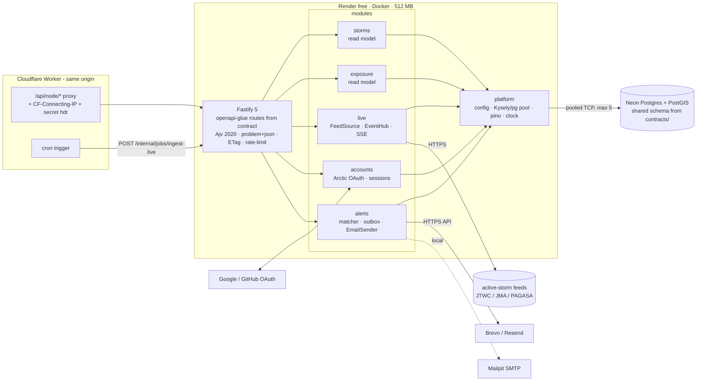
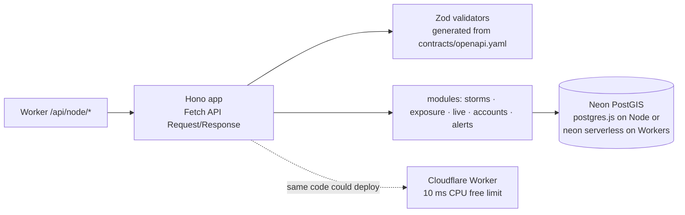

# Replay: Node/TypeScript backend architecture research

Status: research. The backend that was built differs in hosting and framework (Cloudflare Workers, Hono, build-time validators): see [`../README.md`](../README.md) and `docs/architecture/DECISIONS.md`, "Update 2026-10-22".
Checked on 2026-10-21. Package versions come from `npm view` on that day. Hosting terms come from the vendors' own pages unless a row says otherwise.

**Scope.** This is one of four interchangeable backends (Java, Node/TS, Rust, Go). All four implement one OpenAPI 3.1 contract and one PostGIS schema from `contracts/`, and all four must pass one conformance suite. A Cloudflare Worker sends `/api/node/*` to this service. The service runs as a Docker image on Render's free tier against Neon's free Postgres. Local development uses Docker Compose with PostGIS and Mailpit.

---

## 0. TL;DR

| Area | Pick | One-line reason |
|---|---|---|
| Runtime | **Node 24 LTS** (`node:24`, distroless `nodejs24-debian13`) | Node 24 is LTS. Node 26 is still "Current" until it is promoted (expected late Oct 2026). |
| Framework | **Fastify 5.12** | Routes take JSON Schema natively (Ajv validation plus fast-json-stringify serialization). Encapsulated plugins fit the modules. Official plugins exist for SSE, rate limiting, cookies and ETag. |
| Contract-first | **`openapi-typescript` types + `fastify-openapi-glue`** routing by `operationId`, with Ajv 2020-12, a typed handler map checked with `satisfies` | The spec is the only source of truth. Every route is validated from the spec at runtime, and a missing operation fails the build. |
| Architecture | **Modular monolith**: `storms`, `exposure`, `live`, `accounts`, `alerts` plus `platform`. Full hexagonal layering only where there is real I/O or policy; thin read-model slices elsewhere. | Sized right and easy to explain. |
| DI | **Plain factory functions and one composition root** (`buildApp(deps)`) | No container or decorators. Works with Node's type stripping. Easy to show in an interview. |
| Boundaries | **dependency-cruiser 18** rules in CI | Turns the module diagram into a test. |
| DB access | **Kysely 0.29 + `pg` 8 (`Pool`)**, types from **kysely-codegen** run against the contract migrations, and PostGIS through the `sql` template tag | Typed SQL builder with first-class raw SQL. The library never owns the schema. |
| Neon | **Pooled endpoint (`-pooler`)** for the app; never `LISTEN`; plain `pg` over TCP, not `@neondatabase/serverless` | The process is long-running, so TCP is right. Transaction-mode PgBouncer rules out session state. |
| Auth | **Arctic 3 (Google + GitHub OAuth) + hand-rolled sessions** in the shared `sessions` table (SHA-256 of the token, following the Lucia/Copenhagen Book pattern) | Portable to the other three languages. The contract owns the schema. Sessions can be revoked. |
| Session vs token | **Server-side sessions in shared Postgres** (preferred over signed tokens) | Sign-in works across all four backends behind one origin, logout can be revoked instantly, and no signing keys are shared between four codebases. |
| CSRF | `SameSite=Lax` + `__Host-` cookie + an **Origin / `Sec-Fetch-Site` check** on unsafe methods | Same-origin JSON API. No token plumbing needed. |
| Rate limit | **@fastify/rate-limit 11** (in-memory, keyed on `CF-Connecting-IP` only when the Worker's secret header is present) | One instance, so no Redis. |
| SSE | **@fastify/sse 0.6** (official, pre-1.0) with an in-process `EventEmitter` hub; if it misbehaves, a hand-rolled `reply.raw` route of about 40 lines | Handles `Last-Event-ID` replay and heartbeats. |
| Scheduling | **External trigger** (the Worker's cron or GitHub Actions calls `POST /internal/jobs/ingest-live` with a secret), plus **croner 10** in-process for local dev and while awake | Render free sleeps after 15 min idle, so an in-process cron alone would not run. |
| Queue | **None.** Use a Postgres outbox table for alert e-mails. No BullMQ/Redis. | Upstash free is 500k commands/month, and BullMQ polls Redis even when idle. |
| E-mail | An `EmailSender` port with two adapters: **SMTP via Nodemailer 10 → Mailpit** (local) and an **HTTPS e-mail API adapter** (Brevo or Resend) in production | **Render free blocks outbound SMTP ports 25/465/587.** |
| Tests | **Vitest 5**, `fastify.inject` (light-my-request), **Testcontainers 12** with `postgis/postgis`, Ajv response validation against the spec, plus the shared conformance suite | Fast, and no extra HTTP client. |
| Observability | **pino 10** (built into Fastify), request ids, `X-Backend-Impl: node`. OpenTelemetry stays opt-in behind an env flag. | 512 MB RAM budget. |
| Build | **TypeScript 6.0.x** (`tsc --noEmit`, `erasableSyntaxOnly`); run `.ts` directly with Node type stripping in dev; **tsdown** bundle for the image; **distroless `nodejs24-debian13:nonroot`** | typescript-eslint 8.72 still caps TS below 6.1, and tsup is unmaintained. |

**Overall pick: Stack A, "Fastify contract-first modular monolith"** (§9).

---

## 1. Platform facts that drive the design

| Fact | Value | Source | Consequence |
|---|---|---|---|
| Render free web service | **512 MB RAM, 0.1 CPU** | [Render instance types](https://render.com/docs/compute-plans) | Keep the heap small (`--max-old-space-size≈300`), avoid heavy frameworks and agents, and use a small `pg` pool (5). |
| Render spin-down | After **15 min without inbound traffic**; waking takes **about 1 minute** | [Render free docs](https://render.com/docs/free) | An in-process cron does not run while asleep, so ingestion needs an external trigger. Cold start is dominated by Render, not by Node. |
| Render hours | **750 free instance-hours per workspace per month**; sleeping services don't count | [Render free docs](https://render.com/docs/free) | **Four backends in one workspace share 750 h.** Keeping all four awake (4 × 730 h) is impossible. See OPEN-QUESTIONS. |
| Render SMTP | Free services **cannot send to ports 25, 465 or 587** (since 2025-09-26) | [Render free docs](https://render.com/docs/free), [changelog](https://render.com/changelog/free-web-services-will-no-longer-allow-outbound-traffic-to-smtp-ports) | Production e-mail must go over an HTTPS API. Nodemailer SMTP is for local Mailpit only. |
| Render free misc | No persistent disk, no background workers or cron jobs on free; may restart at any time | [Render free docs](https://render.com/docs/free) | Stateless process. In-memory state (SSE hub, rate-limit counters) is best-effort. |
| Neon free | $0, **no card**; **100 CU-hours per project per month**; scale-to-zero after **5 min**, cannot be disabled; 1 GB storage per project; PostGIS included; pooling on all plans | [Neon pricing](https://neon.com/pricing) | Anything that holds a connection or polls often (`LISTEN`, DB health checks, tight polling) keeps compute awake and burns CU-hours. |
| Neon pooler | PgBouncer **transaction mode**. Not supported: `SET`, **`LISTEN/NOTIFY`**, SQL `PREPARE`, session advisory locks. Protocol-level prepared statements are fine. Use the direct endpoint for migrations. | [Neon pooling](https://neon.com/docs/connect/connection-pooling) | No `LISTEN` fan-out. Use `pg_try_advisory_xact_lock` (transaction-scoped) or a lease row instead of session locks. |
| Node lines | v24 "Krypton" **LTS**; v26 **Current** (released 2026-05-05); v22 LTS ending | [Node releases](https://nodejs.org/en/about/previous-releases) | Use Node 24 as briefed. Moving to 26 after it becomes LTS is a one-line change. |
| Node type stripping | **Stable since v24.12 / v25.2**. No enums, namespaces with values, parameter properties or decorators; `tsconfig` paths are ignored (use `#` subpath imports); `.ts` extensions and `import type` required | [Node TypeScript docs](https://nodejs.org/api/typescript.html) | Write erasable TypeScript, which excludes NestJS-style decorators. Dev needs no build step. |

---

## 2. Framework

### Options

| | **Fastify 5.12.7** | **NestJS 12.2** | **Hono 4.13** (+ `@hono/node-server` 2.1) | **Express 5.3** |
|---|---|---|---|---|
| Model | Plugins with encapsulation, hooks, decorators | Angular-style modules, DI container, decorators; runs on an Express or Fastify adapter | Web-standard `Request`/`Response`, runs on any runtime | Middleware chain |
| Schema-native | **Yes**: per-route JSON Schema → Ajv validation and fast-json-stringify serialization | Via pipes; v12 adds Standard Schema (`schema` option on `@Body()` etc.) | Validators via middleware (`@hono/zod-openapi`, `hono-openapi`) | No |
| OpenAPI contract-first | **fastify-openapi-glue 4.12** (active, last release 2026-10-18) registers routes from the spec | Code-first (`@nestjs/swagger` generates the spec), which is the wrong direction here | `@hono/zod-openapi` is **code-first** (Zod → spec). Contract-first would need Zod generated from the spec (orval / hey-api), so the spec becomes Zod and then a spec again. | `express-openapi-validator` exists; routing stays manual |
| SSE | Official **@fastify/sse** (with `Last-Event-ID` replay and heartbeat) | `@Sse()` returns an RxJS Observable | `streamSSE()` helper | Manual |
| Rate limit / cookies / ETag | Official `@fastify/rate-limit`, `@fastify/cookie`, `@fastify/etag`, `@fastify/helmet` | Via adapter or `@nestjs/throttler` | `hono-rate-limiter` (3rd party), built-in cookie/etag | 3rd party |
| Throughput (hello world, Node) | 88k req/s | Adapter overhead | 82k req/s | 60k req/s |
| Footprint | Small | Largest: reflect-metadata, DI graph, RxJS | Smallest | Small |
| Works with Node type stripping | Yes | **No** (decorators need a transpiler) | Yes | Yes |
| Cloudflare Workers | No | No | **Yes, natively** | No |

Benchmark figures come from Fastify's own page ([fastify.dev/benchmarks](https://www.fastify.dev/benchmarks/), updated 2026-08-17: Fastify 5.11.3 88,171 req/s, Hono 4.13.1 82,371, Express 5.2.1 59,754). A third party measured Fastify and Hono within 1% of each other on Node 24 ([techplained](https://www.techplained.com/hono-vs-express-vs-fastify)). With a database round trip per request the frameworks perform about the same, so throughput is not a deciding factor at 0.1 CPU.

NestJS 12 moved its core packages to ESM, made Vitest and oxlint the defaults for new projects, and added Standard Schema validation ([release notes mirror](https://newreleases.io/project/github/nestjs/nest/release/v12.0.0), [InfoQ roadmap](https://infoq.com/news/2026/04/nestjs-12-roadmap-esm)).

### Hono on Cloudflare Workers?

The edge proxy is a Worker, so Hono could serve `/api/node/*` from the edge itself (Neon over HTTP with `@neondatabase/serverless`). This repo already uses Wrangler for Pages. **I advise against it as the primary Node deployment:**

- **10 ms CPU per request on the Workers free plan** (from the portfolio's own limits table). PostGIS serialisation, Ajv validation and JSON encoding of big search results risk error 1027.
- The free plan allows only **5 cron triggers per account**, and the architect's Worker needs them. Long-lived SSE on Workers counts against wall time and concurrency differently.
- It breaks parity. The other three backends are Docker images on Render, and the comparison story ("same contract, same host, four languages") is cleaner if Node is one too.
- Hono stays a reasonable *alternative* stack (§9 Stack C). Its portability is a talking point, not a requirement.

### Bun / Deno

Both would run in Docker on Render. Bun has fast start-up and a built-in Postgres client, and Deno 2 runs TS natively. Neither is needed: Node 24 now runs TS natively too (type stripping), and the brief asks for Node. Leave both out to avoid a "which runtime?" distraction.

**Recommendation: Fastify 5.** Its schema-native routes are exactly what contract-first needs. Plugins map 1:1 onto modules. Every cross-cutting concern (SSE, rate limit, cookies, ETag, helmet, CORS) has an official, maintained plugin released in October 2026. Express 5 is fine but would mean assembling validation, serialisation and error mapping by hand. NestJS shows "enterprise" but adds a DI framework and decorators, and Nest is code-first, which is the opposite of what this project needs.

---

## 3. Contract-first in TypeScript

The contract lives in `contracts/openapi.yaml` (3.1, JSON Schema 2020-12). The Node service **must not** be able to drift from it. The aim is that drift fails at build time where possible and in tests otherwise.

### Options

| Approach | How | Pros | Cons |
|---|---|---|---|
| **A. `openapi-typescript` 7.13 + `fastify-openapi-glue` 4.12** | `openapi-typescript` produces `paths`/`operations`/`components` types. The glue plugin reads the spec at boot, registers each operation as a Fastify route with its request schemas, and dispatches to `serviceHandlers[operationId]`. | One source of truth. Runtime validation comes from the spec itself. Handler names are `operationId`s, which match the contract docs and the other three languages. Adding an operation to the spec breaks the build until it is implemented (see snippet). | The glue's own handler types are loose, so we add a typed map (~30 lines). Fastify's default Ajv is draft-07, so we set an `Ajv2020` validator compiler. Fastify serialises responses but does **not** validate them, so response checks go into tests. |
| B. `openapi-backend` 5.22 | Framework-agnostic router plus Ajv validation; you call `api.handleRequest()` from a Fastify catch-all | Mature and active (pushed 2026-10-19); response-validation helpers | Bypasses Fastify's router, per-route hooks, schemas and serialisation. You keep Fastify's plugins but lose its core strength. |
| C. Code generation (orval 8 / hey-api 0.99 / kubb 5) of server stubs and Zod schemas | Generate Zod and handler stubs from the spec, then use `fastify-type-provider-zod` 7 | Strong types at the edges | Generated files to review or commit; spec → Zod → spec translation can be lossy (`oneOf`, `nullable`, formats). Generators mostly target *clients*. |
| D. Code-first (`@hono/zod-openapi`, `@fastify/swagger`, `@nestjs/swagger`) | Write the routes and emit a spec | Very ergonomic | **Wrong direction**: the spec stops being the source of truth. Only acceptable as a diff check against `contracts/`. |
| E. Hand-written JSON Schema / TypeBox per route | `@fastify/type-provider-json-schema-to-ts` or `typebox` | Excellent types | Duplicates the contract by hand. |

### Recommended wiring (A)

```ts
// src/platform/http/contract.ts  (sketch, not implemented)
import type { operations } from '#contract/types.gen.ts';   // openapi-typescript output

type Op = keyof operations;
type Params<K extends Op> = operations[K]['parameters'];
type Body<K extends Op> = operations[K] extends { requestBody: { content: { 'application/json': infer B } } } ? B : never;
type Ok<K extends Op>  = operations[K]['responses'] extends { 200: { content: { 'application/json': infer R } } } ? R : unknown;

export type Handlers = { [K in Op]: (req: TypedRequest<Params<K>, Body<K>>, reply: FastifyReply) => Promise<Ok<K> | void> };

// src/app.ts
const handlers = { ...storms.handlers, ...exposure.handlers, ...live.handlers, ...accounts.handlers, ...alerts.handlers } satisfies Handlers;
//                                                        ^ any missing or misspelt operationId is a compile error
await app.register(openapiGlue, { specification: bundledSpec, serviceHandlers: handlers, securityHandlers });
```

- **Request validation at runtime:** Ajv 8.20 via `ajv/dist/2020` (`setValidatorCompiler`), with `coerceTypes` limited to query and path params and `removeAdditional: false` so unknown fields are rejected as the contract says. The Ajv error list is mapped to an **RFC 9457** `application/problem+json` response with an `errors[]` extension in one `setErrorHandler`.
- **Response validation:** in tests. A Vitest helper validates every `inject()` response against `responses[status].content[...].schema` with Ajv 2020, and the shared conformance suite checks the deployed service. Optionally, an `onSend` hook validates responses when `NODE_ENV !== 'production'`, so contract bugs show up in local development.
- **Serialisation:** Fastify compiles response schemas with fast-json-stringify, which also *drops undeclared fields*, a cheap guard against leaking columns. Check that fast-json-stringify handles the contract's 3.1 constructs (type arrays for nullable, `const`). Where it doesn't, `x-fastify-config`, or leaving that response unschema'd, are the escape hatches.
- **Bundling:** `redocly bundle` (CLI 2.66) produces one dereferenced JSON file at build time, so start-up doesn't parse YAML across files.
- **Spec lint / breaking change:** owned by `contracts/` CI, not by this service.

**Recommendation: A.** The glue plugin does the boring part (spec → routes + request schemas). TypeScript `satisfies` makes the contract exhaustive at compile time, and Ajv checks it at runtime and in tests. It keeps Fastify's full plugin model. In an interview it fits on one slide: "the router is generated from the contract at boot; the compiler refuses to build if a handler is missing."

Sources: [openapi-typescript](https://openapi-ts.dev/), [fastify-openapi-glue](https://github.com/seriousme/fastify-openapi-glue), [Fastify validation](https://fastify.dev/docs/latest/Reference/Validation-and-Serialization/), [openapi-backend](https://github.com/openapistack/openapi-backend), [Ajv JSON Schema 2020-12](https://ajv.js.org/json-schema.html).

---

## 4. Architecture, DI and boundaries

### Shape: a modular monolith with layering sized per module

```
storms     read model     IBTrACS tracks, storm list and detail, frame manifests        thin: route → query → SQL
exposure   read model     "typhoons that hit my town": ST_DWithin, per-place tables      thin + one domain policy (distance bands)
live       read + write   active-storm feed ingestion, revisioned snapshots, SSE hub     hexagonal: FeedSource port, LiveRepo port, EventHub
accounts   write          OAuth (Google/GitHub), sessions, saved places                  hexagonal: OAuthProvider port, SessionStore port
alerts     write          forecast-track × saved-place matching, outbox, e-mail          hexagonal: EmailSender port, AlertRepo port
platform   shared kernel  config, db pool, http (contract, errors, caching, rate limit), logging, clock, ids
```

Full ports-and-adapters layering for read-only lookups would be ceremony: the "domain" of `storms` *is* a SQL query. `live`, `accounts` and `alerts` have real side effects (HTTP feeds, OAuth, e-mail) and policies worth unit-testing without I/O, so they get `domain/`, `application/` and `adapters/`. **State this trade-off in the README.** That shows judgement, not dogma.

Rules (enforced by dependency-cruiser):

1. `modules/*/domain` imports nothing outside itself except `platform/kernel` (types, Result, Clock).
2. A module may import another module **only via its `index.ts`** (public API). Example: `alerts` uses `accounts`' `SavedPlaceQuery` and `live`'s `ForecastTrack` type.
3. No module imports `platform/http` internals, and only `adapters/http` touches Fastify types.
4. No cycles between modules. `src/contract/types.gen.ts` may be imported by `adapters/http` only, never by the domain.

dependency-cruiser 18.7 (released 2026-10-19) supports these as `forbidden` rules with path regexes and produces the Mermaid/dot module graph for the README ([dependency-cruiser](https://github.com/sverweij/dependency-cruiser)).

### Dependency injection

| Option | Fit |
|---|---|
| NestJS DI | Powerful, but it brings the whole framework, decorators and `reflect-metadata`, and doesn't work with type stripping. |
| awilix 13 + @fastify/awilix 8.3 | Good container, and request scoping is handy. Still magic (name-based resolution) to explain, and adds little at this size. |
| **Plain factories + one composition root** | `createExposureModule({ db, clock })` returns `{ handlers, ... }`. `buildApp(config)` wires everything; tests pass fakes. Fully typed with zero magic. |

**Recommendation: plain factories.** `src/main.ts` reads config. `src/app.ts` (`buildApp(deps)`) is the composition root used by both production and tests. Request-scoped data (the current user, the request id) lives on Fastify's `request` via `decorateRequest` and is set in an `onRequest` hook. If the graph grows, awilix can be added later without touching the domain.

---

## 5. Data access for PostGIS on Neon

The schema and migrations are **owned by `contracts/`** as plain SQL. The Node service never generates or runs DDL in production, and must cope with `geography(Point,4326)` / `LineString` columns, GiST indexes, `ST_DWithin`, `ST_Distance` and probably `ST_AsGeoJSON`, `ST_MakeLine` and `ST_Segmentize`.

| Option | PostGIS | Raw SQL ergonomics | Schema ownership | Verdict |
|---|---|---|---|---|
| **Kysely 0.29.7** + `pg` | No built-in geo types. `sql<T>\`ST_DWithin(...)\`` fragments carry types; `kysely-postgis` 0.5 adds helpers | Excellent: the builder and raw `sql` mix freely and are parameterised | **Types generated from the live DB** by `kysely-codegen` 0.20, so it reads the contract's schema rather than owning it | **Pick** |
| Drizzle 0.45 (1.0 at RC) | `geometry` column with only `point` predefined; **no `geography`** documented | Good `sql` tag | Schema-as-code in TS, which **duplicates** the contract-owned SQL (`drizzle-kit pull` can introspect, but then TS becomes a second schema source) | Second choice. 1.0 is still RC. |
| Prisma 7.10 (8.0 at RC) | Prisma 7 docs: **"does not support … PostGIS"**; `Unsupported("geography")` columns are typed `any` and need `$queryRaw`/TypedSQL. Prisma 8 announces a PostGIS extension, but it is RC. | TypedSQL / SafeQL | Prisma schema becomes a second source of truth | No: the core feature is spatial. |
| `postgres` (postgres.js) 3.4.9 | Raw SQL only | Lovely tagged templates, fast | Neutral | Viable minimal stack, but no generated types (last release April 2026). |
| `pg` + pgtyped / sqlc-gen-typescript | Typed SQL files | SQL in `.sql` files with generated types (pgtyped needs a live DB at build) | Neutral | pgtyped is active (pushed 2026-10-15), but its runtime package was last released Feb 2025. **sqlc-gen-typescript has had no commits since Nov 2024**, so avoid it, even though the Go backend probably uses sqlc. |

Sources: [Kysely raw SQL / extending](https://kysely.dev/docs/recipes/extending-kysely), [kysely-codegen](https://github.com/RobinBlomberg/kysely-codegen), [Drizzle PostGIS](https://orm.drizzle.team/docs/extensions/pg), [Prisma PostGIS / SafeQL](https://www.prisma.io/docs/orm/v7/prisma-client/using-raw-sql/safeql), [Prisma 8 post](https://www.prisma.io/blog/prisma-orm-8-closes-330-most-requested-issues).

**Pattern.** Spatial SQL lives next to the module in a `*.queries.ts` file as named Kysely functions. Small helpers in `platform/db/geo.ts` (`dwithin(col, lon, lat, metres)`, `asGeoJson(col)`) keep the fragments readable and unit-testable against Testcontainers. Example of the hot path:

```ts
// exposure/adapters/db/exposure.queries.ts (sketch)
db.selectFrom('storm_hours as h')
  .innerJoin('storms as s', 's.sid', 'h.sid')
  .select(['s.sid', 's.name', sql<number>`min(ST_Distance(h.geog, ${point}))`.as('closest_m')])
  .where(sql<boolean>`ST_DWithin(h.geog, ${point}, ${radiusM})`)   // GiST index on h.geog
  .groupBy(['s.sid', 's.name'])
  .orderBy('closest_m').limit(pageSize)
```

For the ~1.6k PH ADM3 and ~1.7k JP municipalities, use the **precomputed exposure tables** (one indexed lookup). The live `ST_DWithin` over 580k storm-hours serves arbitrary map clicks only.

**Driver and pooling against Neon.**
- Use **`pg` 8.23 `Pool` over TCP** to the **pooled** host (`…-pooler…neon.tech`, `sslmode=require`), with `max: 5`, a short `idleTimeoutMillis` (about 10 s) and `allowExitOnIdle`. Idle client connections are then released, so the PgBouncer side lets the compute **scale to zero after 5 min**. On a fresh pool, the first query after a Neon suspend pays the compute resume time.
- **`@neondatabase/serverless` 1.2** (WebSocket/HTTP) is for serverless and edge runtimes without TCP. On a long-running Node process, plain `pg` is simpler and well-proven. It would matter only if Stack C ran on Workers.
- **Transaction mode rules:** no `SET` (put `statement_timeout` in the connection string's `options` or use `SET LOCAL` inside a transaction), no `LISTEN`, and transaction-scoped advisory locks only.
- **Do not connect at boot** and **do not touch the DB in `/healthz`.** Render pings the health path, and a DB health check would keep Neon awake for good and burn the 100 CU-hours. Offer a separate `/readyz` that does check the DB, for local Compose and CI only.

---

## 6. Auth, sessions, CSRF and rate limiting

### Session vs signed token: **prefer server-side sessions in the shared Postgres table**

- **Cross-backend sign-in.** All four backends sit behind one origin, so one `__Host-` cookie, `Path=/`, reaches every `/api/<lang>/*`. With a shared `sessions` table, a user signed in through Java stays signed in when the UI switches to Node. That makes a strong demo of "interchangeable backends". Signed tokens would do the same only if all four shared a signing key and claim format, which spreads one secret across four codebases and four Render services.
- **Revocation.** Logout and "sign out everywhere" are a `DELETE`. A JWT stays valid until it expires, unless you add a denylist, which is a session table again.
- **Cost.** One primary-key lookup per authenticated request, and only on `/me/*` routes. Public storm and exposure routes never read the session, so they stay cacheable and don't wake Neon more than needed.
- **Portability.** Every language can implement "random 20-byte token → cookie; store `sha256(token)` as the id; sliding expiry" in about 60 lines. This follows the Lucia successor guidance (Lucia was **deprecated in March 2025** and now publishes a single-file reference implementation, [lucia-auth.com](https://lucia-auth.com/)) and the Copenhagen Book.

### Libraries

| Option | Notes | Fit here |
|---|---|---|
| **Better Auth 1.7** | Very complete. Uses Kysely internally, and table and column names can be remapped (`modelName`, `fields`). Mounts a catch-all `/api/auth/*` handler. | Owns its route surface (not in our OpenAPI) and expects its own `user/session/account/verification` shape, and its schema check runs at boot. Fighting it to match a schema shared by four languages defeats the point. |
| Auth.js (`@auth/core` 0.41) | Still 0.x for non-Next frameworks; adapter-defined schema | Same ownership problem; weaker Fastify story. |
| Lucia v3 | **Deprecated** | No. |
| **Arctic 3.7 + hand-rolled sessions** (`@oslojs/crypto` for SHA-256, or `node:crypto`) | Arctic does only the OAuth 2.0 / OIDC client part (authorization URL, PKCE, code exchange) for Google and GitHub | **Pick.** The contract owns the endpoints (`GET /auth/{provider}/start`, `GET /auth/{provider}/callback`, `POST /auth/logout`, `GET /me`) and the tables (`users`, `oauth_accounts`, `sessions`). |

Flow: `start` creates a `state` and (for Google) a PKCE `code_verifier`, stores them in a short-lived `__Host-oauth` cookie (HttpOnly, 10 min) and redirects. `callback` checks `state` and exchanges the code. Then it upserts `users` / `oauth_accounts` (GitHub needs `/user/emails` for a verified primary e-mail), creates the session row, sets `__Host-tr_session` (HttpOnly, Secure, SameSite=Lax, Path=/) and redirects to the SPA. **Redirect URIs:** the OAuth apps must register one callback per backend (`/api/node/auth/google/callback`, …), or the contract picks one canonical callback path that the Worker routes. See OPEN-QUESTIONS.

### CSRF

The API is same-origin behind the Worker, uses `SameSite=Lax` cookies and takes JSON bodies only. Following OWASP's defence-in-depth advice, add a `preHandler` on unsafe methods that rejects requests unless `Sec-Fetch-Site` is `same-origin`, or the `Origin` equals the configured public origin. With that in place, `@fastify/csrf-protection` (synchronizer tokens) isn't needed. If the contract requires a token header anyway, the plugin is available (v8.0.2).

### Rate limiting

**@fastify/rate-limit 11.2**, in-memory store (one instance; counters reset on restart, which is acceptable). The key is `CF-Connecting-IP`, **trusted only when the request carries the Worker's shared-secret header** (otherwise the socket IP). Per-route tiers come from `x-fastify-config` in the contract or a route config map: a tight limit for `/auth/*` and search, a looser one for cached reads. Response headers (`RateLimit-*` / `Retry-After`) and the 429 problem+json body must match whatever the contract specifies; the plugin lets you rename headers and customise the error. Redis isn't needed. If the architect wants limits that are global across the four backends, put them in the Worker, not in each service.

---

## 7. Live tracker: ingestion, SSE, scheduling, alerts and e-mail

### Scheduling

- **Problem:** Render free sleeps after 15 minutes without inbound traffic, so an in-process `croner` job would not run while nobody is using the site.
- **Pick: an external heartbeat.** The architect's Worker cron (or a GitHub Actions `schedule:` workflow) calls `POST /api/node/internal/jobs/ingest-live` with an HMAC or secret header every N minutes. It runs **only while a storm is active**, so the instance sleeps off-season.
  - This wakes Render.
  - The handler runs one idempotent ingestion cycle under `pg_try_advisory_xact_lock(hashtext('live-ingest'))`, a transaction-scoped lock, so it is safe on the Neon pooler.
- **Local development:** `croner` 10 (ESM, TypeScript, maintained, released 2026-10-18) runs the same use case in-process when `INGEST_CRON` is set. Prefer it to `node-cron` 4.6: overrun protection, timezone support, `nextRun()` for the UI.
- **Queues:**
  - **No BullMQ.** It needs Redis. Upstash's free tier is 500k commands/month, and [Upstash's own BullMQ page](https://upstash.com/docs/redis/integrations/bullmq) warns that BullMQ accesses Redis even when idle, which would exhaust that quota.
  - **No pg-boss** (12.38) either: polling Postgres would keep Neon awake. An **outbox table** is enough for alert e-mails.
- **Which backend ingests?** All four share one DB. Either every backend implements ingestion and the lock or lease makes duplicate triggers harmless, or one designated backend ingests and the others only read. See OPEN-QUESTIONS.

### SSE

- **@fastify/sse 0.6.1** (fastify org, MIT, released 2026-10-18) handles route negotiation (`sse: 'only'`), `reply.sse.send()` from objects or async iterables, **`lastEventId` + `replay()`**, a heartbeat (30 s by default) and `onClose` cleanup. It is **pre-1.0**. The fallback is a hand-written `reply.raw` stream of about 40 lines with `text/event-stream`, `retry:`, `id:` and a `:keepalive` comment, still behind the same `EventHub` port. ([repo](https://github.com/fastify/sse))
- **Fan-out:** an in-process `EventHub` (`EventEmitter`, or an async-iterator broadcaster). Event ids are the **live snapshot revision** (a monotonic bigint from the `live_revisions` table), so `Last-Event-ID` replay is `SELECT … WHERE revision > $1`.
- **Cross-backend freshness without `LISTEN`.** If another backend ingested, the Node hub learns about it by polling `SELECT max(revision)` **every 60 s while at least one SSE client is connected**, and not at all otherwise. `LISTEN/NOTIFY` is ruled out because the pooler doesn't support it, and a dedicated direct connection would keep Neon awake.
- **Proxy and idle concerns:**
  - Send a heartbeat at least every 30 s and set `X-Accel-Buffering: no`.
  - Check that the Worker streams the response body through (plain `fetch` pass-through does), and that Cloudflare doesn't buffer `text/event-stream`.
  - Whether an open SSE stream counts as "inbound traffic" for Render's spin-down timer is undocumented. Test it, because it decides whether long-lived viewers keep the instance awake.

### Alerts and e-mail

- After each ingestion cycle, `alerts` matches forecast-track segments against saved places with `ST_DWithin(place.geog, ST_Segmentize(track, …), radius)` and inserts into `alert_outbox` with a **unique key (user_place_id, storm_id, advisory_no)**, so re-runs cannot send duplicates. A drain step in the same job sends pending rows and marks them sent or failed with attempts. No queue needed.
- **The `EmailSender` port has two adapters:**
  - `SmtpEmailSender` (Nodemailer 10 → Mailpit `:1025`) for local development, so you can see mails at `:8025`.
  - `HttpApiEmailSender` (`fetch` to the provider's REST API) for Render, because **Render free blocks SMTP egress**.
  - Candidates for the HTTP adapter:
    - **Resend**: 3,000/month, 100/day, needs a verified domain to send to arbitrary recipients ([pricing](https://resend.com/pricing)).
    - **Brevo**: 300/day free and no card per third-party reviews; check sender verification without a domain ([review](https://dreamlit.ai/blog/brevo-review)).
  - Nodemailer can still *build* MIME messages for both adapters if wanted. Simpler: render a small text/HTML template and post JSON.
- Templates: plain TS template literals, EN/JA if the UI is bilingual. No MJML at this size.

---

## 8. Testing, observability, build and container

### Testing pyramid

| Layer | Tooling | What |
|---|---|---|
| Unit | **Vitest 5.0** | Domain policies (distance bands, alert matching, session expiry, cursor encoding) with fakes for ports |
| Integration (DB) | **@testcontainers/postgresql 12.2** with `postgis/postgis:<pg>-3.6` (match Neon's major version), migrations applied **from `contracts/migrations`** and a small fixture seed | Kysely queries, PostGIS behaviour, transaction-lock semantics |
| HTTP / contract | `app.inject()` (**light-my-request 6.8**, built into Fastify), so **supertest isn't needed**; an `expectMatchesContract(res, operationId)` helper uses Ajv 2020 on the bundled spec | Every operation: status codes, problem+json, `ETag`/`304`, `Cache-Control`, pagination links, `X-Backend-Impl` |
| Conformance | The **shared suite from `contracts/`** run against `docker compose up` (service + PostGIS + Mailpit) in CI | Same pass/fail as the other three backends |
| E2E e-mail | Mailpit's REST API (`/api/v1/messages`) in an integration test | The alert e-mail actually arrives |

Use Vitest `projects` to split `unit` (no Docker) from `integration` (Docker), and set `globalSetup` to start one container per run.

### Observability

- **pino 10** via Fastify's logger: JSON logs, `reqId` from `CF-Ray` or generated, redaction of `cookie`/`authorization`. Pretty output in development via `pino-pretty`.
- One `onSend` hook adds **`X-Backend-Impl: node`** (plus perhaps `X-Backend-Version: <git sha>`) and `Server-Timing: db;dur=…` for the demo.
- **OpenTelemetry** (`@opentelemetry/sdk-node` 0.223, `auto-instrumentations-node` 0.81): **opt-in** via `OTEL_ENABLED=1` with only the `http`, `fastify` and `pg` instrumentations, loaded with `--import ./otel.js`. The full auto-instrumentation bundle costs tens of MB of RAM and start-up time, which matters on 512 MB and 0.1 CPU. Whether to send to a free OTLP backend is a cross-backend decision (OPEN-QUESTIONS).

### Build

- **TypeScript 6.0.x**, not 7.0. TS 7.0.2 (the Go-native `tsc`) is out, but **typescript-eslint 8.72 still requires `typescript <6.1.0`**, and TS 7.0 has no stable programmatic API yet (planned for 7.1). Optionally use `@typescript/native-preview` / TS 7 `tsc --noEmit` in CI for speed alongside, and move over when typescript-eslint supports it ([InfoQ TS 7](https://infoq.com/news/2026/08/typescript-7-released/)).
- **tsconfig:**
  - `module`/`moduleResolution: nodenext`, `verbatimModuleSyntax`, `erasableSyntaxOnly`, `allowImportingTsExtensions`, `rewriteRelativeImportExtensions`, `noEmit`.
  - `#` subpath imports in `package.json` instead of `paths`.
  - Together these let **Node 24 run `src/main.ts` directly** (`node --watch src/main.ts`) with no tsx or ts-node in development.
- **Bundle for the image: tsdown 0.23** (Rolldown). **tsup 9 is marked "not actively maintained" and points to tsdown.** A single ESM `dist/main.js` with dependencies external (or bundled, measure both) means fewer files to stat at cold start and a smaller image. Plain `esbuild` 0.28 is an equally fine choice; avoid `tsc` emit (slower, multi-file).
- **Lint:** ESLint 9/10 + typescript-eslint. The **dependency-cruiser** check and `tsc --noEmit` run in CI.

### Container

```dockerfile
# sketch
FROM node:24-alpine AS build          # node:24-alpine3.24 tag current
WORKDIR /app
COPY package*.json ./
RUN npm ci
COPY . .
RUN npm run build && npm prune --omit=dev

FROM gcr.io/distroless/nodejs24-debian13:nonroot
WORKDIR /app
COPY --from=build /app/node_modules ./node_modules
COPY --from=build /app/dist ./dist
COPY --from=build /app/contract ./contract     # bundled openapi.json
ENV NODE_ENV=production NODE_OPTIONS="--max-old-space-size=300 --enable-source-maps"
EXPOSE 8080
CMD ["dist/main.js"]                           # distroless entrypoint is already `node`
```

- Distroless has no shell, so the Compose health check must be `CMD ["node","-e","fetch('http://localhost:8080/healthz').then(r=>process.exit(r.ok?0:1))"]`. Alpine (musl) is the fallback if a native addon misbehaves. None of the picks need native addons: `pg` runs pure JS without `pg-native`. ([distroless nodejs](https://github.com/GoogleContainerTools/distroless/blob/main/nodejs/README.md))
- **Expected footprint (to measure, not verified):** Fastify + Kysely + pg + Ajv with a compiled spec should idle at roughly **70–110 MB RSS**, well inside 512 MB. Node starts in under 1 s at full CPU, but **0.1 CPU** can stretch start-up and Ajv compilation of a large spec to several seconds. Measure it and consider lazy compilation (Ajv `compile` per route on first use is the default in Fastify). The user-visible cold start is still dominated by Render's ~60 s wake, plus Neon's resume on the first query.
- Listen on `0.0.0.0:${PORT}` (Render injects `PORT`), handle `SIGTERM` with `app.close()` (closing SSE streams and the pool), and set `trustProxy` for Render plus the Worker.

### HTTP caching

- `storms` and `exposure` serve **immutable-ish** data that changes only when the IBTrACS/ERA5 load runs. Use a **dataset-version ETag** (e.g. `W/"ibtracs-2026-10-18.r3"`, from a one-row `dataset_versions` table cached in memory for 60 s). `If-None-Match` then returns 304 **without running the spatial query** and often without touching Neon.
- `Cache-Control: public, max-age=300, s-maxage=86400, stale-while-revalidate=…` lets the Worker or edge cache absorb traffic.
- `@fastify/etag` (payload hash) covers everything else.
- Personal routes get `Cache-Control: private, no-store`.
- Pagination: keyset cursors (opaque base64url of `(sort_key, id)`) per the contract.

---

## 9. Three coherent Node stacks

### Stack A: "Fastify contract-first modular monolith" (recommended)

Node 24 · Fastify 5 · openapi-typescript + fastify-openapi-glue + Ajv 2020 · Kysely + pg + kysely-codegen · Arctic + Postgres sessions · @fastify/sse · croner + external trigger · outbox + HTTP e-mail adapter · Vitest + Testcontainers + inject · pino · tsdown · distroless.



**What a recruiter sees:** a backend that obeys a contract rather than producing one. It is idiomatic Fastify (plugins, hooks, schemas), uses real SQL with PostGIS, has clean module boundaries backed by a failing build, has sessions and OAuth done by hand and correctly, and was designed around hard free-tier limits (SMTP block, sleep, Neon CU-hours). Small dependency list, every piece explainable.

### Stack B: "NestJS enterprise"

Node 24 · NestJS 12 on `@nestjs/platform-fastify` · DI modules/providers · `@nestjs/schedule` · `@nestjs/throttler` · Passport-free guards with Arctic · Kysely (via a provider) or Prisma 7 + TypedSQL · `@Sse()` with RxJS · Jest→Vitest · SWC build · alpine image.

```mermaid
flowchart LR
  W[Worker /api/node/*] --> N12[NestJS 12 app\nFastify adapter]
  subgraph Nest[Nest module graph · DI container]
    SM[StormsModule] --- XM[ExposureModule]
    LM[LiveModule\n@Sse Observable\n@Cron] --- AM[AccountsModule\nGuards]
    ALM[AlertsModule] --- DBM[DatabaseModule\nKysely provider]
  end
  N12 --> Nest
  DBM --> PG[(Neon PostGIS)]
  Spec[contracts/openapi.yaml] -.validated in tests only.-> N12
```

- **Pros:** instantly familiar to Java/Spring and Angular teams; DI, guards, interceptors and pipes are idiomatic; a big hiring signal in enterprise listings.
- **Cons:** code-first by nature, so contract-first becomes "validate in tests and hope". Decorators rule out native type stripping. Heaviest memory on 512 MB. Its DI container mirrors what the Java backend already shows, so it adds little contrast to the portfolio.
- **What a recruiter sees:** "knows the enterprise Node framework", with less evidence of independent design judgement.

### Stack C: "Hono, web-standard and portable"

Node 24 via `@hono/node-server` (or Workers) · Hono 4.13 · validators generated from the spec (orval/hey-api → Zod) with `@hono/zod-validator` · postgres.js or `@neondatabase/serverless` · Arctic + sessions · `streamSSE` · croner · Vitest (`app.request()`) · tsdown · distroless.



- **Pros:** modern Web-standard API, tiny, and the same app could run on Workers, Bun or Deno; `app.request()` testing is elegant.
- **Cons:**
  - Contract-first means a spec → Zod → (optionally) spec round trip.
  - Rate limiting and SSE replay come from third-party or hand-written code.
  - Fewer official batteries than Fastify.
  - The Workers deployment is tempting but conflicts with the free-tier CPU limit and cron budget.
- **What a recruiter sees:** "up to date with edge/runtime-agnostic TS". Good, but the PostGIS and SSE story is a little less mature.

### Overall pick: **Stack A**

It is the most idiomatic way to do *contract-first* in Node in 2026. It fits 512 MB and 0.1 CPU comfortably, every concern has an official plugin, and the design choices it shows (sessions over JWT, no Redis, an outbox instead of a queue, an external trigger instead of cron, HTTP e-mail instead of SMTP) can each be explained with a free-tier fact. Stack C is a good comparison in the README ("why not Hono on Workers?"). Stack B mainly makes sense if the portfolio deliberately wants an enterprise Node piece.

---

## 10. Recommended project layout (Stack A)

```
api/node/
├── package.json               # "type":"module", engines node 24, "imports": {"#platform/*": "./src/platform/*", "#modules/*": "./src/modules/*", "#contract/*": "./src/contract/*"}
├── tsconfig.json              # nodenext, erasableSyntaxOnly, verbatimModuleSyntax, noEmit
├── tsdown.config.ts
├── vitest.config.ts           # projects: unit, integration
├── eslint.config.js
├── .dependency-cruiser.cjs    # module boundary rules
├── Dockerfile                 # build → distroless nodejs24-debian13:nonroot
├── README.md                  # what/why, diagrams, trade-offs, how to run
├── docs/                      # this research + ADRs later
├── scripts/
│   ├── gen-contract.ts        # redocly bundle + openapi-typescript → src/contract/
│   └── gen-db-types.ts        # testcontainer + contracts/migrations → kysely-codegen → src/platform/db/schema.gen.ts
├── src/
│   ├── main.ts                # read env, buildApp(), listen, SIGTERM
│   ├── app.ts                 # composition root: create modules, register plugins, openapi-glue
│   ├── contract/
│   │   ├── openapi.json       # bundled from contracts/ (generated, git-ignored or checked)
│   │   └── types.gen.ts       # openapi-typescript output
│   ├── platform/
│   │   ├── config.ts          # env-schema / zod-free validation of env
│   │   ├── db/{pool.ts, kysely.ts, geo.ts, schema.gen.ts, tx.ts}
│   │   ├── http/{contract.ts, errors.ts (RFC 9457), caching.ts, rate-limit.ts, csrf.ts, backend-header.ts, security.ts (session → request.user)}
│   │   ├── log.ts             # pino options, redaction
│   │   └── kernel/{clock.ts, ids.ts, result.ts, cursor.ts}
│   └── modules/
│       ├── storms/{index.ts, handlers.ts, storms.queries.ts}
│       ├── exposure/{index.ts, handlers.ts, exposure.queries.ts, distance-bands.ts}
│       ├── live/
│       │   ├── index.ts
│       │   ├── domain/{snapshot.ts, revision.ts}
│       │   ├── application/{ingest-live.ts, ports.ts}
│       │   └── adapters/{http/handlers.ts, http/sse.ts, feeds/jtwc.ts, feeds/jma.ts, db/live.repo.ts, event-hub.ts, scheduler.ts}
│       ├── accounts/
│       │   ├── index.ts
│       │   ├── domain/{session.ts, user.ts}
│       │   ├── application/{sign-in.ts, saved-places.ts, ports.ts}
│       │   └── adapters/{http/handlers.ts, oauth/arctic.ts, db/session.repo.ts, db/places.repo.ts}
│       └── alerts/
│           ├── index.ts
│           ├── domain/{match-policy.ts, alert.ts}
│           ├── application/{evaluate-alerts.ts, drain-outbox.ts, ports.ts}
│           └── adapters/{db/outbox.repo.ts, email/smtp.ts, email/http-api.ts, email/templates.ts}
└── test/
    ├── helpers/{app.ts, contract-assert.ts, pg-container.ts, fixtures.sql}
    ├── unit/…                 # or co-located *.test.ts
    └── integration/…
```

`docker-compose.yml` (in the repo root or `api/`, owned by the architect) adds `node-api`, `postgis/postgis:<ver>-3.6` and `axllent/mailpit`.

---

## 11. Version snapshot (npm, 2026-10-21)

fastify 5.12.7 · @nestjs/core 12.2.0 · hono 4.13.13 · @hono/node-server 2.1.5 · @hono/zod-openapi 1.6.3 · express 5.3.0 · fastify-openapi-glue 4.12.0 · openapi-backend 5.22.0 · openapi-typescript 7.13.0 · ajv 8.20.0 · @redocly/cli 2.66.0 · kysely 0.29.7 · kysely-codegen 0.20.0 · kysely-postgis 0.5.4 · drizzle-orm 0.45.4 (1.0.0-rc.5) · @prisma/client 7.10.1 (8.0.0-rc) · pg 8.23.1 · postgres 3.4.9 · @neondatabase/serverless 1.2.0 · arctic 3.7.0 · better-auth 1.7.12 · @auth/core 0.41.3 · @fastify/rate-limit 11.2.1 · @fastify/sse 0.6.1 · @fastify/cookie 11.1.3 · @fastify/csrf-protection 8.0.2 · @fastify/helmet 13.2.0 · awilix 13.0.5 · dependency-cruiser 18.7.0 · croner 10.0.1 · node-cron 4.6.0 · bullmq 6.3.19 · pg-boss 12.38.0 · nodemailer 10.1.7 · vitest 5.0.5 · testcontainers / @testcontainers/postgresql 12.2.1 · light-my-request 6.8.0 · supertest 7.3.1 · pino 10.4.0 · @opentelemetry/sdk-node 0.223.0 · typescript 7.0.2 (6.0.3 recommended) · typescript-eslint 8.72.0 (TS <6.1) · tsdown 0.23.1 · tsup 9.0.0 (unmaintained) · esbuild 0.28.2 · Docker: `node:24-alpine3.24`, `gcr.io/distroless/nodejs24-debian13`, `postgis/postgis:18-3.6`.

## 12. Sources

- Render: [free tier](https://render.com/docs/free), [instance types](https://render.com/docs/compute-plans), [SMTP block changelog](https://render.com/changelog/free-web-services-will-no-longer-allow-outbound-traffic-to-smtp-ports)
- Neon: [pricing / free plan](https://neon.com/pricing), [connection pooling](https://neon.com/docs/connect/connection-pooling)
- Node: [release status](https://nodejs.org/en/about/previous-releases), [TypeScript type stripping](https://nodejs.org/api/typescript.html)
- Frameworks: [Fastify benchmarks](https://www.fastify.dev/benchmarks/), [Fastify validation & serialization](https://fastify.dev/docs/latest/Reference/Validation-and-Serialization/), [techplained comparison](https://www.techplained.com/hono-vs-express-vs-fastify), [NestJS 12 release](https://newreleases.io/project/github/nestjs/nest/release/v12.0.0), [InfoQ NestJS 12 roadmap](https://infoq.com/news/2026/04/nestjs-12-roadmap-esm), [Hono streaming](https://hono.dev/docs/helpers/streaming)
- Contract: [fastify-openapi-glue](https://github.com/seriousme/fastify-openapi-glue), [openapi-typescript](https://openapi-ts.dev/), [openapi-backend](https://github.com/openapistack/openapi-backend), [Ajv JSON Schema](https://ajv.js.org/json-schema.html)
- Data: [Kysely extending / sql](https://kysely.dev/docs/recipes/extending-kysely), [kysely-codegen](https://github.com/RobinBlomberg/kysely-codegen), [Drizzle PostGIS](https://orm.drizzle.team/docs/extensions/pg), [Prisma 7 PostGIS/SafeQL](https://www.prisma.io/docs/orm/v7/prisma-client/using-raw-sql/safeql), [Prisma 8 announcement](https://www.prisma.io/blog/prisma-orm-8-closes-330-most-requested-issues), [sqlc-gen-typescript](https://github.com/sqlc-dev/sqlc-gen-typescript), [pgtyped](https://github.com/adelsz/pgtyped)
- Auth: [Lucia deprecation & reference impl](https://lucia-auth.com/), [Arctic](https://arcticjs.dev/), [Better Auth database](https://www.better-auth.com/docs/concepts/database), [Better Auth + Fastify](https://www.better-auth.com/docs/integrations/fastify), [OWASP CSRF cheat sheet](https://cheatsheetseries.owasp.org/cheatsheets/Cross-Site_Request_Forgery_Prevention_Cheat_Sheet.html)
- Realtime/jobs: [@fastify/sse](https://github.com/fastify/sse), [Upstash pricing](https://upstash.com/docs/redis/overall/pricing), [Upstash on BullMQ idle traffic](https://upstash.com/docs/redis/integrations/bullmq)
- E-mail: [Resend pricing](https://resend.com/pricing), [Brevo review 2026 (third-party)](https://dreamlit.ai/blog/brevo-review)
- Build: [TypeScript 7 release (InfoQ)](https://infoq.com/news/2026/08/typescript-7-released/), [tsdown migrate from tsup](https://tsdown.dev/guide/migrate-from-tsup), [distroless nodejs](https://github.com/GoogleContainerTools/distroless/blob/main/nodejs/README.md), [dependency-cruiser](https://github.com/sverweij/dependency-cruiser)

## Frozen showcase policy (decided 2026-10-21)

Applies once this backend is built (`docs/architecture/DECISIONS.md`, "Frozen showcase policy"; the Java backend's
README shows it in practice). After its first conformant release the backend only receives security fixes.

- **Pinned:** npm with exact versions (`save-exact=true` in `.npmrc`, no `^`/`~`) and the committed `package-lock.json` (`npm ci` only); the Node 24 base image by digest; `.nvmrc`/`engines` on the same 24.x; CI actions by commit SHA.
- **Security fixes:** Renovate (`renovate.json`) opens no routine updates under `api/node/`. Vulnerability fixes
  (GitHub advisories / OSV) and base-image digest refreshes arrive as one grouped PR ("node backend security
  fixes", branch `renovate/node/security-fixes`) and auto-merge only when this backend's CI is green: its own
  tests **and** the shared conformance suite against its image.
- **Unfreezing** for a deliberate upgrade: change the pins (`package.json` + `npm install --package-lock-only`), regenerate the lockfile, re-measure
  startup/RSS, and open a PR labelled `unfreeze`; the same tests and conformance gate it.
