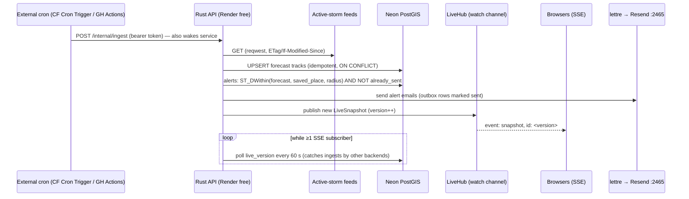
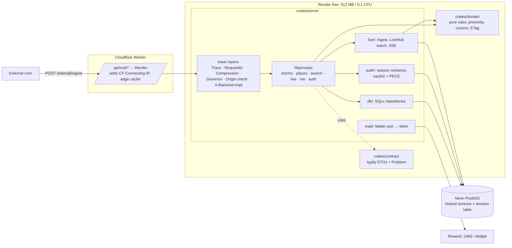
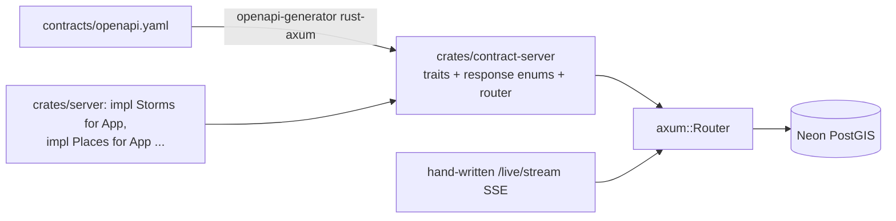

# Typhoon Replay: Rust backend architecture research

Status: research only, nothing implemented. Versions checked on crates.io, GitHub and vendor docs on **2026-10-21**.
Scope: the Rust implementation of the shared OpenAPI 3.1 contract (`/api/rust/*` behind the edge proxy).

## 0. TL;DR

| Area | Pick | One-line reason |
|---|---|---|
| Framework | **Axum 0.8.9** (tokio + tower) | Default choice of the ecosystem. Tower middleware covers CORS, tracing, timeouts, compression and rate limiting. Built-in SSE. |
| Contract-first | **typify-generated DTO crate from `contracts/openapi.yaml` + hand-written Axum routes + schema-validating contract tests** | The contract stays the source of truth. Handlers stay idiomatic. openapi-generator `rust-axum` is the fallback (it's BETA, lists no 3.1 support, and can't stream SSE). |
| Layout | **Small Cargo workspace: `contract`, `domain`, `server`** ("hexagonal-lite") | It's explainable in 2 minutes. Traits exist only where there's a real second implementation. |
| Data | **SQLx 0.9** (`query_as!`, offline `.sqlx/` cache in CI). PostGIS does the geometry in SQL and returns GeoJSON/lon-lat. | Compile-time-checked SQL suits a schema owned by language-neutral migrations. This also avoids `geozero`'s sqlx 0.8 pin. |
| Sessions | **Server-side sessions in the shared Postgres table**, via a small hand-written extractor. Not `tower-sessions`. | `tower-sessions` IDs are base64 `i128` and its store serializes opaque blobs, so it can't share a table with Java, Node or Go. |
| OAuth2 | `oauth2` 5.0 (PKCE + state) for Google and GitHub, plus a `reqwest` userinfo call | Small and explicit. GitHub isn't OIDC anyway. |
| Rate limit | `tower_governor` 0.8 keyed on `CF-Connecting-IP` | In-memory is fine because each Render free service runs a single instance. |
| Realtime | `axum::response::sse` + `tokio::sync::watch` (latest snapshot) | A new subscriber gets the current state at once, and lagging can't happen. |
| Scheduling | **No in-process cron as the primary trigger.** An external cron (Cloudflare Cron Trigger or GitHub Actions) calls an authenticated `POST /internal/ingest`; a `tokio::time::interval` runs only in local dev | Render free spins down after 15 min idle, so in-process cron never fires while asleep. |
| Email | `lettre` 0.11 over SMTP: Mailpit locally, Resend on **port 2465** in production | Render free blocks outbound 25/465/587, and Resend also listens on 2465/2587. |
| Tests | `cargo nextest`, `axum-test` 21, testcontainers PostGIS, `jsonschema` contract checks, the shared conformance suite | Covers unit, integration and contract layers, plus the cross-language suite. |
| Observability | `tracing` + JSON logs to stdout. OTLP (`opentelemetry` 0.33 / `tracing-opentelemetry` 0.34) is optional and env-gated | Costs nothing by default. OTel is available for the demo. |
| Container | cargo-chef → `gcr.io/distroless/cc-debian13`, glibc, rustls. Built in GitHub Actions and pushed to GHCR; Render deploys the image | Image is about 25–35 MB (estimate). This avoids Render's 500 build-min/month and keeps cold start to "Render's minute". |

**Overall pick: Stack A, "Contract-first Axum"** (§10).

---

## 1. Constraints that shape the Rust design (verified)

| Constraint | Fact (source) | Consequence for Rust |
|---|---|---|
| Render free instance | **512 MB RAM, 0.1 CPU** ([compute plans](https://render.com/docs/compute-plans.md)) | Rust idles at tens of MB (estimate). Pin `TOKIO_WORKER_THREADS=2` (a 0.1-CPU quota rounds `available_parallelism` to 1, and a second thread keeps SSE plus a slow query from stalling each other). Use `max_blocking_threads` defaults. |
| Spin-down | After **15 min** with no inbound HTTP; wake takes **about 1 minute**. **750 instance-hours/workspace/month** ([Render free](https://render.com/docs/free)) | In-process schedulers don't run while asleep. Four always-on backends would need 4 × 730 h, which is more than 750 h (see OPEN-QUESTIONS). |
| Outbound SMTP | Free web services **can't use ports 25, 465 or 587** ([Render free](https://render.com/docs/free)) | Use Resend SMTPS on **2465** ([Resend SMTP](https://resend.com/docs/send-with-smtp)) or an HTTP email API. |
| Bandwidth | Hobby workspace **5 GB/month** outbound. Without a card, services **spin down until next month** when it runs out ([Render bandwidth](https://render.com/docs/outbound-bandwidth)). It was cut from 100 GB on 2026-08-01 ([review](https://jwatte.com/blog/render-com-platform-review.md)) | ETag/304 and `Cache-Control` so the Cloudflare edge serves repeat reads aren't optional. Use gzip/br compression (`tower-http`). Keep SSE payloads small. |
| Build minutes | Hobby: 500/month (same review) | Compile in GitHub Actions instead and deploy a prebuilt image from GHCR. |
| Neon free | **1 GB storage/project (20 GB account total)**, **100 CU-h/project/month**, scale to zero after **5 min, can't be disabled** ([Neon plans](https://neon.com/docs/introduction/plans)) | Pool `min_connections = 0` and `idle_timeout` < 5 min. Don't hold a `LISTEN` connection open (it's lost on suspend, per [compute lifecycle](https://neon.com/docs/introduction/compute-lifecycle)). |
| Neon pooler | PgBouncer in **transaction mode**. **Protocol-level prepared statements supported (`max_prepared_statements=1000`)**. No `LISTEN/NOTIFY`, `SET` or session advisory locks ([Neon pooling](https://neon.com/docs/connect/connection-pooling)) | SQLx's statement cache works through `-pooler`. A long-lived server with a pool of about 5 can also just use the direct endpoint. Use direct for migrations and advisory locks. |
| Neon PostGIS | PG17 → PostGIS 3.5.7, **PG18 → 3.6.4** ([Neon extensions](https://neon.com/docs/extensions/pg-extensions)) | Pin the local/test image to the same major/minor. |
| PostGIS images | `postgis/postgis:18-3.6` is **amd64-only**. `imresamu/postgis:18-3.6` is amd64 + arm64 (Docker Hub, checked today) | On Apple Silicon, use the multi-arch image for testcontainers and Compose (or the architect's choice). |

---

## 2. Framework

| | **Axum 0.8.9** | **Actix Web 4.17** | **Loco 1.2** | **Poem 3.1.12 / poem-openapi 5.1.16** |
|---|---|---|---|---|
| Last crate release | 2026-04-14 | 2026-10-15 | 2026-09-24 | **2025-07-28** (15 months ago, though the repo is still active) |
| Recent downloads (90 days, crates.io) | 135.8 M | 11.9 M | 0.13 M | 0.85 M / 0.47 M |
| Runtime / middleware | tokio + **tower/tower-http** (huge shared ecosystem) | Own runtime and middleware traits (actix-rt on tokio) | Axum underneath, with Rails-style conventions | tokio, own middleware |
| SSE | `axum::response::sse` (with `KeepAlive`) | via `actix-web-lab` / manual stream | via Axum | built-in |
| OpenAPI | none built in (utoipa/aide add it) | utoipa/apistos | none first-class | **code-first** via macros (poem-openapi) |
| DB opinion | none | none | **SeaORM 2 + its own migrations** | none |
| Fit for "4 backends, 1 contract, 1 SQL schema" | Very good | Good | Poor: it fights language-neutral SQL migrations and a shared session table; JWT auth is the default | Medium: code-first means the spec comes from Rust, which inverts the contract; release cadence has stalled |

Sources: crates.io API (`/api/v1/crates/<name>`), [axum](https://github.com/tokio-rs/axum), [actix-web](https://github.com/actix/actix-web), [loco.rs](https://loco.rs/), [poem](https://github.com/poem-web/poem).

**Recommendation: Axum.** It's the most idiomatic modern choice, its tower layers compose cleanly (`TraceLayer`, `CompressionLayer`, `TimeoutLayer`, `SetResponseHeaderLayer` for `X-Backend-Impl`, `tower_governor`), and its extractor and state model is easy to explain. Actix is equally capable and fast, but it gives a recruiter nothing extra and has a separate middleware ecosystem. Loco's value (generators, SeaORM, JWT auth, workers) is exactly what the shared contract and schema take away.

Version-pinning note: `axum` 0.8.9 depends on `tower-http ^0.6.8` (optional). `tower-http` 0.7.1 exists (2026-08-31) and its layers are framework-agnostic over `http` 1. Prefer one `tower-http` major in the lockfile to avoid duplicate compile units.

---

## 3. Contract-first: keeping `contracts/openapi.yaml` the source of truth

| Option | What you get | Problems found |
|---|---|---|
| **A. openapi-generator `rust-axum`** (openapi-generator v7.26.0, 2026-10-06) | A generated crate with one **trait per tag**, per-operation **response enums** (`Status200_…`, `Status404_…`), models with `validator`, and a router you plug your impl into. | Marked **BETA**. The docs list OAS2/OAS3 only (**no 3.1 listed**), no OAuth2/OIDC security, and no `Null`/`AnyType`/polymorphism ([generator docs](https://openapi-generator.tech/docs/generators/rust-axum/)). The **SSE sample just models a JSON body, it doesn't stream** ([sample](https://github.com/OpenAPITools/openapi-generator/tree/master/samples/server/petstore/rust-axum/output/rust-axum-sse)). Handlers get `(&Method, &Host, &CookieJar, …)` instead of Axum extractors. It pulls in `lazy_static`, `async-trait`, `frunk` and validator 0.20. Default error handler is an empty 500. Generated code is hard to make look idiomatic. |
| **B. typify (types) + hand-written Axum routes + contract tests** | `typify` 0.8.0 (2026-10-14) turns `components.schemas` into serde structs and enums (`oneOf` → enum). Routes, extractors and SSE are written by hand, idiomatically. A test suite parses the contract (`oas3` 0.22) and **validates every response body against its schema** (`jsonschema` 0.59) and checks the route table covers every operation. | typify's `anyOf` handling is self-described as weak ([typify](https://github.com/oxidecomputer/typify)). OpenAPI 3.1 `type: [x, "null"]` handling needs a spike. Paths, params and status codes aren't generated, so they're held by tests rather than the compiler. |
| **C. progenitor** (0.15.1) | A **typed client** from the contract, useful for Rust-side tests. | Client-only and **3.0.x only** per its README ([progenitor](https://github.com/oxidecomputer/progenitor)). Can't consume a 3.1 contract without downgrading it. |
| **D. Code-first utoipa 6.0 (+ utoipa-axum 0.3) + drift check** | Spec emitted from Rust annotations. CI diffs it against `contracts/openapi.yaml` (e.g. with `oasdiff`) and fails on drift. utoipa 6 adds 3.2 support, MSRV 1.88 ([changelog](https://github.com/juhaku/utoipa/blob/master/utoipa/CHANGELOG.md)). | Two specs to keep in sync. Annotations duplicate the contract. The contract is *checked*, not *the source*. |
| **E. poem-openapi** | Code-first, type-safe, nice docs UI. | Same inversion as D, plus a framework switch and a stalled release cadence. |
| (newer) `oas3-gen` 0.29 / `openapi-to-rust` 0.22 | Claim 3.1 support and Axum server scaffolding. | Low adoption (`oas3-gen` 12.7k recent downloads). Too young for a flagship's foundation. Revisit if B's spike fails. |

**Recommendation: B.** The `contract` crate is regenerated by `cargo xtask gen-contract` (typify builder API) and **committed**, so diffs are reviewable and docs.rs-style browsable. CI regenerates it and fails on `git diff`. Correctness of paths, parameters, status codes and headers is enforced by:
1. the **shared conformance suite** (the source of truth for behaviour);
2. a Rust **contract test**: for every `operationId`, an `axum-test` request against a seeded PostGIS container, with the response validated by `jsonschema` against the contract's response schema, including `application/problem+json` errors;
3. a **route-coverage test** that lists contract operations and asserts each is mounted (a `const ROUTES: &[(Method, &str, &str /*operationId*/)]` table next to the router).

Keep **A** as a documented fallback: if typify chokes on the 3.1 schemas, generate with `rust-axum` into `crates/contract` and implement its traits. That's still contract-first, just less idiomatic. Serve the contract file itself at `/api/rust/openapi.yaml` (`include_str!`) rather than a Rust-emitted spec.

---

## 4. Internal architecture

### 4.1 Workspace vs one crate

| | One crate, modules | **Small workspace (3 crates)** | Full hexagonal (5–7 crates: domain, application, ports, adapters-db, adapters-http, …) |
|---|---|---|---|
| Compile time | One unit; any edit rebuilds everything | Generated `contract` and pure `domain` are cached; edits to handlers rebuild only `server` | Most parallelism, most boilerplate |
| Boundaries | By convention | **Enforced by `Cargo.toml`**: `domain` can't depend on sqlx/axum | Enforced, but many traits that have exactly one implementation |
| Explainability | Easy | Easy, with one diagram | Ceremony needs justifying |

**Recommendation: three crates.**
- `crates/contract` is generated DTOs only (serde, no I/O). It allows `clippy::all` noise.
- `crates/domain` is pure logic, with no async, no sqlx and no axum: storm/track types, alert proximity rules ("forecast cone within R km of a saved place"), pagination cursor encoding, ETag derivation, input validation. Fast unit and property tests.
- `crates/server` is the binary. It has modules `http/` (routes, extractors, errors, middleware), `db/` (SQLx repositories), `auth/`, `live/` (ingest + SSE), `mail/`, `config.rs`, `telemetry.rs`, `main.rs`.
- `xtask/` handles codegen and `sqlx prepare` helpers.

### 4.2 Ports (traits) only where there's a second implementation
- `Mailer`: `SmtpMailer` (lettre) vs `LogMailer` (tests). Native `async fn` in traits (Rust 1.75+) isn't dyn-compatible, so either make `AppState` generic over `M: Mailer` or have the trait return a boxed future (`Pin<Box<dyn Future<…> + Send>>`) to allow `Arc<dyn Mailer>`.
- `FeedSource`: `HttpFeed` (JMA/JTWC/PAGASA feeds) vs `FixtureFeed` (recorded JSON for tests and conformance).
- `Clock`: `SystemClock` vs fixed (alerts and ETag tests).
- **Repositories are concrete SQLx structs, not traits.** They're tested against real PostGIS. Mocking SQL proves nothing. This is the explicit "sized right" call.

### 4.3 Errors → RFC 9457
- `domain`: `thiserror` 2.0.21 enums (`DomainError::PlaceNotFound`, `InvalidRadius{max}`, …).
- `server`: a single `ApiError` enum (thiserror) with `impl IntoResponse`. It maps each variant to `status`, `type` URI (from the contract's problem registry), `title`, `detail` and `instance`, with `Content-Type: application/problem+json`. The struct is the **contract's `Problem` schema type** from `crates/contract`, so the shape can't drift. A JSON rejection or `Query` rejection is turned into problem+json by a custom extractor wrapper (`ValidJson<T>`, `ValidQuery<T>`) or `WithRejection` from `axum-extra`.
- `anyhow` 1.0.104 appears only in `main.rs` and startup. `sqlx::Error` → `ApiError::Internal` is logged with a trace id, and the problem body carries only the trace id.
- Not needed: `problem_details` 0.11 (exists, but the contract type is better).

### 4.4 Config
- `config` 0.15.27 (active, 2026-09-30): layered `config/default.toml` plus env (`TR__DATABASE__URL`) into a typed `Settings` (serde). `figment` 0.10.19 is fine but hasn't been released since 2024-05.
- Use `secrecy` for secrets (DB URL, OAuth secrets, SMTP key, ingest token), so `Debug` never leaks them.
- Fail fast at startup with a readable error (anyhow context).

### 4.5 State sharing
```rust
#[derive(Clone)]
struct AppState {
    db: PgPool,                          // Arc inside
    live: watch::Receiver<Arc<LiveSnapshot>>,
    mailer: Arc<dyn Mailer>,
    oauth: Arc<OAuthClients>,
    settings: Arc<Settings>,
    http: reqwest::Client,               // Arc inside
}
```
Use `axum::extract::FromRef` for sub-state (`State<PgPool>` in handlers that only need the DB). Don't use globals or `lazy_static`. Background tasks get a clone of the needed parts plus a `tokio_util::sync::CancellationToken` for graceful shutdown on Render's SIGTERM.

---

## 5. Data access for PostGIS

| | **SQLx 0.9.0** (2026-05-21; repo moving to `transact-rs`) | Diesel 2.3.14 + postgis_diesel 3.1.1 | SeaORM 2.0.4 |
|---|---|---|---|
| Model | Raw SQL, **compile-time checked** by `query!`/`query_as!` against a live DB or the offline `.sqlx/` cache | Typed query DSL; schema from `diesel print-schema` | ActiveRecord-ish ORM on SQLx 0.9 |
| PostGIS | No native geometry type; cast in SQL | `postgis_diesel` gives `Geometry` types + `ST_*` DSL functions | Custom types; spatial via raw SQL |
| Fit with *language-neutral SQL migrations owned by contracts/* | **Excellent**: SQL is the interface, and macros verify against the real migrated schema | Good (print-schema from the DB), but the DSL hides the SQL that the other three backends share | Weak: entity generation and its own migrator |
| Async | Native | `diesel-async` (separate crate) | Native |
| 0.9 notes | `query*()` now take `SqlSafeStr` (only `&'static str` by default; dynamic SQL needs `AssertSqlSafe`); `Migrate` trait changed; Postgres nullability inference changed ([discussion](https://github.com/launchbadge/sqlx/discussions/4271)). MSRV 1.94. Has an optional `sqlx.toml` config. | | |

**Recommendation: SQLx 0.9**, with these rules:
1. **Geometry stays in Postgres.** Inputs go in as `$1::float8, $2::float8` → `ST_SetSRID(ST_MakePoint($1,$2),4326)::geography`. Outputs come back as `ST_AsGeoJSON(geom)::json AS "geometry: Json<geojson::Geometry>"` or `ST_X/ST_Y::float8`. **Never select a raw `geography` column**, because SQLx macros can't type it. This avoids the version skew too: `geozero` 0.15.1's `with-postgis-sqlx` feature pins **sqlx ^0.8**, and the `postgis` crate was last released in 2021.
2. `geo` 0.33 / `geo-types` 0.7 only in `domain`, and only if alert proximity is computed in Rust. Prefer `ST_DWithin` in SQL so the four backends behave the same.
3. Spatial search pattern: `WHERE ST_DWithin(t.geog, $point, $radius_m)` on a **GiST index on geography**, keyset pagination (`(start_time, sid) < ($c1, $c2)`) with an opaque base64 cursor. Exposure lookups (`place_id → storms`) are plain B-tree joins on the precomputed per-place tables.
4. **Offline mode:** commit `.sqlx/`. CI sets `SQLX_OFFLINE=true` for build and clippy, and one job runs `cargo sqlx prepare --workspace --check` against a PostGIS service container with `contracts/migrations` applied. The Docker build sets `SQLX_OFFLINE=true` and needs no DB.
5. Dynamic filters (optional search params) use `sqlx::QueryBuilder` (still parameterised) or `($3::text IS NULL OR basin = $3)` patterns, so macros keep checking.
6. **Pool against Neon:** `PgPoolOptions::new().max_connections(5).min_connections(0).idle_timeout(240s).acquire_timeout(10s)` with `test_before_acquire(true)`, which survives Neon resuming from suspend. Use TLS via `tls-rustls-ring-webpki` (pure Rust, easiest for any target). Connect to the direct endpoint, or to the pooler, since protocol-level prepared statements are supported. Run statements on a fresh connection after suspend (Neon drops session state).
7. Migrations: **don't** embed `sqlx::migrate!` as the owner. `contracts/` owns them. Use `#[sqlx::test(migrations = "../../contracts/migrations")]` only if the file naming matches SQLx's `<version>_<name>.sql` convention; otherwise a small test helper applies the files in order (see OPEN-QUESTIONS).

---

## 6. Auth, sessions, CSRF, rate limiting

### 6.1 Sessions vs signed tokens: preference

**I prefer server-side sessions in the shared Postgres table.** Reasons:
- **Revocation and logout are real** (`DELETE` the row). A signed token can't be revoked without a denylist, which is a table anyway.
- **Cross-backend parity is trivial.** Every language just does `SELECT … FROM session WHERE id_hash = sha256($cookie) AND expires_at > now()`. With tokens, four JWT/PASETO libraries must agree on alg, claims, clock skew and key rotation, which is a classic source of conformance flakiness.
- The edge is same-origin, so one `__Host-tr_session` cookie (Secure, HttpOnly, SameSite=Lax, Path=/) works for all `/api/<lang>/*`.
- Cost: one indexed lookup per authenticated request. Neon is awake anyway when the API is serving, and public, cacheable endpoints don't need the session at all.
- Store **SHA-256 of a 256-bit random token**, never the raw token. Rotate on login. Use sliding expiry with a write throttle (update `last_seen_at` at most every N minutes, to save Neon writes).

### 6.2 Why not `tower-sessions` / `axum-login`
- `tower-sessions` 0.15's `Id` is `pub struct Id(pub i128)` parsed from base64 ([docs.rs](https://docs.rs/tower-sessions-core/0.15.0/tower_sessions_core/session/struct.Id.html)). A session cookie minted by the Java or Go backend won't parse. Its stores persist an opaque serialized record, not shared columns.
- There's **version skew** today: `tower-sessions-sqlx-store` 0.15.0 depends on **sqlx ^0.8** and `tower-sessions-core ^0.14`. `axum-login` 0.18.0 (2025-07) depends on `tower-sessions ^0.14`, while `tower-sessions` itself is at 0.15 (crates.io dependency API).
- **So: about 150 lines of our own.** An `AuthSession` extractor (`FromRequestParts`) reads the cookie (`axum-extra` `CookieJar`) and loads the user from the shared table. A `RequireUser` extractor returns 401 problem+json. Login, logout and rotation live in `auth/session.rs`. This is very explainable and fully under test.

### 6.3 OAuth2 (Google, GitHub)
- `oauth2` 5.0.0: authorization-code + **PKCE** + `state`. Keep the pre-login `state`/`pkce_verifier`/`return_to` in a short-lived **signed, encrypted cookie** (`axum-extra` `PrivateCookieJar`, 10 min) or a `oauth_flow` row (to be decided by the shared schema). After callback, fetch userinfo (Google `openidconnect`-style userinfo or `https://api.github.com/user` + `/user/emails`) with `reqwest`.
- Skew: `oauth2`'s optional `reqwest` feature is **reqwest ^0.12**, and reqwest is 0.13.5. Either use reqwest 0.12 everywhere, or (cleaner) disable oauth2's reqwest feature and implement its `AsyncHttpClient` adapter in about 20 lines over reqwest 0.13.
- Since both providers aren't OIDC (GitHub), `openidconnect` 4.0.1 isn't worth it.
- Callback URLs: `/api/rust/auth/{provider}/callback`. Each backend needs its own redirect URI registered, or the edge routes a shared `/api/auth/*` to one backend (see OPEN-QUESTIONS).

### 6.4 CSRF
- `SameSite=Lax` + same-origin edge already blocks classic cross-site POSTs. Add an **Origin / `Sec-Fetch-Site` check middleware** on unsafe methods (OWASP "verifying origin with standard headers"). It's tiny and language-neutral, so the conformance suite can test it. Optionally require a custom header (`X-Requested-With`), which forces a CORS preflight. Token-based `axum-csrf` 0.11 isn't needed.

### 6.5 Rate limiting
- `tower_governor` 0.8.0 (axum ^0.8, governor 0.10). Use a custom `KeyExtractor` reading **`CF-Connecting-IP`** (trust it only when the request came through the Worker, e.g. a shared secret header the Worker adds). The default peer IP would be Cloudflare's.
- Use separate quotas for anonymous public API vs signed-in users vs `/auth/*`. On rejection, return 429 problem+json with `Retry-After`. Emit the headers the contract specifies (IETF `RateLimit`/`RateLimit-Policy` or `X-RateLimit-*`). If tower_governor's header set doesn't match, wrap with a small layer.
- In-memory state is correct for a single instance. Note in the README that multi-instance would need Postgres or Redis.

---

## 7. Live tracker: ingestion, SSE, email

### 7.1 Flow


### 7.2 SSE
- `axum::response::sse::{Sse, Event, KeepAlive}` with `KeepAlive::new().interval(15s)`. Comment pings keep the Cloudflare and Render proxies from idling out the stream.
- Use **`tokio::sync::watch<Arc<LiveSnapshot>>`** rather than `broadcast`. A tracker shows "current state", a new client should get the latest snapshot immediately, and `watch` can't lag (a slow client just skips to the newest). If the contract needs per-event deltas, use `broadcast` and handle `RecvError::Lagged` by emitting a full `snapshot` event.
- Honour `Last-Event-ID`: if it equals the current version, send nothing until the next change.
- Shutdown: streams `take_until(cancel.cancelled())` so Render's SIGTERM drains cleanly.
- **Don't use `LISTEN/NOTIFY`**: the pooler doesn't support it, and Neon drops it on suspend. Poll a one-row `live_version` table only while subscribers exist (`watch::Sender::receiver_count()`), so Neon can scale to zero when nobody is watching.

### 7.3 Scheduling
- `tokio-cron-scheduler` 0.15.1 works, but on Render free **a sleeping process runs no cron**. The production trigger is external and hits `POST /internal/ingest` (constant-time token compare). The handler is idempotent and guarded by `pg_try_advisory_xact_lock` (transaction-scoped, so it works even through the pooler), which makes concurrent ingests from four backends safe.
- Local dev: a plain `tokio::time::interval` with `MissedTickBehavior::Skip`, enabled by config. It's one function, with no extra crate.

### 7.4 Email
- `lettre` 0.11.23 (`tokio1-rustls`, `builder`), `AsyncSmtpTransport`:
  - local: `builder_dangerous("mailpit").port(1025)`;
  - prod: `relay("smtp.resend.com").port(2465)` (implicit TLS). Resend's free plan is **3,000/month, 100/day** ([pricing](https://resend.com/pricing)). Alternative: Brevo free is 300/day with no card (per Brevo's free-SMTP page), but its non-blocked port needs checking.
- Use a transactional **outbox** (`alert_outbox` rows inserted in the ingest transaction, then sent and marked) so retries never double-send. Templates are plain `format!` or `askama` (compile-time templates; optional).

---

## 8. Testing and observability

| Layer | Tooling | Notes |
|---|---|---|
| Unit | `cargo nextest` (0.9.148), `proptest` for cursor and ETag codecs | `domain` only, sub-second |
| HTTP in-process | `axum-test` 21.1.0 (axum ^0.8.9) | Build the `Router` with test state; assert status, headers (`ETag`, `Cache-Control`, `X-Backend-Impl`) and problem+json |
| DB integration | `testcontainers` + `testcontainers-modules` 0.15 (`postgres` feature, custom image `imresamu/postgis:18-3.6`) **or** `#[sqlx::test]` against a Compose PostGIS | Skew: `testcontainers-modules` 0.15 pins `testcontainers ^0.27` (latest 0.28), so pin 0.27. One container per test binary (`OnceCell`), with a fresh database per test (`CREATE DATABASE … TEMPLATE`) |
| Contract | `jsonschema` 0.59 + `oas3` 0.22 | Validate every response against `contracts/openapi.yaml` (§3) |
| Conformance | The shared language-neutral suite | Run in CI against `docker compose up rust-api postgis mailpit`, with fixtures loaded; same job as the other three backends |
| Lint | `cargo clippy -- -D warnings`, `cargo fmt --check`, `cargo deny` (licences/advisories) | |

Observability:
- `tracing` 0.1.44 + `tracing-subscriber` 0.3.23 (JSON in prod, pretty locally). `tower-http` `TraceLayer` + `SetRequestIdLayer`/`PropagateRequestIdLayer` (`x-request-id`). The trace id goes into problem+json `instance`/extension.
- OpenTelemetry: `opentelemetry` / `opentelemetry-otlp` 0.33.1 + `tracing-opentelemetry` 0.34.0 (which requires `opentelemetry ^0.33`, so they match). Enabled only when `OTEL_EXPORTER_OTLP_ENDPOINT` is set, so the default is zero-cost and needs no account. A free OTLP backend is an open question.
- `/healthz` (process) and `/readyz` (DB `SELECT 1`, short timeout). Keep `/healthz` DB-free so health checks don't wake Neon.

---

## 9. Build, container, CI

- **Toolchain:** stable **1.99.1** (2026-10-13, from `static.rust-lang.org/dist/channel-rust-stable.toml`), edition 2024. Pin via `rust-toolchain.toml`. SQLx 0.9 needs MSRV 1.94.
- **Release profile:**
  ```toml
  [profile.release]
  lto = "thin"          # "fat" saves a little more size, costs CI minutes
  codegen-units = 1
  strip = "symbols"
  panic = "abort"       # smaller; fine for a server that restarts
  [profile.dev.package."*"]
  opt-level = 1         # faster tests with deps optimised
  ```
- **glibc + distroless vs static musl:**
  - `gcr.io/distroless/cc-debian13` (tag exists, checked today) + glibc build is the recommended default. No musl-allocator slowdown, and no `aws-lc`/C cross-compilation pain.
  - `scratch` + `x86_64-unknown-linux-musl` gives the smallest image, but you need `mimalloc` (musl malloc is slow under contention), CA certs copied in, and care with any C deps. Choose it only if image size is shown to matter for Render cold start.
  - TLS: rustls everywhere (`sqlx tls-rustls-ring-webpki`, `lettre tokio1-rustls`, `reqwest` 0.13 uses rustls by default), so there's no OpenSSL in the image.
- **Dockerfile:** `lukemathwalker/cargo-chef` (0.1.78) planner → cook (deps cached as a layer) → build with `SQLX_OFFLINE=true` → copy one binary into distroless, `USER nonroot`. Optionally embed `contracts/openapi.yaml` and static problem-type docs.
- **CI (GitHub Actions, public repo → standard Linux runners free):** `Swatinem/rust-cache@v2` (v2.9.3, 2026-10-20) keyed on `Cargo.lock`. Jobs: fmt+clippy, nextest (+PostGIS service), `sqlx prepare --check`, conformance (Compose), and docker build with `cache-to: type=gha` → push `ghcr.io/<owner>/typhoon-replay-api-rust:<sha>` → call the Render deploy hook (image-backed service).
  - Compile-time **estimates (to be measured)**: clean release build of axum+sqlx+lettre+reqwest+otel on a 4-vCPU runner is about 4–7 min. Warm cache is about 1–2 min for tests. The cargo-chef-cached Docker build after a code-only change is about 1–2 min.
- **Runtime footprint (estimates to measure):** RSS about 15–40 MB idle, against a 512 MB budget. Process start is a few ms. Cold start on Render is dominated by Render's ~1-minute wake plus Neon's few hundred ms resume, not by Rust. A small image (about 25–35 MB) helps image pull only marginally.

---

## 10. Three coherent Rust stacks

### Stack A: "Contract-first Axum" (recommended)
Axum 0.8 · typify contract crate · SQLx 0.9 (offline) · hand-rolled shared-table sessions · oauth2 5 · tower_governor · SSE + watch · external-cron ingest · lettre → Resend · axum-test + testcontainers + jsonschema contract tests · tracing/OTel · cargo-chef → distroless.


**What a recruiter sees:** idiomatic modern Rust (the Axum/tower/SQLx "standard stack"), SQL checked at compile time against a schema shared with three other languages, a typed error model that maps one-to-one to RFC 9457, honest trade-offs written down (why no ORM, why not tower-sessions, why external cron), and a ~30 MB container. It reads as "knows the ecosystem and its sharp edges", not "followed a tutorial".

### Stack B: "Generated server" (fallback if typify can't handle the 3.1 schemas)
Same as A, but `crates/contract` is produced by **openapi-generator `rust-axum`** (v7.26.0). The app implements the generated per-tag traits, and SSE and auth callback routes are mounted beside the generated router.


**What a recruiter sees:** strict contract-first with compiler-enforced operation signatures (a missing operation won't compile). The cost is visible too: non-idiomatic generated handler signatures, a BETA generator, and hand-mounted exceptions. It's a good conversation piece, but it shows the generator more than it shows Rust.

### Stack C: "Batteries-included" (Loco 1.2 + SeaORM 2)
Loco app with SeaORM entities generated from the shared schema, Loco's mailer, workers and scheduler, utoipa for docs, and drift-checked against the contract.

```mermaid
flowchart LR
    L[Loco app: controllers · models · mailers · workers] --> SO[SeaORM 2 entities<br/>(sea-orm-cli generate from DB)]
    SO --> PG[(Neon PostGIS)]
    L --> UT[utoipa spec] -->|oasdiff in CI| SPEC[contracts/openapi.yaml]
```
**What a recruiter sees:** fast productivity and Rails familiarity. But spatial queries drop to raw SQL anyway, Loco's migrations and JWT-auth conventions have to be switched off to honour the shared schema and session table, and the spec is checked rather than authoritative. That's the least distinctive of the three.

**Overall pick: Stack A.** B is the documented escape hatch. C is rejected for this multi-language, contract-first setup (it would be a fine pick for a single-backend Rust product).

---

## 11. Recommended project layout

```
api/rust/
├── Cargo.toml                 # [workspace] members, shared [workspace.dependencies], release profile
├── Cargo.lock
├── rust-toolchain.toml        # 1.99 (pin), components: clippy, rustfmt
├── .sqlx/                     # SQLx offline query cache (committed)
├── deny.toml                  # cargo-deny: licences, advisories, duplicate majors
├── Dockerfile                 # cargo-chef → distroless/cc-debian13
├── README.md                  # how to run, architecture diagram, trade-offs
├── config/
│   ├── default.toml
│   └── local.toml             # Compose: postgis, mailpit
├── crates/
│   ├── contract/              # GENERATED by xtask from ../../contracts/openapi.yaml (committed)
│   │   └── src/lib.rs
│   ├── domain/                # pure: no tokio/sqlx/axum
│   │   └── src/{storm.rs, place.rs, alert.rs, cursor.rs, etag.rs, error.rs}
│   └── server/
│       ├── src/
│       │   ├── main.rs        # config → telemetry → pool → state → router → serve + graceful shutdown
│       │   ├── config.rs
│       │   ├── telemetry.rs
│       │   ├── state.rs       # AppState + FromRef
│       │   ├── http/
│       │   │   ├── mod.rs     # router(), ROUTES table, layers
│       │   │   ├── error.rs   # ApiError → application/problem+json
│       │   │   ├── extract.rs # ValidJson, ValidQuery, Pagination
│       │   │   ├── caching.rs # ETag / If-None-Match / Cache-Control
│       │   │   ├── csrf.rs    # Origin / Sec-Fetch-Site check
│       │   │   ├── ratelimit.rs
│       │   │   └── routes/{storms.rs, search.rs, places.rs, live.rs, me.rs, auth.rs, internal.rs}
│       │   ├── auth/{session.rs, oauth.rs}
│       │   ├── db/{mod.rs, storms.rs, search.rs, places.rs, users.rs, sessions.rs, alerts.rs}
│       │   ├── live/{hub.rs, ingest.rs, feeds.rs, sse.rs}
│       │   └── mail/{mod.rs, smtp.rs, templates.rs}
│       └── tests/
│           ├── common/mod.rs  # PostGIS container, apply contracts/migrations, seed fixtures
│           ├── contract.rs    # every operationId → jsonschema-validated response
│           ├── search.rs
│           ├── auth.rs
│           └── live_sse.rs
├── xtask/                     # gen-contract, prepare-sqlx, seed
└── docs/
    ├── ARCHITECTURE-RESEARCH.md
    └── OPEN-QUESTIONS.md
```

---

## 12. Version set (checked 2026-10-21, crates.io)

| Crate | Version | Note |
|---|---|---|
| tokio | 1.54.0 | |
| axum / axum-extra | 0.8.9 / 0.12.6 | |
| tower / tower-http | 0.5.3 / 0.6.x (0.7.1 exists) | match axum's tower-http major |
| sqlx (+ sqlx-cli) | 0.9.0 | MSRV 1.94; `SqlSafeStr` |
| typify | 0.8.0 | contract codegen |
| jsonschema / oas3 | 0.59.0 / 0.22.0 | contract tests |
| oauth2 | 5.0.0 | reqwest-0.12 feature; adapter for 0.13 |
| reqwest | 0.13.5 | rustls default |
| tower_governor / governor | 0.8.0 / 0.10.4 | |
| lettre | 0.11.23 | |
| thiserror / anyhow | 2.0.21 / 1.0.104 | |
| config / secrecy | 0.15.27 / 0.10.3 | |
| serde_with / uuid / time | 3.24.0 / 1.28.0 / 0.3.55 | `jiff` 0.2.38 is the modern alternative to `time` |
| geojson / geo | 1.0.0 / 0.33.1 | geo optional |
| tracing / tracing-subscriber | 0.1.44 / 0.3.23 | |
| opentelemetry(-otlp) / tracing-opentelemetry | 0.33.1 / 0.34.0 | matching pair |
| axum-test | 21.1.0 | |
| testcontainers / -modules | 0.27.x / 0.15.0 | modules pin ^0.27 |
| cargo-chef / cargo-nextest | 0.1.78 / 0.9.148 | |
| Rejected or noted | tower-sessions 0.15, tower-sessions-sqlx-store 0.15 (sqlx 0.8), axum-login 0.18, geozero 0.15.1 (sqlx 0.8), postgis 0.9 (2021), progenitor 0.15.1 (3.0 only), poem-openapi 5.1.16 (2025-07), utoipa 6.0.0 (only if code-first) | |

## 13. Sources
- crates.io API, `https://crates.io/api/v1/crates/<crate>` and `/<version>/dependencies` (versions, dates, downloads, dependency ranges), queried 2026-10-21
- Rust stable channel: https://static.rust-lang.org/dist/channel-rust-stable.toml
- Render: https://render.com/docs/free · https://render.com/docs/compute-plans.md · https://render.com/docs/outbound-bandwidth · plan-change review https://jwatte.com/blog/render-com-platform-review.md
- Neon: https://neon.com/docs/introduction/plans · https://neon.com/docs/connect/connection-pooling · https://neon.com/docs/introduction/compute-lifecycle · https://neon.com/docs/extensions/pg-extensions
- Resend: https://resend.com/docs/send-with-smtp · https://resend.com/pricing ; Brevo: https://www.brevo.com/free-smtp-server
- openapi-generator rust-axum: https://openapi-generator.tech/docs/generators/rust-axum/ and samples under `samples/server/petstore/rust-axum/output/` (rust-axum-sse, petstore)
- progenitor: https://github.com/oxidecomputer/progenitor · typify: https://github.com/oxidecomputer/typify · utoipa changelog: https://github.com/juhaku/utoipa/blob/master/utoipa/CHANGELOG.md
- SQLx 0.9 release: https://github.com/launchbadge/sqlx/discussions/4271
- tower-sessions Id: https://docs.rs/tower-sessions-core/0.15.0/tower_sessions_core/session/struct.Id.html
- Loco: https://loco.rs/ · Poem: https://github.com/poem-web/poem · Axum: https://github.com/tokio-rs/axum · Actix: https://github.com/actix/actix-web
- Docker Hub tags: `postgis/postgis`, `imresamu/postgis`; distroless tags: `gcr.io/v2/distroless/cc-debian13/tags/list`
- cargo-chef: https://github.com/LukeMathWalker/cargo-chef · rust-cache: https://github.com/Swatinem/rust-cache
- OWASP CSRF cheat sheet (Origin / Fetch Metadata checks): https://cheatsheetseries.owasp.org/cheatsheets/Cross-Site_Request_Forgery_Prevention_Cheat_Sheet.html

## Frozen showcase policy (decided 2026-10-21)

Applies once this backend is built (`docs/architecture/DECISIONS.md`, "Frozen showcase policy"; the Java backend's
README shows it in practice). After its first conformant release the backend only receives security fixes.

- **Pinned:** `Cargo.toml` with exact `=x.y.z` requirements and the committed `Cargo.lock` (`cargo build --locked`); `rust-toolchain.toml` with an exact channel; the runtime base image by digest; CI actions by commit SHA.
- **Security fixes:** Renovate (`renovate.json`) opens no routine updates under `api/rust/`. Vulnerability fixes
  (GitHub advisories / OSV) and base-image digest refreshes arrive as one grouped PR ("rust backend security
  fixes", branch `renovate/rust/security-fixes`) and auto-merge only when this backend's CI is green: its own
  tests **and** the shared conformance suite against its image.
- **Unfreezing** for a deliberate upgrade: change the pins (`Cargo.toml` + `cargo update -p <crate> --precise <version>`, or `rust-toolchain.toml`), regenerate the lockfile, re-measure
  startup/RSS, and open a PR labelled `unfreeze`; the same tests and conformance gate it.
