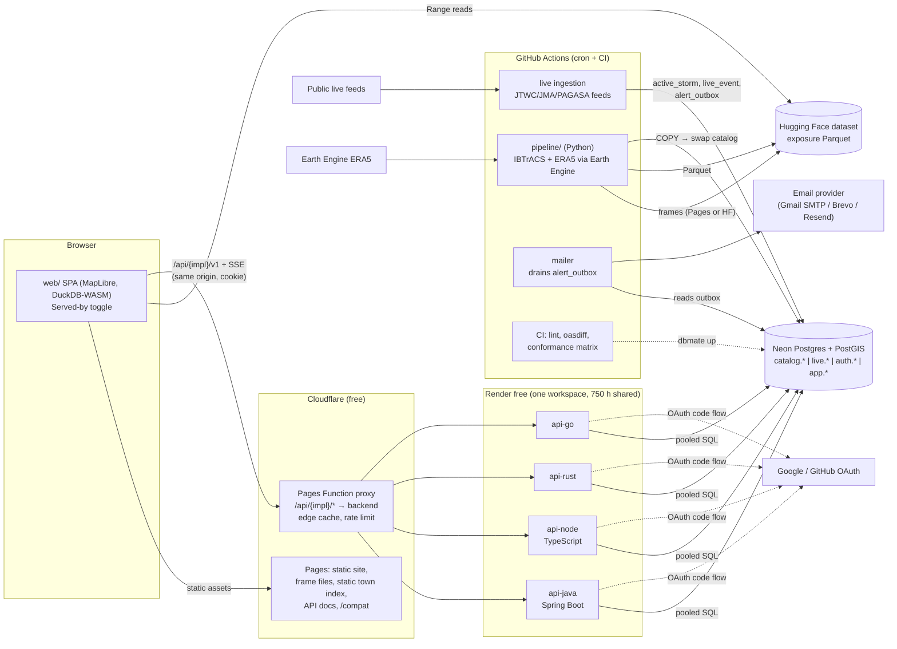

# Replay: system and contract architecture (research)

> **Update 2026-10-21:** accounts were dropped (no OAuth, sessions, saved places or alert email); the API is a public, read-only showcase. See `DECISIONS.md` ("Update 2026-10-21: no accounts…") and `contracts/docs/CONTRACT-GUIDE.md` §14. The account parts below are kept as research history.

Status: research and recommendations, 2026-10-21. Nothing here is implemented yet.
Scope: everything the four backends (Java Spring Boot, Node/TypeScript, Rust, Go) share: the contract, conformance tests, database schema and migrations, auth, the edge proxy, backend selection, repo layout, CI and free-tier capacity. Each backend's internal design belongs to its language's own docs (`api/<lang>/docs/`).
Companion docs: [`contracts/docs/CONTRACT-GUIDE.md`](../../contracts/docs/CONTRACT-GUIDE.md) (draft rules every backend follows) and [`OPEN-QUESTIONS.md`](OPEN-QUESTIONS.md).

Product recap (from `big-data-ideas.md` §2 and `PROPOSALS.md` §E): the hour-by-hour replay is fully static (frame files on Cloudflare Pages, Parquet on Hugging Face read with DuckDB-WASM). The API exists only for four things: (1) "typhoons that hit my town" PostGIS search over about 581,721 storm-hours and the PH ADM3 / JP municipality polygons; (2) a live tracker of active storms pushed over SSE; (3) accounts (Google/GitHub OAuth2, saved places, email alerts); (4) a public documented REST API. Constraint: free tiers only, no credit card.

---

## 0. Recommendation at a glance

| Area | Recommendation | Runner-up |
|---|---|---|
| Contract | **OpenAPI 3.1**, contract-first, split YAML in `contracts/openapi/`, bundled by **Redocly CLI** to one `openapi.json` (plus a down-converted 3.0 bundle for generators that need it). URL major version `/v1`; contract semver in `info.version`. | Author in 3.2 now (native SSE `itemSchema`), but generator support is still thin |
| Lint / diff | **Redocly CLI** lint (custom rules) + **oasdiff** breaking-change gate in CI | Spectral or vacuum (Spectral-compatible, already supports 3.2) |
| SSE spec | `text/event-stream` operation in OpenAPI 3.1, with event payloads as normal component schemas plus an `x-sse-events` map; move to 3.2 `itemSchema` when tooling catches up. **No AsyncAPI.** | AsyncAPI 3.1 doc beside the OpenAPI file |
| Errors / paging / caching | RFC 9457 `application/problem+json`; cursor (keyset) pagination; **weak ETags derived from the DB data version** so every backend emits the same ETag | Offset pagination; body-hash ETags (cannot match across languages) |
| Conformance | **Schemathesis** (property-based, OpenAPI 3.1/3.2, validates SSE) + a **TypeScript/Vitest scenario suite over HTTP** (scenarios, SSE, auth) run against every backend in a CI matrix; results feed a published compatibility table | Hurl for scenarios (readable, but weak at SSE and multi-step OAuth) |
| Mocks | **Prism** (HTTP, from the bundled spec) + **MSW `sse()`** for the stream, so `web/` runs with no backend | Microcks (heavier; no SSE evidence found) |
| Migrations | **dbmate**, plain SQL up/down, owned by `contracts/db/`, applied only by CI, never by a backend at start-up | Atlas (powerful, but key features are Pro/EULA); Flyway CLI in Docker |
| Database | **One Neon project, one shared `main` branch** for all four backends (shared sessions and saved places are the point); CI uses PostGIS in Docker, not Neon | Neon project per backend (4× compute, but data loaded 4×, sessions not shared) |
| Ingestion / email | **Not in the backends.** Exactly one shared Python job (GitHub Actions cron) ingests live feeds, writes `live_event`, enqueues `alert_outbox` idempotently and sends mail over an HTTPS API (Brevo with no domain, Resend with one; Mailpit locally). Backends only read and fan out | Each backend runs its own scheduler (4× duplicates, wakes every service) |
| Auth | Each backend implements the OAuth2 code flow (+PKCE) itself, with one GitHub app + one Google client holding exact per-backend callback URIs (GitHub allows 10 since 2026-08), against **one shared, language-neutral session table** (jsonb, no framework serialisation): opaque random token in a `__Host-` cookie, SHA-256 hash stored in Postgres. Switching backend keeps you signed in. | Shared-key PASETO v4.public / JWT (EdDSA) bearer tokens |
| Origin / cookies | **Same-origin edge proxy**: a Cloudflare Pages Function on `typhoon-replay.pages.dev` routes `/api/{impl}/*` to the four Render services; static assets excluded via `_routes.json` | Custom domain with `api-java.<domain>` subdomains (costs money; needs a card or domain purchase) |
| Backend selection | **Runtime switch** ("Served by: Java / Node / Rust / Go"), path-based `/api/{impl}/v1/...`, choice saved in `localStorage`; every response carries `X-Backend-Impl`; build-time env only sets the default | Build-time env per deploy (four frontends) |
| Repo | Monorepo: `web/ contracts/ api/{java,node,rust,go}/ pipeline/ infra/ docs/`, `just` as the single entry point, `compose.yaml` with profiles, path-filtered CI | Polyrepo (contract as a package): too much ceremony for one person |
| Free tier | **Works for a portfolio, with sleeping backends and mandatory edge caching** (≈ 180k API visits/month uncached, §7.1). Render's **5 GB/month outbound per workspace** and **750 instance-hours shared by four services** break first; see §7 | Move the Node backend to Workers + Hyperdrive to free Render hours |

---

## 1. Contract: OpenAPI contract-first

### 1.1 Spec version: 3.1 vs 3.2

- **OpenAPI 3.2.0** was released in September 2025 ([openapi.tools early adopters](https://openapi.tools/collections/openapi-v3-2-early-adopters)). It adds first-class streaming: `itemSchema` on sequential media types (`text/event-stream`, JSON Lines, JSON Sequences, multipart/mixed) ([Learn OpenAPI: sequential media types](https://learn.openapis.org/specification/media-types), [Speakeasy SSE guide](https://www.speakeasy.com/openapi/content/server-sent-events), [Bump.sh](https://bump.sh/blog/json-streaming-openapi-3-2/)).
- **Tool support for 3.2 (verified 2026-10):**
  - Schemathesis: 3.2 since 4.9.0; SSE response validation since 4.11.0; latest seen 4.22.4 (2026-07-08) ([4.9.0](https://newreleases.io/project/pypi/schemathesis/release/4.9.0), [4.11.0](https://newreleases.io/project/pypi/schemathesis/release/4.11.0), [dev.co](https://dev.co/testing/open-source/schemathesis)).
  - Redocly CLI: "basic support" for 3.2 since v2.3.0 ([openapi.tools](https://openapi.tools/tools/redocly-cli/), [Redocly blog](https://redocly.com/blog/openapi-3-2)).
  - vacuum (Spectral-compatible linter): lists 3.2 ([openapi.tools](https://openapi.tools/tools/vacuum)).
  - oasdiff: its README links "OpenAPI 3.1 and 3.2 support", but depth is unclear; it parses via kin-openapi ([repo](https://github.com/oasdiff/oasdiff)).
  - Spectral: no 3.2 support announced ([providers.apis.io](https://providers.apis.io/providers/spectral/)).
- **Server generators lag even on 3.1:**
  - Go: oapi-codegen gained "initial OpenAPI 3.1 support" only in v2.8.0 ([releases](https://github.com/oapi-codegen/oapi-codegen/releases)); before that people down-converted with overlays ([jvt.me](https://www.jvt.me/posts/2025/05/04/oapi-codegen-trick-openapi-3-1/)). ogen (v1.23.0, 2026-07-10) still says "OpenAPI v3" ([pkg.go.dev](https://pkg.go.dev/github.com/ogen-go/ogen@v1.23.0)).
  - Java: openapi-generator 7.x lists 3.1 as "beta support", and 7.24.0 still fixes `type: [object, "null"]` normalisation ([7.24.0](https://newreleases.io/project/github/OpenAPITools/openapi-generator/release/v7.24.0)).
  - Rust: progenitor targets 3.0.x and is client-only ([docs.rs](https://docs.rs/progenitor)). Newer crates (oas3-gen, openapi-to-rust) claim 3.1 and Axum scaffolding but are young ([oas3-gen](https://docs.rs/crate/oas3-gen/latest), [openapi-to-rust](https://libraries.io/cargo/openapi-to-rust)).
  - Down-converter: `@apiture/openapi-down-convert` (3.1 → 3.0, "not fully robust", minimal) ([socket.dev](https://socket.dev/npm/package/@apiture/openapi-down-convert/overview/^0.13.0)).

**Recommendation: author OpenAPI 3.1.0, using a "portable subset" enforced by lint rules:**
- no `type` arrays and no `null`: optional fields are *omitted*, never `null` (this sidesteps the weakest part of every generator's 3.1 support);
- no `$dynamicRef`, `if/then/else`, `patternProperties`, `unevaluatedProperties` or webhooks;
- `oneOf` only with a `discriminator` (for SSE events and problem subtypes).

CI publishes two bundles: `openapi.json` (3.1, canonical) and `openapi.3.0.json` (down-converted; only for generators that need it).
Revisit 3.2 when oasdiff, Redocly and at least two of the four generators handle `itemSchema` (tracked in OPEN-QUESTIONS).

### 1.2 Spec layout

```
contracts/
  openapi/
    openapi.yaml               # root: info, servers, tags, security, $refs to paths
    paths/                     # one file per resource: storms.yaml, places.yaml, live.yaml, auth.yaml, me.yaml, meta.yaml
    components/
      schemas/                 # Storm.yaml, StormPoint.yaml, Place.yaml, Hit.yaml, LiveEvent*.yaml, Problem.yaml, Page.yaml ...
      parameters/              # Cursor, Limit, IfNoneMatch, PlaceId, Sid ...
      responses/               # Problem400/401/403/404/409/412/422/429/500/503, NotModified304
      headers/                 # XBackendImpl, XContractVersion, XRequestId, ETag, CacheControl, RetryAfter
      securitySchemes.yaml     # sessionCookie (apiKey in cookie)
    examples/                  # named examples reused by Prism and the docs
  redocly.yaml                 # lint rules (portable subset, naming, every op has 4xx + problem+json, ...)
  dist/                        # CI output, not committed: openapi.json, openapi.3.0.json, docs/index.html
  db/                          # migrations, seed, fixtures (§3)
  conformance/                 # schemathesis config + vitest scenarios (§2)
  docs/CONTRACT-GUIDE.md
  CHANGELOG.md                 # contract semver history
```

Bundle with `redocly bundle`; render the public docs (Redoc or Scalar) into `web/` at `/api-docs` so the documented REST API ships with the static site.

### 1.3 Linting and breaking-change detection

| Tool | Pros | Cons |
|---|---|---|
| **Redocly CLI** (recommended) | Lint + bundle + split + docs in one tool; configurable rules; 3.1 and basic 3.2 | Custom rules use Redocly's own format |
| Spectral | Large ruleset ecosystem; also lints AsyncAPI | No 3.2 announced; slower maintenance since the SmartBear acquisition (inferred from release cadence, not verified) |
| vacuum | Runs Spectral rulesets, very fast, 3.2 | Smaller community |

**oasdiff** ([repo](https://github.com/oasdiff/oasdiff), [GitHub Action](https://github.com/oasdiff/oasdiff-action)) compares the PR's bundled spec with the bundle from the last contract release tag:
- `oasdiff breaking --fail-on ERR` fails the PR unless the PR also bumps the major version (which means a new `/v2` path prefix);
- `oasdiff changelog` output is pasted into `contracts/CHANGELOG.md`.

Alternative: pb33f `openapi-changes` (3.0–3.2).

### 1.4 Versioning

- The URL carries the major version only: `/v1`. Breaking changes mean `/v2` runs side by side until all four backends have migrated.
- `info.version` is the contract semver (`1.4.0`). Minor = additive (new endpoint, new optional field, new event type); patch = docs or examples only.
- Clients must ignore unknown fields and unknown SSE event types (the "tolerant reader" rule). That is what makes additive changes non-breaking.
- Backends declare the contract version they implement (§6.4).

### 1.5 Generating code from the contract (names only; the language agents decide)

| Language | Contract-first server options | Notes |
|---|---|---|
| Java / Spring Boot | openapi-generator `spring` (interfaceOnly / delegate, Spring Boot 3) | 3.1 "beta"; fall back to the 3.0 bundle |
| Node / TypeScript | openapi-typescript (types) + runtime validation from the spec (openapi-backend, fastify-openapi-glue, or AJV directly) | `web/` uses openapi-typescript + openapi-fetch from the same bundle |
| Rust | openapi-generator `rust-axum`, oas3-gen, openapi-to-rust; or code-first with utoipa / aide plus a diff gate | Least mature ecosystem |
| Go | oapi-codegen v2.8+ (strict server) or ogen | oapi-codegen 3.1 support is "initial" |

**Code-first is allowed under one rule.** A backend that emits its own spec (springdoc, utoipa, aide, @hono/zod-openapi …) must serve it at `GET /api/{impl}/v1/openapi.emitted.json`, and CI runs `oasdiff breaking` **in both directions** between the contract and the emitted spec. Neither direction may show breaking changes. The served `GET /v1/openapi.json` is always the contract bundle, byte-identical across backends.

### 1.6 Specifying the realtime stream (SSE)

Options:
1. **OpenAPI 3.1 + `text/event-stream` + `x-sse-events`** (recommended now). The operation returns `text/event-stream` with `schema: {type: string}`. A vendor extension maps each SSE `event:` name to a component schema (`LiveSnapshot`, `StormUpserted`, `StormRemoved`). The conformance suite parses frames and validates each `data:` against the mapped schema. One file, all tools still parse it.
2. **OpenAPI 3.2 `itemSchema`** (target later): `itemSchema` describes `{event, data, id, retry}` with `data` as `contentMediaType: application/json` + `contentSchema`. Schemathesis already validates this; most generators don't.
3. **AsyncAPI 3.x** (3.1.0 released 2026-01-31; no SSE-specific binding found) ([release notes](https://www.asyncapi.com/blog/release-notes-3.1.0)). It is a second spec with its own tooling, linting and diffing, for a single stream endpoint. Microcks mocks AsyncAPI mainly over Kafka/MQTT/WebSocket; no SSE support found. Not worth it here.

Event design (full rules in CONTRACT-GUIDE §7):
- `id:` is a global monotonic sequence from the shared `live_event` table, so `Last-Event-ID` resume works **even after switching backend**.
- A comment heartbeat every 20 s.
- A `snapshot` event first on every connection.

### 1.7 Errors, pagination, caching (summary; normative text in CONTRACT-GUIDE)

- **Errors.** RFC 9457 `application/problem+json` with `type` URIs under `https://typhoon-replay.pages.dev/problems/{slug}` (dereferenceable docs pages). Extension members: `code` (stable machine slug), `requestId`, and `errors[]` for validation (`{pointer, detail}`).
- **Pagination.** Opaque `cursor` (base64url of the keyset), `limit` (default 50, max 200), body `{items, nextCursor?}` plus an RFC 8288 `Link: <…>; rel="next"` header. Every backend must produce *interchangeable* cursors, so the encoding is specified exactly (CONTRACT-GUIDE §5): a cursor from the Go backend must work on the Rust backend.
- **Caching.**
  - Catalogue data changes only when the pipeline publishes, so ETags are **weak** and **derived from data, not bytes**: `W/"d{datasetVersion}-{resourceKey}"`. JSON bytes differ between languages (key order, float formatting), so byte-hash ETags could never match across backends.
  - Public catalogue reads: `Cache-Control: public, max-age=300, stale-while-revalidate=86400`, and `If-None-Match` → 304.
  - User data: `private, no-store`.
  - The live snapshot: `no-cache` with an ETag of the latest event `seq`.

---

## 2. Conformance testing

One language-neutral suite in `contracts/conformance/`, run in CI against every backend.

| Layer | Tool | What it proves |
|---|---|---|
| Schema / fuzz | **Schemathesis** 4.x (`st run dist/openapi.json --url …`) with checks `not_a_server_error`, `status_code_conformance`, `content_type_conformance`, `response_schema_conformance`, `response_headers_conformance`, `negative_data_rejection` | Every documented operation accepts what the spec allows, rejects what it forbids with problem+json, and never 500s |
| Scenarios | **Vitest + TypeScript over plain `fetch`**, types from openapi-typescript (the same as `web/`) | Business semantics with golden fixtures: "Tacloban returns Haiyan 2013 first by closest approach"; cursor round-trips across backends; ETag/304; headers; problem `code`s |
| SSE | Vitest + `eventsource-parser` | snapshot-first, heartbeat ≤ 25 s, `Last-Event-ID` resume, event schema validity; an event inserted into `live_event` is delivered within 5 s |
| Auth | Vitest + **mock OAuth2 server** in Docker (e.g. navikt `mock-oauth2-server`; verify) | login redirect has `state` + PKCE S256; callback sets the `__Host-` cookie; a session minted by backend A works on backend B; logout revokes it everywhere; CSRF rejection |
| Cross-backend | Vitest "differential" job | The same requests against all four, with responses compared after canonicalising JSON (sorted keys, numbers to 6 dp) |

**Scenario tool choice:**
- Hurl (8.0.1, 2026-04) ([Arch](https://archlinux.org/packages/extra/x86_64/hurl/)) is pleasant for request/response files, but no SSE streaming support was found, and the OAuth multi-hop with cookies and PKCE is awkward.
- A pytest suite would match the Python pipeline, but would duplicate the TS types that `web/` already generates.
- Vitest wins because the frontend team (and the user) read TypeScript, and the client types come from the same bundle.

**Test hooks.** Every backend implements `POST /v1/_test/sessions` and `POST /v1/_test/live-events`, enabled **only** when `TR_TEST_HOOKS=1`. The suite asserts they return 404 when the hooks are disabled. Without them, the auth and SSE scenarios would need real Google/GitHub accounts.

**Mock servers for a backend-free frontend:**
- **Prism** (`stoplight/prism` v5.16.0, 2026-07-17, maintained; OpenAPI 3.1) ([releases](https://github.com/stoplightio/prism/releases)) serves `dist/openapi.json` with the named examples (`prism mock -d` for dynamic data).
- Prism does not stream SSE, so `web/` uses **MSW's `sse()`** handler (MSW 2.12+) ([MSW SSE docs](https://mswjs.io/docs/sse/)) fed by `contracts/conformance/fixtures/live-*.json`.
- Microcks 1.15 is a heavier Java stack (mocks + contract tests, OpenAPI 3.1, AsyncAPI); it adds little over Prism + MSW here and has no SSE evidence.

**CI matrix and compatibility table:**
- Matrix `backend ∈ {java,node,rust,go}` × `suite ∈ {schemathesis, scenarios, sse, auth}`. Each job starts `compose --profile <backend>` (PostGIS with fixture data + mock OAuth + Mailpit), waits on `/readyz`, runs the suite, and uploads JUnit + JSON.
- An aggregate job writes `compat.json` and renders it in `web/` at `/compat` plus a README table: rows = backends (with their `implVersion` and claimed `contractVersion`), columns = suites, cells = pass / fail / skipped with the test count.
- A nightly job also runs the read-only scenarios against the **deployed** services through the proxy (it tolerates cold starts: wait up to 120 s on `/readyz`).

---

## 3. Shared database and migrations

### 3.1 Ownership

The schema belongs to the contract, not to any backend: `contracts/db/migrations/*.sql`. Rules for backends:
- backends never run DDL at start-up (no Flyway-in-Spring, no `sqlx migrate run`, no `goose up` on boot);
- `/readyz` fails with 503 if `schema_migrations` is older than the `minSchemaVersion` the backend declares.

Migrations are applied by one CI job on merge to `main` (direct, non-pooled Neon URL) and locally by `just db-up`.

### 3.2 Migration tool

| Tool | Format | Pros | Cons |
|---|---|---|---|
| **dbmate** (recommended) | Plain SQL with `-- migrate:up` / `-- migrate:down`; `transaction:false` per file | Single Go binary + `ghcr.io/amacneil/dbmate` image; `dbmate wait`; dumps `schema.sql` for review diffs; table `schema_migrations` ([repo](https://github.com/amacneil/dbmate)) | No lint/plan; ordering by timestamp only |
| Atlas | Declarative HCL/SQL or versioned | Schema diffing, migration lint | Community build is Apache-2.0 but lacks commands; many features need the EULA "Open" build or Pro at $9/seat ([community edition](https://www.atlasgo.io/community-edition), [features](https://atlasgo.io/features)); extension handling reportedly Pro (unverified) |
| Flyway CLI (Docker) | Plain SQL `V1__x.sql` | Mature; the Java backend team knows it | JVM image; Redgate is shifting Community distribution to include non-OSS parts ([Redgate](https://www.red-gate.com/blog/the-flyway-engine-oss-open-source-software-and-redgate)); looks "owned" by the Java backend |
| sqitch | Plain SQL deploy/revert/verify, dependency graph | Verify scripts are nice | Perl toolchain; heavier mental model |

dbmate keeps the schema language-neutral: plain SQL, which every backend agent can read.
CI adds two checks:
- `dbmate up && dbmate rollback && dbmate up` on a fresh PostGIS;
- `schema.sql` must be committed and unchanged after `dbmate dump`.

### 3.3 Schema sketch (schemas, not final DDL)

- `catalog.*`: read models loaded by the pipeline. `storm`, `storm_point` (581k rows, `geography(Point)`, GiST), `place` (PH ADM3 + JP municipalities, simplified `geography(MultiPolygon)`), `storm_place_hit` (precomputed storm × place pairs within 500 km: closest approach, max wind, hours inside radius), `dataset_version`.
- `live.*`: `active_storm` (current state), `live_event` (`seq bigserial`, type, payload jsonb, created_at; keep 7 days).
- `auth.*`: `user`, `identity` (provider, subject, email, email_verified), `session` (token_hash bytea PK, user_id, created_at, last_seen_at, expires_at, revoked_at, user_agent, created_by_impl), `oauth_state` (state, pkce_verifier, return_to, provider, expires_at): short-lived, shared, so a login started on one backend can complete on another.
- `app.*`: `saved_place`, `alert_subscription`, `alert_outbox` (written by the ingestion job, drained by the mailer), `email_suppression`.

**Language-neutral session table.** Framework session stores can't share a table across languages: Spring Session JDBC serialises Java objects, and gob is Go-only. Each backend therefore writes a small custom store against this contract-owned table:

```sql
CREATE TABLE auth.session (
  token_hash     bytea PRIMARY KEY,            -- sha256(raw cookie token), 32 bytes
  user_id        uuid NOT NULL REFERENCES auth."user"(id) ON DELETE CASCADE,
  data           jsonb NOT NULL DEFAULT '{}',  -- neutral attributes only (e.g. {"locale":"ja"}); never language-serialised objects
  created_at     timestamptz NOT NULL DEFAULT now(),
  last_seen_at   timestamptz NOT NULL DEFAULT now(),
  expires_at     timestamptz NOT NULL,
  revoked_at     timestamptz,
  created_by_impl text NOT NULL CHECK (created_by_impl IN ('java','node','rust','go','test')),
  user_agent     text
);
CREATE INDEX ON auth.session (user_id);
CREATE INDEX ON auth.session (expires_at);
```

- Logout sets `revoked_at` (or `DELETE`s; both are acceptable, and the suite checks only the effect).
- Expired rows are purged by the shared maintenance job, not by backends.

**Jobs and locking.** Neon's pooled endpoint (transaction mode) blocks session-level advisory locks as well as LISTEN/NOTIFY. Any job coordination therefore uses a lease row:

```sql
CREATE TABLE ops.job_lease (job text PRIMARY KEY, holder text, lease_until timestamptz NOT NULL DEFAULT '-infinity', last_ok_at timestamptz);
-- acquire: UPDATE ops.job_lease SET holder=$1, lease_until=now()+interval '10 min'
--          WHERE job=$2 AND lease_until < now() RETURNING job;
```

**Alert outbox (no queue on the free tier).** `app.alert_outbox(id bigserial, dedupe_key text UNIQUE, user_id, kind, payload jsonb, created_at, claimed_by, claimed_until, sent_at, attempts, last_error)`.
- `dedupe_key` = `alert:{userId}:{liveId}:{advisoryNo}` makes enqueueing idempotent (`INSERT … ON CONFLICT DO NOTHING`).
- Senders claim rows with `SELECT … FOR UPDATE SKIP LOCKED LIMIT 50` inside one transaction (this works through the pooler), then set `sent_at`.

### 3.3a Sizing against Neon's 1 GB

| Table | Rows | Estimate (heap + indexes) | Notes |
|---|---|---|---|
| `catalog.storm` | 3,076 | < 2 MB | names, peak, landfall summary |
| `catalog.storm_point` | 581,721 (hourly, interpolated) or about 100k (observed 3/6-hourly) | about 60 MB heap + 30 MB GiST + 20 MB btree ≈ **110 MB** | Could store only observed points and interpolate in SQL; that is a ~5× saving if space gets tight |
| `catalog.place` | about 3,400 (1,642 PH ADM3 + about 1,740 JP) | **30–60 MB** at about 100 m simplification | Full-resolution boundaries stay as static files / PMTiles on Pages |
| `catalog.storm_place_hit` | storms × places within 500 km: about 1–3M | **100–250 MB** | Precomputed by the pipeline in PostGIS or GeoPandas; this drives "typhoons that hit my town" |
| `auth.*`, `app.*`, `live.*` | small | < 20 MB | `live_event` pruned at 7 days |
| **Total** | | **about 250–450 MB** | **A full-schema swap needs 2×, so swap table by table** (load `catalog_next.storm_place_hit`, swap, drop, then the next table), keeping the peak under about 700 MB |

Stays **off Postgres**:
- per-place **hourly** exposure (hundreds of millions of rows) and ERA5 field statistics: Parquet on Hugging Face, queried in the browser by DuckDB-WASM;
- frame files: about 19 GB raw / about 5.7 GB WebP for all 3,076 storms per `SPIKE.md`, so a Hugging Face dataset is the likely home, since Pages' total-size limit is unverified;
- full-resolution polygons and the IBTrACS raw CSV.

The API returns *which* storms hit a place. The browser fetches the hour-by-hour detail from the static stores.

### 3.4 Pipeline loads (COPY → staging → swap)

1. The Python pipeline creates `catalog_next` with `CREATE TABLE catalog_next.x (LIKE catalog.x INCLUDING ALL)`, so the DDL stays owned by the migrations.
2. It runs `COPY … FROM STDIN (FORMAT binary)` via psycopg 3, builds the indexes, then `ANALYZE`.
3. Swap **one table at a time**, each in its own short transaction: `ALTER TABLE catalog.x RENAME TO x_old; ALTER TABLE catalog_next.x SET SCHEMA catalog; DROP TABLE catalog.x_old;`. Finally, insert a new `catalog.dataset_version` row, which changes every ETag.
   - Swapping per table keeps the peak storage at about "everything + the largest table" instead of 2×, which matters on 1 GB (§3.3a).
   - Foreign keys between catalog tables are avoided (the pipeline validates instead), so tables swap independently.

Risk: prepared statements re-plan on invalidation, so this should work through Neon's pooler, but verify (OPEN-QUESTIONS).

### 3.4a Ingestion, alerts and jobs: one shared owner (confirmed model)

Exactly **one** shared ingestion job writes live-storm data, and the backends only read it.
- **The job:** Python in `pipeline/`, run by GitHub Actions cron every 30 min.
- **Each run:**
  1. fetch the public feeds;
  2. upsert `live.active_storm`;
  3. append `live.live_event` rows (a new `seq` per change);
  4. match alert subscriptions spatially in SQL and `INSERT … ON CONFLICT (dedupe_key) DO NOTHING` into `app.alert_outbox`;
  5. drain the outbox through the email provider's HTTPS API;
  6. purge expired sessions, OAuth states and old events.
- **Lock:** a lease row in `ops.job_lease`, so an overlapping manual run is harmless.
- **Why not in the backends:**
  - in-process schedulers stop when Render sleeps;
  - four schedulers would duplicate work;
  - every run would wake four services and burn the shared 750 h.

Alternative raised by the Go agent: GitHub Actions cron calls an authenticated `POST /v1/_jobs/{ingest|mail}` (bearer secret) on one backend, rotating by day, so each language also implements ingestion.
- Pros: more showcase.
- Cons: each run wakes a Render service (about 1 min cold start + work, so about 50–100 h/month of the 750), and ingestion parity must then be conformance-tested too.
- Kept as an option for the user (OPEN-QUESTIONS); not the default. If chosen, the endpoints and the lease table above are already contract-ready.

Cloudflare Worker cron was rejected for ingestion: 10 ms CPU per run on Free is too little for parsing feeds and spatial matching.

Size estimate: storm_point about 150 MB with indexes; places with simplified polygons about 30–60 MB; hits about 1–3M rows about 150–300 MB. The billion-row hourly exposure stays on HF Parquet, not in Postgres.

### 3.5 Seed and fixtures

- `contracts/db/fixtures/` holds a small deterministic dataset in COPY CSVs: about 20 storms (Haiyan 2013, Odette/Rai 2021, Hagibis 2019, Jebi 2018, a 1940s storm, an unnamed storm, a dateline-crossing storm), about 30 places (Tacloban, Naha, edge-case polygons), 2 users, and live events.
- The conformance golden answers are written against this fixture.
- `just db-seed` loads it into local and CI PostGIS.

### 3.6 Neon: shared database or one per backend? ([pricing](https://neon.com/pricing), verified 2026-10-21)

Free plan, no card, "permanent":
- 100 projects; 10 branches per project; 100 CU-hours **per project** per month; autoscaling up to 2 CU;
- scale-to-zero after 5 min, which can't be disabled on Free; resume takes "a few hundred milliseconds";
- 1 GB storage per project (20 GB total); 5 GB egress per project; 6-hour history.
- The pooler (PgBouncer, transaction mode) accepts up to 10,000 client connections. LISTEN/NOTIFY and session `SET` don't work through it ([pooling](https://neon.com/docs/connect/connection-pooling)).

| Option | Pros | Cons |
|---|---|---|
| **A. One project, `main` branch shared by all four** (recommended) | Sessions, saved places and live events are shared, so switching backend is seamless; one pipeline load; the demo story "four languages, one database" | 100 CU-h shared (400 h awake at 0.25 CU); one noisy backend affects the others |
| B. One project, a branch per backend | Isolation; copy-on-write branches are cheap in storage | All branches draw on the same project's 100 CU-h; branches diverge, so sessions are not shared |
| C. One project per backend | 4 × 100 CU-h, 4 × 1 GB | Pipeline loads 4×; no shared sessions; four sets of secrets |

Choose A. Set the compute max to 0.25–0.5 CU (autoscaling to 2 CU burns CU-hours 8× faster). Use Neon branches only for migration rehearsal (a branch from `main`, `dbmate up`, smoke test, delete). CI uses Docker PostGIS, never Neon.

---

## 4. Auth across backends

### 4.1 The cookie problem

`pages.dev` and `onrender.com` are both on the Public Suffix List, so `typhoon-replay.pages.dev` and `tr-java.onrender.com` are **different sites**:
- a session cookie set by the API is a third-party cookie from the page's point of view;
- Safari, Firefox and Brave block those by default;
- Chrome reversed its phase-out in April 2025 and keeps them ([Stape](https://stape.io/news/google-chrome-cookie-deprecation)), so "works in Chrome" would hide the bug.

Fixes:

| Fix | Free? | Notes |
|---|---|---|
| **Same-origin proxy on Pages Functions** (recommended) | Yes | `https://typhoon-replay.pages.dev/api/{impl}/*` → `https://tr-{impl}.onrender.com/*`. The cookie is first-party with `SameSite=Lax`, there is no CORS, and one origin serves all four backends |
| Custom domain, `api-{impl}.<domain>` | No (domain about US$10/yr, needs a payment method) | Same-site cookies via `Domain=<domain>`; also unblocks Resend email. The best upgrade path if the user ever buys a domain |
| Bearer tokens in JS (no cookies) | Yes | Works cross-site, but tokens sit in JS-readable storage (XSS exposure) and the OAuth callback must hand the token to the SPA |

**Cloudflare limits for the proxy** ([Workers limits](https://developers.cloudflare.com/workers/platform/limits/), [Pages Functions routing](https://developers.cloudflare.com/pages/functions/routing/)):
- 100,000 requests/day on Free (Pages Functions share it); Error 1027 past the cap.
- 10 ms CPU per request, but **I/O wait does not count**, and HTTP-triggered Workers have **no wall-clock limit** "as long as the client remains connected".
- So an SSE stream returned as `return fetch(upstream)` (body passed through, no TransformStream) costs well under 1 ms CPU and can stay open. Each SSE connection is one request; reconnects count again.
- `_routes.json` with `include: ["/api/*"]` keeps static assets (frames, tiles) from invoking Functions. Without it, every request invokes the Function.
- Cloudflare's 100 s proxy read timeout applies to orange-clouded zones. With a 20 s heartbeat it doesn't matter either way.

### 4.2 Session model (recommended): opaque token, shared Postgres table

- Each backend implements the OAuth2 authorization-code flow with PKCE S256 and `state` for Google and GitHub. Implementing it four ways is part of the showcase.
- `state`, the PKCE verifier and `returnTo` go into the shared `auth.oauth_state` table, not into backend memory. So a login started on Java can be completed by Go if the user toggles mid-flow.
- On callback: upsert `auth.user` / `auth.identity` by `(provider, subject)`. Mint 32 random bytes, store `sha256(token)` in `auth.session`, and set the cookie:
  - `__Host-tr_session=<base64url>; Path=/; Secure; HttpOnly; SameSite=Lax; Max-Age=2592000`;
  - `__Host-` requires `Path=/`, so the cookie covers `/api/*` for all impls, which is exactly what makes switching seamless.
- Every authenticated request hashes the cookie and looks it up (`revoked_at IS NULL AND expires_at > now()`). `last_seen_at` is touched at most every 5 minutes, and sessions slide to 30 days.
- CSRF: `SameSite=Lax` plus an `Origin` check on unsafe methods (must equal the site origin), plus a required `X-Requested-With: typhoon-replay` header on unsafe methods. Cheap to implement four times, and testable.

**Alternatives considered:**
- *Shared-key signed tokens (PASETO v4.public or JWT EdDSA):* stateless, but revocation needs a denylist table anyway; PASETO libraries are uneven across the four languages; key rotation must be coordinated across four deploys.
- *Shared auth service (e.g. one backend or a Worker does OAuth for everyone):* less code, but it removes the per-language showcase, and the other three become token consumers. Keep it as a fallback if Google's consent-screen verification for `pages.dev` becomes painful.

**OAuth app registration.** This corrects the "a GitHub OAuth app allows only one callback URL" assumption, which is outdated.
- Since GitHub's 2026-08-14 changelog, OAuth apps can register **up to 10 callback URIs**, each with a per-URI wildcard toggle. Single-URI apps registered before 2026-08-03 kept legacy wildcard (sub-directory) matching on by default ([changelog](https://github.blog/changelog/2026-08-14-multiple-redirect-uris-and-token-refresh-for-oauth-apps), [docs](https://docs.github.com/en/apps/oauth-apps/building-oauth-apps/authorizing-oauth-apps)). PKCE S256 is supported.
- New apps get short-lived tokens (8 h access + refresh) by default. We only need the identity once at login, so we ignore the refresh token and don't store provider tokens at all.

**Recommendation:**
- **one GitHub OAuth app** and **one Google OAuth client**, each with exact-match callback URIs (wildcard off), one per backend: `https://typhoon-replay.pages.dev/api/{java|node|rust|go}/v1/auth/github/callback`;
- plus `http://localhost:8788/api/{impl}/v1/auth/github/callback` for local dev (5 URIs, within the 10 allowed); a separate dev app keeps production clean.
- Each backend runs its own callback (the showcase).

Alternatives:
- (a) one OAuth app per backend (four client secrets, otherwise identical);
- (b) a single shared callback `/api/auth/callback/{provider}` handled in the proxy, which reads `oauth_state.impl` and forwards to that backend. It adds proxy logic and is only needed if the 10-URI limit or Google verification forces it.

Provider endpoints (authorize/token/userinfo) must be configurable via env so CI can point them at the mock IdP.

---

## 5. Backend selection and cold-start UX

| Option | Verdict |
|---|---|
| Build-time env (`VITE_API_BASE`) | Needed for the *default* only. Four frontend builds would hide the point of the showcase |
| **Runtime toggle** (recommended) | "Served by: [Java] [Node] [Rust] [Go] [Auto]" in the footer and on the API docs page. The choice is stored in `localStorage` and becomes the path prefix `/api/{impl}/v1`. `Auto` = the proxy picks the first backend whose `/readyz` answered within the last 10 min (tracked in the Cache API), else the build-time default |
| Header- or cookie-based routing by the proxy | Hides the impl from URLs; harder to debug and to curl. Path-based routing is explicit |

- Every response carries `X-Backend-Impl`, `X-Backend-Version`, `X-Contract-Version` and `X-Request-Id`. The proxy adds `X-Edge-Route: {impl}` and `Server-Timing: edge;dur=…`. The UI shows a badge from the *response* header, not from the toggle, so a misroute is visible.
- `GET /api/{impl}/healthz` (process up, no DB) and `/readyz` (DB reachable and schema version OK).
- **Render free ([docs](https://render.com/docs/free)):**
  - spins down after 15 min without inbound traffic; spin-up "takes about one minute";
  - **750 free instance-hours per workspace per month**, and hours exhausted means *all* free services suspended until next month.
  - Four services always on would need about 2,976 h, so the four **must** sleep: about 187 h each, roughly 6 h/day awake.
  - **No keep-alive pinging.**
- **Cold-start UX:**
  - The static replay never waits on the API.
  - On the first API need, the SPA fires `GET /api/{impl}/healthz`. If there is no answer in 2 s, it shows "Waking the {Java} backend… (free hosting sleeps; about 60 s)" with a progress bar, a "switch to a warm backend" button (warm = any backend that answered `/healthz` in this session), and a link to the compat page.
  - Town search falls back to a precomputed static index on Pages (the top 5,000 places → their storm lists as JSON shards), so the core feature works with all backends asleep.
- **Edge caching to hide cold starts** (the Java agent asked for an evaluation):
  - **What works.** The Cache API works in Pages Functions on `*.pages.dev` ([docs](https://developers.cloudflare.com/workers/runtime-apis/cache/)). The proxy can cache public catalogue GETs (keyed by impl + path + sorted query), honour `Cache-Control` and ETags, and serve hits **without waking the backend**.
  - **Limits.**
    - The cache is **per data centre**, not replicated globally, so it only helps repeat visitors near the same PoP (Manila or Tokyo PoPs matter most).
    - `cache.put` bypasses tiered cache.
    - `waitUntil` background revalidation is capped at 30 s after the response, which is shorter than a 60 s cold start, so stale-while-revalidate can't fully hide one.
  - **Recommended behaviour:**
    1. Fresh hit → serve with `X-Edge-Cache: HIT`.
    2. Stale hit, and the backend doesn't answer `/healthz` within 1.5 s → serve stale with `X-Edge-Cache: STALE` and kick the backend awake with a fire-and-forget `/healthz`.
    3. Miss → forward.
  - **Cross-impl serving.** All four backends read the same DB and emit identical data-derived ETags, so the proxy *may* answer a cold impl's miss from another impl's cached entry for catalogue GETs. It labels this honestly: the response keeps the original `X-Backend-Impl`, and `X-Edge-Cache: CROSS`. The UI then shows "served from edge cache (originally: Go)". Off by default; a flag for the demo.
  - Never cache `/me`, auth, SSE or anything with `Cache-Control: private`.
  - Verdict: **required, not optional.** Render Hobby outbound bandwidth is 5 GB/month (new plans 2026-04-23; legacy workspaces migrated 2026-08-01), and exhausting it without a card suspends all four backends until the next month. Every cache hit is egress Render never sees. Pair it with the static fallback index for the headline query. Budget: §7.1.
- **SSE and sleep:** the client opens the live stream only when the live panel is visible, and closes it on `visibilitychange: hidden` and after 10 min without interaction. Whether an open SSE stream counts as "inbound traffic" for Render's 15-min timer is **unverified**. Either it keeps the service awake (burning hours) or the service sleeps mid-stream (the client reconnects with `Last-Event-ID`). Both are handled by the client rule.

---

## 6. Repo layout, local dev, CI, releases

### 6.1 Layout

```
typhoon-replay/
  web/                    # Vite SPA (exists)
  functions/api/[[path]].ts  # Pages Function proxy (Pages expects functions/ at the project root; see OPEN-QUESTIONS)
  contracts/              # openapi/, db/, conformance/, docs/, CHANGELOG.md
  api/java/ api/node/ api/rust/ api/go/   # each: Dockerfile, src, docs/, impl.json
  pipeline/               # Python (exists): IBTrACS/ERA5 → Pages/HF; catalog loads; live ingestion; mailer
  infra/                  # render.yaml blueprint, compose.yaml, mock-oauth config, CI helper scripts
  docs/architecture/
  justfile
```

`api/<lang>/impl.json` holds `{ "impl": "go", "version": "0.3.0", "contract": "^1.2.0", "minSchemaVersion": "20261101120000" }`. CI checks that the claimed contract range includes the current contract version. The same values are served at `/v1/meta` and in the headers.

### 6.2 Local dev

`compose.yaml` services and profiles:
- `db`: `postgis/postgis`, pinned to the PostgreSQL + PostGIS versions Neon runs (verify);
- `migrate` (dbmate, one-shot), `seed`;
- `mailpit` (SMTP sink + UI, for the mailer job);
- `oauth-mock` (mock IdP);
- `prism` (mock API on :4010);
- `api-java`, `api-node`, `api-rust`, `api-go` (profiles `java|node|rust|go|all`);
- `edge`: `wrangler pages dev` running the same proxy against local backends;
- `web`.

**`just` is the one entry point:** `just up go`, `just mock`, `just conformance rust`, `just conformance-all`, `just db-reset`, `just contract-lint`, `just contract-bundle`.
- It is a single static binary and recipes take arguments, which suits the existing `scripts/*.sh` + `deploy.config` style.
- Make is the fallback if no new tool is wanted.

### 6.3 CI (GitHub Actions, public repo = free minutes)

- Path filters (`on.push.paths` or `dorny/paths-filter`):
  - `contracts/**` triggers lint + bundle + oasdiff + the **full matrix of all four backends**;
  - `api/<lang>/**` triggers that backend's build/unit tests + its conformance column;
  - `web/**` triggers the web checks + the web e2e against Prism;
  - `pipeline/**` triggers the pytest suite.
- On merge to `main`, in order: migrate Neon → deploy changed backends (Render deploy hook) → deploy Pages → nightly read-only conformance against production.
- Scheduled jobs: live ingestion (`*/30` cron; GitHub cron is best-effort and can be delayed), mailer (after ingestion), pipeline incremental (IBTrACS three times a week).

### 6.4 Releases

- The contract is released as git tag `contract-v1.4.0`, and the bundle is attached to the GitHub release.
- Each backend is tagged `api-go-v0.3.0`; its `impl.json` declares the contract range.
- A backend may lag one minor version. Its compat row shows the missing operations as "skipped (not claimed)": the suite tags each test with the minimum contract version, which is how the matrix stays green while backends catch up.
- Database migrations are versioned by dbmate timestamp; backends declare `minSchemaVersion`. Migrations must be **expand/contract** (add new, deploy all backends, remove old) because four independently deployed backends read the same schema.

---

## 7. Free-tier capacity and what breaks first

| Resource | Limit (verified 2026-10-21 unless noted) | Demand | Verdict |
|---|---|---|---|
| Render instance-hours | 750 h / workspace / month, shared by all free services ([docs](https://render.com/docs/free)) | 4 services × awake time | **Binding.** About 6 h/day each; no pinging; idle-close SSE |
| Render outbound bandwidth | **5 GB / month per Hobby workspace** (cut from 100 GB; new plans 2026-04-23, legacy workspaces auto-migrated 2026-08-01); over it with no card = services spun down until next month ([docs](https://render.com/docs/outbound-bandwidth), [plans](https://render.com/docs/new-workspace-plans)) | API JSON, SSE | **Most dangerous: silent, and stops all four.** Gzip/brotli; edge-cache public GETs in the proxy (Cache API keyed by impl + URL + ETag); keep big data on Pages/HF; SSE heartbeats are comments of about 3 bytes |
| Render build minutes | 500 / month (third-party sources) | 4 Docker builds per deploy (Java/Rust builds are slow) | Build images in GitHub Actions and push to GHCR; Render deploys a prebuilt image (verify the free tier allows image deploys) |
| Render RAM/CPU | 512 MB, 0.1 CPU (third-party) | JVM | Java cold start matters (the Java agent reports Oracle stepping back from GraalVM Native Image toward Leyden AOT cache); edge caching (§5) hides it for public reads |
| Render SMTP | Outbound 25/465/587 **blocked** on free services since 2025-09-26 ([changelog](https://render.com/changelog/free-web-services-will-no-longer-allow-outbound-traffic-to-smtp-ports)) | email alerts | The mailer must not run on Render; run it in GitHub Actions (see email) |
| Neon compute | 100 CU-h / project / month; scale to zero after 5 min | API queries + ingestion every 30 min + pipeline loads | About 400 h at 0.25 CU. Ingestion every 30 min ≈ 48 wakes × 5 min ≈ 4 h/day ≈ 30 CU-h/month. OK if capped at 0.25 CU and the backends hold no idle LISTEN connections (whether idle connections block suspend is unverified) |
| Neon storage / egress | 1 GB, 5 GB egress / project | about 400 MB catalogue (×2 during swap) | Tight but OK; the hourly exposure stays on HF |
| Workers / Pages Functions | 100k req/day; 10 ms CPU (I/O excluded) | every API call + each SSE (re)connect | Fine for a portfolio; Error 1027 past the cap, so the SPA treats 1027/429 as "API resting" and uses the static fallback |
| Hyperdrive (if Option C) | 100k queries/day on Free ([pricing](https://developers.cloudflare.com/hyperdrive/platform/pricing/)) | Node-on-Workers queries | OK |
| GitHub Actions | free for public repos; 20 concurrent jobs; cron best-effort | 4 × 4 matrix, ingestion, pipeline | OK. Keep the matrix to PRs that touch the relevant paths |
| Email | Resend Free: 3,000/month, 100/day; SMTP on 25/465/587/**2465/2587** (2587 gets past Render's block), plus an HTTPS API. But it **requires a verified domain**: without one, `onboarding@resend.dev` delivers only to the account owner's own address and 403s otherwise ([pricing](https://resend.com/pricing), [SMTP](https://resend.com/docs/send-with-smtp), [403 doc](https://resend.com/docs/knowledge-base/403-error-resend-dev-domain)). Brevo Free: 300/day, no card (third-party sources), single-sender verification of an existing mailbox; mail "from" a free-mail address sent via Brevo fails DMARC alignment and is likely spam-foldered | alert emails | **No fully free, deliverable option without a domain.** See §7.2 |

### 7.1 API egress budget under Render's 5 GB/month

Verified: Hobby = 5 GB included; overage $0.15/GB, but only with a card on file. Without one, services are spun down until the next month ([outbound bandwidth](https://render.com/docs/outbound-bandwidth), [new workspace plans](https://render.com/docs/new-workspace-plans)). The plans were announced 2026-04-23, and legacy workspaces were auto-migrated 2026-08-01. The 5 GB is shared by all four backends.

**Design rule:** heavy payloads never touch a backend. Frames, hourly tracks, the hourly exposure Parquet and full-resolution polygons come from Pages / Hugging Face. The API returns only small JSON indexes (contract rule: responses ≤ 64 KB uncompressed; tracks at observed resolution only).

| Item (gzip/brotli, incl. about 0.5 KB headers) | Size | Per API-using visit |
|---|---|---|
| `GET /places/{id}/storms` (50 items) | about 3–4 KB | 2 → 8 KB |
| Place search / nearest | about 1.5 KB | 3 → 4.5 KB |
| Storm summary / observed track (no hourly points) | about 2–4 KB | 2 → 6 KB |
| `/me`, saved places, alerts | about 1 KB | 2 → 2 KB |
| SSE (uncompressed): snapshot about 5 KB + heartbeat about 40 B on the wire every 20 s ≈ 7 KB/h + events | about 7 KB per 10-min session | 7 KB |
| **Total per visit** | | **≈ 25–30 KB** |

- **Budget:** 5 GB ÷ 28 KB ≈ **180k API-using visits/month** (≈ 6k/day) with no caching. With a 60–80% edge-cache hit rate on catalogue reads (concentrated at the Manila and Tokyo PoPs), that rises to ≈ 350–600k/month.
- **The Workers 100k requests/day cap** (≈ 3M/month) is then the next ceiling, not Render.
- **Real threats** are not normal visitors:
  - scrapers or a loop polling the API, so the proxy must rate-limit per IP;
  - Schemathesis or load tests aimed at production (forbidden; the nightly production check is a fixed read-only list of ≈ 30 requests ≈ 100 KB/night ≈ 3 MB/month);
  - SSE left open in background tabs (handled by close-on-hidden);
  - anyone exposing hourly tracks or GeoJSON polygons through the API.
- **Guardrail (decided 2026-10-21, OPEN-QUESTIONS A.9):** no nightly static-mode job. The backends stay live; egress is kept down by gzip from Render to the edge and by the edge cache, whose catalogue entries stay fresh while the dataset version is unchanged (the dataset pin, edge/README.md). The proxy's `STATIC_MODE` flag remains as a manual emergency switch. Usage can be read from Render's API (`GET /v1/metrics/bandwidth`, hourly MB per service).

### 7.2 Email options, and the "buy a domain" decision

All options send from the shared mailer (GitHub Actions) via an **HTTPS API** in production, with Mailpit locally. Backends never send mail, so Render's SMTP block is irrelevant.

| Option | Cost | Deliverability | Notes |
|---|---|---|---|
| **No domain: Brevo single sender** (recommended free default) | Free, 300/day | Fair to poor (DMARC alignment fails for gmail.com/outlook.com senders) | Fine for a demo with a "check spam" hint. Verify Brevo's current single-sender rules |
| No domain: Gmail SMTP + app password from the GH Actions mailer | Free, about 500/day | Good (real Gmail) | Personal account sending automated mail; ToS grey area; SMTP rather than an API |
| No domain: Resend test sender | Free | Only to the account owner | Useless for real users; fine for CI smoke tests |
| **Buy a domain** (≈ US$10–15/yr; a Cloudflare Registrar `.com` at cost; **needs a payment method**) + Resend | about US$10–15/yr | Good (SPF/DKIM/DMARC aligned) | Also enables custom API subdomains or a clean `typhoonreplay.<tld>` origin, Option B |

**Explicit user decision:** stay card-free and accept weak email deliverability, or spend about US$10–15/year on a domain, which fixes email *and* gives professional URLs. It doesn't change the proxy design; the same-origin proxy is still recommended.

**What breaks first, in order:**
1. Render bandwidth (5 GB) if a demo goes viral or someone polls;
2. Render hours if backends don't sleep;
3. the Workers 100k/day cap under a traffic spike;
4. Neon CU-hours if something holds connections or autoscaling is left at 2 CU;
5. email deliverability.

**Mitigations already in the design:**
- the static replay and a static town-search fallback, so the API is optional for the core demo;
- shared ingestion, so backends do no background work;
- edge caching of public GETs;
- SSE only while visible;
- per-IP rate limiting in the proxy (Workers Rate Limiting binding or a simple Cache-API counter) returning problem+json 429.

---

## 8. System diagram



---

## 9. Coherent system-level options

### Option A: "One origin, one database, four interchangeable engines" (recommended)

The design described above:
- Pages + a Pages Function proxy on one origin;
- four Render services that sleep;
- one shared Neon database with shared opaque sessions;
- ingestion, mailer and migrations in GitHub Actions;
- OpenAPI 3.1 + dbmate + Schemathesis/Vitest conformance.

| | |
|---|---|
| **For** | Zero cost, no card. Switching backend keeps the session, saved places and SSE position, which is the most convincing "universal frontend" demo. The backends are pure request/response + fan-out, so they are comparable like for like. |
| **Against** | Cold starts of about 60 s. Render's 750 h / 5 GB limits are shared and unforgiving. Email deliverability is weak without a domain. |

### Option B: Option A plus a custom domain (about US$10/year)

- `typhoon-replay.<domain>` on Pages, and `api-java.<domain>` … as Render custom domains behind Cloudflare DNS, or still behind the proxy;
- Resend on the same domain for alerts.

| | |
|---|---|
| **For** | Professional URLs; deliverable email; cookies via `Domain=` even without the proxy, which removes the Workers 100k/day dependency for API calls. |
| **Against** | Not free, and a domain purchase needs a payment method, which breaks the brief. Recommended as the *first* paid upgrade only. |

### Option C: Option A with a hybrid runtime (Node on Cloudflare Workers + Hyperdrive)

- The TypeScript backend runs as a Worker (Hono or similar) on the same origin; its DB access goes through Hyperdrive (100k queries/day free).
- Java, Rust and Go stay on Render, so each gets about 250 h/month instead of about 187.

| | |
|---|---|
| **For** | The Node backend is always warm; more Render headroom; shows edge-runtime skill. |
| **Against** | Not "Node" (the workerd runtime); a long-lived SSE stream must be built differently (a Durable Object or polling `live_event` per connection), so it diverges from the other three; the 10 ms CPU limit restricts JSON-heavy endpoints. Decide with the Node agent. |

**Recommendation: build Option A.** Keep B as the documented upgrade and C as an experiment the Node agent may propose.
