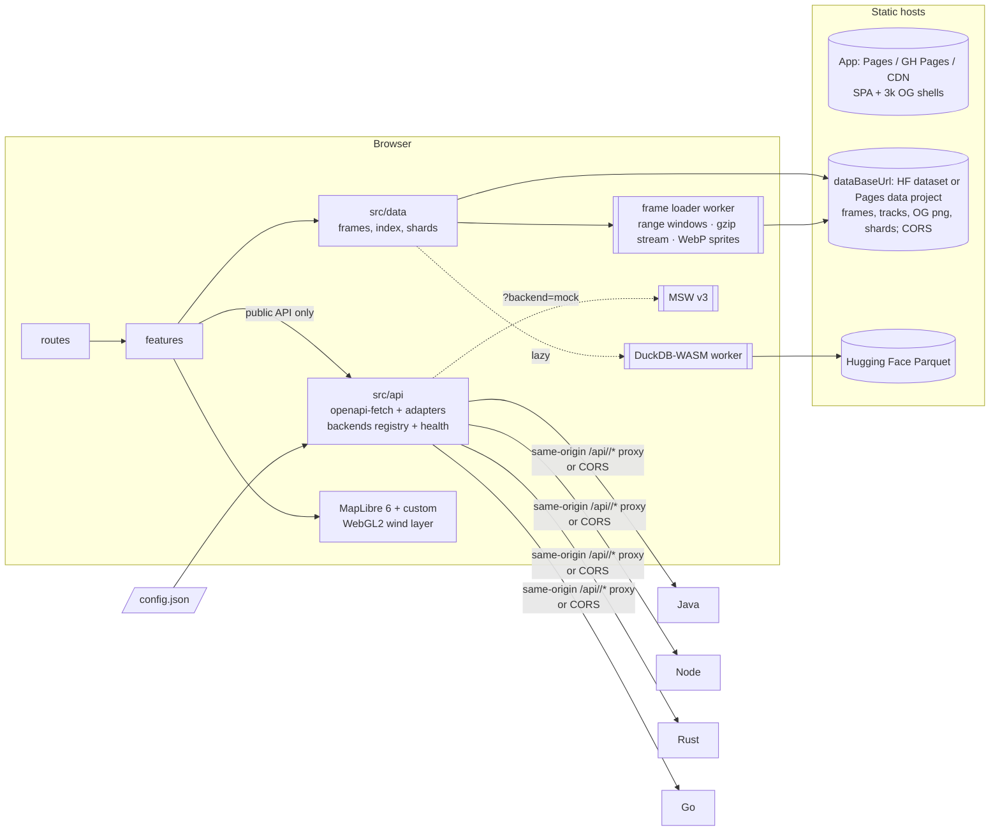
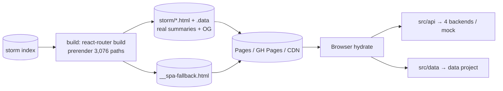
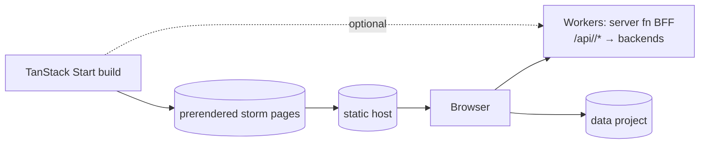

# Replay frontend: architecture research

Status: research only, for the owner to choose from. Nothing here is implemented.
Checked: 2026-10-21. I took versions from the npm registry (`latest` tag) and the sources linked inline. Anything I inferred rather than found in documentation says so.
Inputs: `../../big-data-ideas.md` §2 (in the portfolio root), `PROPOSALS.md` §E, the pipeline's frame format (`pipeline/typhoon/frames.py`, `.tyf`), the current deploy placeholder (`web/`, `deploy.config`, `wrangler.jsonc`, `web/public/_headers`), and `@abrycta/akari`.
Companion: [OPEN-QUESTIONS.md](./OPEN-QUESTIONS.md).

---

## 0. Summary

**Recommendation: Stack A, "Static-first SPA".**

**Stack and rendering**
- Vite 8 + React 19 + TanStack Router (typed URL state) + TanStack Query.
- A build step stamps about 3,000 static per-storm HTML shells that carry Open Graph tags.
- No server runtime. The `dist/` folder runs on Cloudflare Pages, GitHub Pages or any CDN.

**API access**
- Only `src/api/` may talk to a backend. It holds an openapi-typescript client generated from the shared contract, plus an adapter.
- The backend is chosen by a runtime `config.json` plus a "Served by" switcher.
- MSW v3 serves a mock mode built from the same spec.

**Replay data**
- The replay reads only static files: frames, the track and shards. It is fenced off from `src/api/` by a lint rule.
- If all four backends are asleep, the replay still works.

**Runner-up: Stack B.** React Router 8 framework mode with `ssr:false` + `prerender`. Choose it if real prerendered HTML per storm (text content, not only meta tags) matters more than simplicity.

**Option C** (TanStack Start static) is credible but was declared 1.0 only on 2026-10-13. Next.js static export is not recommended.

Six findings change the design. Each is verified below.
1. **Cloudflare Pages does not serve HTTP range requests.** It returns 200, not 206, and `application/octet-stream` is not on Cloudflare's auto-compress list. Hugging Face `resolve` URLs do return 206 with CORS. Frames total 19 GB raw (5.7 GB as WebP), so they may well live on HF. The frame loader is therefore **host-agnostic**: `dataBaseUrl` comes from config, and a capability probe chooses range windows or whole-file streaming (gzip, frame-major, decoded progressively in a worker). Lossless WebP sprites are a third format (§4).
2. **DuckDB-WASM's `.wasm` (34–39 MB raw) exceeds Pages' 25 MiB per-file limit.** It has to come from a CDN such as jsDelivr, so it becomes a lazy, optional "Explore" feature. "Typhoons that hit my town" gets a static, sharded fallback.
3. **File count.** Frames (3,076, or about 15k as per-variable sprites), storm HTML shells (about 3,076) and OG images (about 3,076) would crowd or exceed the 20,000-file cap on one origin, and would couple data and app deploys. Proposal: data lives behind `dataBaseUrl` (an HF dataset or a second Pages project), and the app origin holds only shells and assets (§5).
4. **MapLibre GL JS is now v6 (6.15.0).** It requires WebGL2 and is ESM-only. React Router is now v8 (8.5.0), MSW v3 (3.0.3), Vitest 5 and Lingui v6.
5. **The IETF browser-apps BCP is final as RFC 10017 (Aug 2026).** It strongly recommends a BFF for apps with sign-in. Cookies across four backend origins on Render are third-party cookies, so cookie auth practically needs a same-origin proxy (§3.4).
6. **`OES_texture_float_linear` is available on only about 75% of Android and 53% of iOS devices.** The wind field must use RGBA8 textures with manual bilinear sampling, which is what webgl-wind does.

---

## 1. Framework and rendering

Requirements:
- static output with no server runtime
- about 3,076 shareable storm URLs with per-storm Open Graph meta
- runs on Pages, GitHub Pages or any CDN
- easy to explain

Constraints that apply to every option:
- **Social crawlers do not run JavaScript.** Facebook, X, LinkedIn and Slack read only the HTML they receive, so per-storm OG tags must exist in static HTML or be injected at the edge. Sources: [Unhead SPA guide](https://unhead.unjs.io/docs/head/guides/get-started/single-page-applications) and [Prerender.io](https://prerender.io/blog/benefits-of-using-open-graph/) (vendor sources).
- **Google renders JavaScript but still says "server-side or pre-rendering is still a great idea"** ([Google Search Central, JS SEO basics](https://developers.google.com/search/docs/crawling-indexing/javascript/javascript-seo-basics)).
- **Cloudflare Pages free plan** ([limits](https://developers.cloudflare.com/pages/platform/limits)): 20,000 files, 25 MiB per file, 500 builds/month, and a **20-minute build timeout**. Static asset requests are free and unlimited, while Functions use the Workers 100k requests/day ([pricing](https://developers.cloudflare.com/pages/functions/pricing/)).
- **Pages vs Workers.** Cloudflare steers new projects to Workers Static Assets, but there is no deprecation notice for Pages ([migration guide](https://developers.cloudflare.com/workers/static-assets/migrate-from-pages/)). Workers Free has the same 20k-file and 25 MiB limits ([limits](https://developers.cloudflare.com/workers/platform/limits/)).
- **GitHub Pages** ([limits](https://docs.github.com/en/pages/getting-started-with-github-pages/github-pages-limits)): 1 GB site, 100 GB/month soft bandwidth, and **no custom headers**. That means no COOP/COEP and no cache headers ([discussion #13309](https://github.com/orgs/community/discussions/13309)). It also has no SPA rewrite, so it needs the `404.html` copy trick.

| Option | Version (2026-10-21) | Storm pages and OG | Server runtime | Main trade-offs |
|---|---|---|---|---|
| **1a. Vite SPA + TanStack Router** (or React Router 8 in data/declarative mode) | vite 8.3.4 ([Vite 8 stable 2026-03-12](https://vite.dev/blog/announcing-vite8)); @tanstack/react-router 1.170.45 | A post-build script copies `index.html` to `storm/<sid>/index.html` with storm-specific `<title>`, description, `og:*` and canonical tags (my design; about 3k small files). The body is still the SPA. | None | **+** Simplest mental model. All code is browser-only, which suits MapLibre, workers and WASM. Fast builds. TanStack Router has the best typed search params for URL state. **−** No real HTML body for SEO (the meta tags only). The stamping script is hand-rolled, though it is about 50 lines. |
| **1b. React Router 8 framework mode, `ssr:false` + `prerender`** | react-router 8.5.0 (v8.0.0 on 2026-06-17, [changelog](https://reactrouter.com/8.0.0/changelog)) | `prerender: { paths: [...3,076], concurrency: N }` renders real HTML, and loaders can read the storm index at build time. Paths not listed fall back to the SPA (`__spa-fallback.html`). See the [pre-rendering](https://reactrouter.com/how-to/pre-rendering) and [SPA mode](https://reactrouter.com/how-to/spa) docs. | None | **+** Real content per storm (name, dates, peak, affected provinces) in the HTML. A documented, mainstream feature. **−** The root route renders in Node at build time, so code must be SSR-safe (guard MapLibre, workers and DuckDB with `clientLoader` or lazy imports). Pages render one at a time by default. Inference: a loader produces `.html` + `.data` per path, about 6k files. Build time for 3k pages is unmeasured, against the 20-minute cap. |
| **1c. TanStack Start, static prerender (or SPA mode)** | @tanstack/react-start 1.169.3; **1.0 stable on 2026-10-13** ([blog](https://tanstack.com/blog/tanstack-start-1-0)) | `prerender: { pages: [...], crawlLinks, concurrency, failOnError }`. Dynamic `$sid` routes are not auto-discovered, so list them ([docs](https://tanstack.com/start/latest/docs/framework/react/guide/static-prerendering)). SPA mode emits `/_shell.html` ([docs](https://tanstack.com/start/latest/docs/framework/react/guide/spa-mode)). | None for static. Optional Nitro/Workers server functions later. | **+** The same router as 1a plus prerendering. A path to server functions (a BFF on Workers) if ever wanted. **−** Eight days past 1.0, so less battle-tested. Its full-stack features tempt you into vendor-runtime coupling. Same SSR-safety cost as 1b. |
| **1d. Next.js `output: 'export'`** | next 16.4.2 | `generateStaticParams()` for 3k storms | None | **−** Export mode disallows next/image optimisation (needs a custom loader), rewrites, headers, middleware/proxy, ISR, Server Actions and cookies ([static exports docs, 2026-08-09](https://nextjs.org/docs/app/guides/static-exports)). You carry the App Router/RSC mental model without its benefits. **Not recommended.** |

**OG images**
- Satori 0.63.2 + @resvg/resvg-js 2.6.2 can render about 3k PNGs ([satori](https://github.com/vercel/satori)). I found no sourced benchmark. My estimate is tens of ms to 100 ms per image, about 2–5 minutes in total.
- **Recommendation:** render them **in the data pipeline**, once per storm when it changes. The track over a coastline plus peak stats looks better than text-only, and the pipeline already draws coastlines.
- Ship them with the data project, not the app build. Edge generation (workers-og / @cf-wasm/og) is Cloudflare-only and uses the 100k/day quota.

**Recommendation for area 1**
- **1a for the flagship.** The app is a map-first visual tool, and almost all of its value runs in the browser.
- Choose **1b** if the owner values indexable storm summaries ("Typhoon Haiyan 2013, peak 170 kt, 6,300 dead, provinces…") enough to accept SSR-safety discipline.
- In 1a the stamping script can also inject a short `<noscript>` storm summary paragraph. That gives most of the SEO benefit at little cost (my suggestion).

---

## 2. Code organisation and dependency rules

| Approach | Description | Pros | Cons |
|---|---|---|---|
| **Feature-Sliced Design** ([Steiger 0.7.0](https://github.com/feature-sliced/steiger), linter still beta) | Layers `app/pages/widgets/features/entities/shared`, with slices and public APIs | Well-known methodology, strict import direction | Six layers is ceremony for an app of about 6 features. The "is this a widget or a feature?" debates are hard to explain to a recruiter in a minute. The linter is beta. |
| **Feature folders** (bulletproof-react style, [docs](https://github.com/alan2207/bulletproof-react/blob/master/docs/project-structure.md)) | `app/`, `features/*`, `shared/`. One-way flow shared → features → app, enforced with `import/no-restricted-paths` zones, no cross-feature imports. | Simple, popular, explainable | Needs a couple of extra explicit modules for this project (see below) |
| **Layered by technical type** (`components/ hooks/ services/`) | Grouped by kind | Familiar | Scales badly, hides features, and boundaries are hard to express |

**Recommended: feature folders plus two infrastructure modules that encode the product rules.**

```
src/
  app/            providers, router, config bootstrap, error boundaries
  routes/         thin route files (TanStack file routes), compose features
  features/
    replay/       map, wind layer, scrubber, timeline table   (static data only)
    storm-search/ catalogue browse/filter                      (static index)
    compare/      side-by-side storms                          (static)
    town-history/ "typhoons that hit my town"                  (api → static fallback)
    live-tracker/ SSE map                                      (api)
    account/      sign-in, watchlists, alerts                  (api)
  api/            ONLY module that talks to a backend
    generated/    openapi-typescript output (schema.d.ts), never hand-edited
    client.ts     openapi-fetch instance, baseUrl from backend registry, middleware
    backends.ts   registry, selection, health/cold-start state machine
    adapters/     DTO → domain mappers (domain types live in shared/model)
    queries/      TanStack Query options factories (keys include backend id)
    live.ts       SSE client (reconnect/backoff)
    mocks/        MSW handlers (typed by openapi-msw), browser + node setup
    index.ts      the public surface; features import only from here
  data/           static data access: .tyf frames, storm index, shards, Parquet
    workers/      decode worker, DuckDB worker (lazy)
  shared/         akari wrappers, i18n, model types, utils
```

**Rules**, enforced in ESLint with [eslint-plugin-boundaries 7.2.0](https://github.com/javierbrea/eslint-plugin-boundaries) (flat config, works with ESLint 10):
- `features/*` may import `api` (only via `api/index.ts`), `data`, and `shared`. It must not import another feature.
- `api` may import only `shared`. Nothing outside `api` may import `api/generated` or `openapi-fetch`.
- **`data` must never import `api`, and `features/replay`, `compare` and `storm-search` must not import `api`.** This puts "the static replay never depends on the API" in a lint rule a reviewer can read.
- Ban bare `fetch`/`EventSource` outside `api/` and `data/` with `no-restricted-globals` / `no-restricted-syntax`.
- Optional: [dependency-cruiser 18.7.0](https://www.npmjs.com/package/dependency-cruiser) in CI to render the module graph as an SVG for the README. A diagram of enforced boundaries reads well to a recruiter.

---

## 3. The universal API layer

### 3.1 Client generation

| Tool | Version | Output | OpenAPI 3.1 | Fit |
|---|---|---|---|---|
| **openapi-typescript + openapi-fetch + openapi-react-query** ([docs](https://openapi-ts.dev/)) | 7.13.0 / 0.17.0 / 0.5.4 (all 2026-02-11) | Types only (`paths`), plus a fetch wrapper of about 6 kB with `client.use()` middleware. `baseUrl` is settable per client **and per request**, so the backend can be switched at runtime. | 3.0 and 3.1 documented. 3.2 not mentioned. | **Recommended.** Almost no generated code to review, and the types *are* the contract. Downside: no release for 8 months (stable, but watch it). |
| **orval** ([orval.dev](https://orval.dev/)) | 8.43.0 (2026-10-14) | Hooks per operation (React Query), **MSW handlers with Faker data**, Zod schemas | Claims 3.1; completeness unverified | Strong if you want generated mocks and Zod in one tool. Generates a lot of code, and the hooks couple features to generated names unless wrapped. |
| **@hey-api/openapi-ts** ([docs](https://heyapi.dev/openapi-ts/get-started)) | 0.99.0 (2026-06-22), **still 0.x**, "pin exact version" | SDK + TanStack Query plugin + Zod plugin; client bundled since 0.73 | 2.0/3.0/3.1 | Feature-rich but has frequent breaking releases. Fine if pinned, but a less settled story to present. |

**Recommendation**
- Use openapi-typescript for `paths` types, openapi-fetch for the client, and TanStack Query wrapped in `api/queries/*` option factories.
- openapi-react-query is optional. Hand-written factories are clearer, and they let the adapter map DTOs to domain types.
- For validation at runtime, add **Zod schemas only in dev, test and the mock leg of CI** (orval or hey-api's Zod output, or hand-written for the few hot endpoints). They detect a backend that drifts from the contract and log *which* backend did, which shows the four-backend story on screen.
- CI regenerates types from `contracts/` and fails on diff (`git diff --exit-code`).

### 3.2 Backend selection, switching and cold starts

- **Build once, deploy anywhere.** The backend list comes from a runtime `/config.json`, not from build-time env vars. Example: `{ "backends": [{ "id": "rust", "label": "Rust", "baseUrl": "https://…/api" , "proxied": true }, …], "default": "go", "mock": true }`. The same `dist/` then works on Pages, GitHub Pages or a CDN, and only the JSON changes per host.
- **Choosing a backend.** Precedence is `?backend=` in the URL, then localStorage, then `config.default`. The footer shows "Served by: Java | Node | Rust | Go | Mock", plus the last request latency and the API version from a health or `info` endpoint.
- **Query keys include the backend id.** `['storms', backendId, params]` means switching never shows one backend's cache as another's. On switch, also cancel in-flight queries and reconnect SSE.
- **Health state machine** per backend: `unknown → probing → up | waking | down`.
  - Probe `GET /health` with a short timeout (for example 3 s). If it times out, move to `waking`, keep probing with backoff up to about 60–90 s (Render free cold start), then `down`.
  - The UI shows "Waking the Rust API (free tier, about 30–60 s)…" next to features that need it. The replay, compare and storm search never wait on it.
  - "Try another backend" offers whichever backends are `up`.
- **Per-backend status indicator.** Render free instances sleep after 15 minutes idle, and all four cannot stay warm.
  - The switcher shows each backend as a chip with a state dot and a last-checked time: up, waking, asleep/unknown or down.
  - Backends are probed only when the switcher is opened or a feature needs one, so the frontend does not wake every backend on page load.
  - The default backend can be the one most recently seen `up`, kept in localStorage.
  - Waking is explained in plain words: "Free-tier servers sleep after 15 min idle; first request takes ~30–60 s". The replay is never blocked.
- **Retries.** TanStack Query retry with exponential backoff only for idempotent GETs and 502/503/504/network errors, not 4xx.

### 3.3 Mock mode (no backend at all)

- **MSW v3** (3.0.3, 2026-10-10). It is ESM-only and needs Node 22+ ([v3 release notes](https://newreleases.io/project/github/mswjs/msw/release/v3.0.0)). Handlers are typed with **[openapi-msw 2.1.0](https://github.com/christoph-fricke/openapi-msw)**, which takes `paths` from openapi-typescript, so a handler that no longer matches the contract fails typecheck. Fixtures are hand-made realistic ones: Haiyan, Rai, Hagibis.
- **[@msw/source 0.7.0](https://github.com/mswjs/source)**, formerly @mswjs/source, can generate handlers from the spec as a starting point.
- **Prism 5.16.0** ([releases](https://github.com/stoplightio/prism/releases)) runs as an HTTP mock *server* in CI and local dev. It is maintained, but its 3.1 support was announced only as a "first step", so validate it against the real contract. Microcks and Mockoon are alternatives.
- **`?backend=mock` on the deployed site starts MSW in the browser.** A recruiter can try sign-in, watchlists and the live tracker even when every Render instance is asleep. Label the mode clearly.

### 3.4 Auth assumptions (to be confirmed by the system architect)

- **The standard.** RFC 10017 / BCP 212, "OAuth 2.0 for Browser-Based Applications" (Aug 2026, [RFC](https://www.rfc-editor.org/rfc/rfc10017.html)), strongly recommends a **BFF**: an HttpOnly session cookie, with tokens kept server-side.
- **Why cookies need a proxy here.** The four backends run on other origins (Render). A cookie they set is cross-site, and Safari and Chrome increasingly block third-party cookies. **Cookie sessions therefore practically require a same-origin proxy:** `/api/<backend>/*` on the site's own origin.
  - On Cloudflare that is a Pages Function or Worker. It counts against 100k requests/day, and it is the one Cloudflare-specific piece.
  - Free-plan CPU is 10 ms per request, while wall time is unlimited while the client is connected ([Workers limits](https://developers.cloudflare.com/workers/platform/limits/)). So a pass-through SSE stream should fit. That is my inference; spike it.
- **Assumption A (recommended): cookie session via the same-origin proxy.**
  - The frontend sends `credentials: 'include'` and never sees a token. CSRF is handled with SameSite=Lax plus a header token if the contract defines one.
  - Each backend implements the OAuth2 code flow server-side. Whether a session is valid across all four backends (a shared session store or signing key) is a system decision.
  - On hosts without a proxy (GitHub Pages), the account features show "Sign-in is available on the main site". Replay and mock still work.
- **Assumption B: bearer token in memory** (PKCE in the SPA). It works cross-origin with CORS and is portable, but RFC 10017 rates it the weakest option. Token refresh logic sits in the frontend.
- **Code impact.** The frontend is written so **only `api/client.ts` middleware knows which model is in use**: a credentials mode or an `Authorization` header. Features call `useSession()` and see neither.

### 3.5 SSE (live tracker)

- **Native `EventSource`** follows the spec reconnect behaviour: the `retry:` field, the `Last-Event-ID` header, and HTTP 204 to stop ([WHATWG](https://html.spec.whatwg.org/multipage/server-sent-events.html)). It cannot send custom headers, which is fine with cookie auth (`withCredentials`).
- **For bearer tokens or full control**, use [eventsource-client 1.2.0](https://github.com/rexxars/eventsource-client) or `fetch` + [eventsource-parser 4.1.2](https://www.npmjs.com/package/eventsource-parser).
- **Avoid @microsoft/fetch-event-source.** Its last release was in 2021.
- **The `api/live.ts` wrapper adds:**
  - jittered exponential backoff after a non-retriable failure (the browser gives up on a non-200)
  - pause while the tab is hidden (`visibilitychange`)
  - a `stale` badge when no heartbeat has arrived for N s
  - reconnect when the backend changes
  - events parsed through the adapter
- **In the contract.** OpenAPI 3.2 (released 2025-09-19) adds `itemSchema` for `text/event-stream` ([spec §4.14.4](https://spec.openapis.org/oas/v3.2.0.html)). None of the three TS generators document 3.2 support yet, so if the contract stays 3.1, type the event payloads as a named component schema and validate them in the adapter.

---

## 4. Map and animation

| Option | Version | Pros | Cons |
|---|---|---|---|
| **MapLibre GL JS + custom WebGL2 layer** | maplibre-gl 6.15.0 (2026-10-18), BSD-3. v6: WebGL2 required, ESM-only ([CHANGELOG](https://raw.githubusercontent.com/maplibre/maplibre-gl-js/main/CHANGELOG.md)) | One renderer. Akari's `maps` subpath already targets it. `CustomLayerInterface.render(gl: WebGL2RenderingContext)` plus `prerender` for offscreen passes, with globe support via `shaderData` ([docs](https://maplibre.org/maplibre-gl-js/docs/API/interfaces/CustomLayerInterface/)). Scalar fields can use `ImageSource.updateImage()` / `CanvasSource` ([docs](https://maplibre.org/maplibre-gl-js/docs/API/classes/CanvasSource/)). | You write the particle shader yourself, about 300 lines following webgl-wind |
| **deck.gl over MapLibre** | deck.gl 9.4.0 (2026-09-05), MIT. `@deck.gl/maplibre` for overlaid or interleaved rendering ([what's new](https://deck.gl/docs/whats-new)) | Declarative layers for the track (PathLayer), points and heatmaps. Good picking. | About 125 kB+ gzipped plus luma.gl. **The ready-made weather layers are not free**: weatherlayers-gl needs a paid licence ([terms](https://weatherlayers.com/license-terms-of-use.html)), and deck.gl-particle is archived and stuck on deck.gl 8. So you still write the particle layer. |
| **Plugin: @sakitam-gis/maplibre-wind 2.0.3** (MIT) | peer maplibre ≥3, **untested on v6** | Fastest to a demo | Third-party maintenance risk, less to explain |

**Recommended: MapLibre v6 + react-map-gl 8.1.3 (`react-map-gl/maplibre`) + one hand-written custom layer.**
- **Scalar fields** (gust, rain, MSLP) are colourised in the fragment shader from the uint8 texture plus an Akari scale lookup texture. Using a shader rather than CPU-rendered PNGs makes theme and colour-scale switches instant.
- **Wind particles** follow the [mapbox/webgl-wind](https://github.com/mapbox/webgl-wind) technique (ISC):
  - particle state in RGBA8 textures, ping-ponged between frames
  - a fading trail framebuffer
  - the wind texture sampled with manual bilinear filtering
- **Time interpolation.** Hourly frames are interpolated in the shader (`mix(frameA, frameB, t)`), so playback looks smooth at any speed.
- **Converting the pipeline's wind to u/v.** `.tyf` stores `wind` (speed) and `wdir` (direction blown towards, uint8 angle). The decode worker converts these to u/v once per frame into an RGBA8 texture (u, v, gust, rain).
- **Texture budget.** Fields are about 81×81 per variable, so frames are tiny as textures. Keep atlases ≤4096 px ([MAX_TEXTURE_SIZE survey](https://web3dsurvey.com/webgl2/parameters/MAX_TEXTURE_SIZE)), and do not rely on float linear filtering ([75% Android / 53% iOS](https://web3dsurvey.com/webgl2/extensions/OES_texture_float_linear)). WebGL2 itself is at about 99% on Android and iOS ([survey](https://web3dsurvey.com/webgl2)).
- **Add deck.gl later only if needed.** It is worth it if the compare view needs many synchronised layers or picking-heavy views.

**Streaming and decoding: a host-agnostic frame loader**

Facts from `SPIKE.md`:
- `.tyf` averages 5.95 MiB per storm; the largest is 23.3 MiB.
- All 3,076 storms come to 19.1 GB raw, 9.7 GB gzipped, or about 5.7 GB as lossless WebP sprite sheets.
- Each sprite sheet holds one variable as an 81×81 tile grid (Haiyan: 15×15 tiles). The longest storm, at 745 frames, needs a sheet about 2,268 px wide, within the ≤4096 px texture budget.
- Hosting is undecided: a Hugging Face dataset is likely, with Pages as an option.

Host behaviour:
- **Cloudflare Pages returns 200 for range requests** ([serving Pages](https://developers.cloudflare.com/pages/configuration/serving-pages/)), and `application/octet-stream` is not auto-compressed ([compression](https://developers.cloudflare.com/speed/optimization/content/compression/)).
- **Hugging Face `resolve` URLs do serve 206 + CORS** (checked with curl, §5).

The loader therefore lives in `src/data/frames/` behind one interface, `openStorm(sid) → AsyncIterable<HourFrame>`. It never knows *which* host it is on, only the following:

- **`dataBaseUrl`** comes from runtime `config.json`, like the backend list. A **manifest** per storm (or in the index) gives the file name and hash, the format (`tyf`, `tyf.gz` or `webp-sprites`), byte size and frame count. For `.tyf` it also gives the header length, so frame byte offsets can be computed (`header + i × vars × ny × nx`).
- **Strategy 1, range windows.** Use this where the host answers 206: probe once with `Range: bytes=0-0` and cache the result per host. The loader fetches the header, then the frames around the playhead first (for example ±24 h), then the rest in background chunks. Scrubbing to day 6 doesn't wait for days 1–5, and `abort()` cancels windows that are no longer needed.
- **Strategy 2, whole-file stream.** Use this where the host returns 200: stream `response.body` (through `DecompressionStream('gzip')` for `.tyf.gz`; gzip is about 2× per the spike). Because `.tyf` is frame-major (`[frames][vars][ny][nx]`), the worker **posts each completed hour as soon as its bytes arrive** as a transferable ArrayBuffer, and playback starts after the first few hundred KB.
- **Strategy 3, WebP sprites** (about 70% smaller, decoded natively by the browser).
  - Fetch one sheet per variable and decode it with `createImageBitmap(blob, { colorSpaceConversion: 'none', premultiplyAlpha: 'none' })` in the worker.
  - Upload with `UNPACK_COLORSPACE_CONVERSION_WEBGL = NONE`, so the stored values stay exact (the pipeline writes lossless WebP).
  - The trade-off is no progressive playback within a variable, though a sheet is only about 0.2–0.6 MB.
  - Recommended default once validated. A unit test must assert byte-exact round trips against the `.tyf` values in Chromium, Firefox and WebKit, because colour-management bugs here would silently corrupt data.
- A **progress bar** shows hours buffered versus played. **Errors** (CORS, 404, 429 rate limit) fall back to the track-only replay with a message. The replay never calls the API.
- CSP: the `connect-src` in `web/public/_headers` already allows `huggingface.co` and `*.hf.co`. Any other data host must be added there.
- **Worker plumbing.** [Comlink 4.4.2](https://www.npmjs.com/package/comlink) (about 2 kB) gives typed worker RPC. OffscreenCanvas is fully supported from iOS 17 ([caniuse](https://caniuse.com/offscreencanvas)), but it is not needed because the map owns the GL context. Workers do only the decoding.
**Fixes the spike viewer showed are needed** (`spike/viewer.html`):
- **Colour and legend.** Use Akari's tested sequential scales (`@abrycta/akari/maps` `scaleColors('seq', theme)`), baked into a 256-px lookup texture per theme. Always show a legend with units (m/s, mm/h, hPa) and a toggle between m/s and kt.
  - The scale domain is **fixed per variable across all storms**, not per storm, so "compare across decades" is honest.
  - Theme changes swap only the lookup texture.
- **Soft data window.** The field is a storm-following ±10° square. In the fragment shader, fade alpha to 0 over the outer ~1.5° (smoothstep on distance to the edge) and stop particles at the window edge, so the square does not show.
- **Real map.** Use a MapLibre basemap (OpenFreeMap tiles, already in the CSP) with zoom and pan. Add PH province/municipality and JP prefecture/municipality boundaries as vector layers, styled with Akari's choropleth helpers for the "affected" view.
  - A layer panel toggles wind particles, gust, rain, pressure, track, uncertainty cone (if any) and boundaries. Toggles live in the URL (`layer=`).
- **Track interpolation with provenance.** Best-track agencies report every 3–6 h, while frames are hourly.
  - The timeline shows interpolated position and intensity at every hour, marked *interpolated between 06:00 and 12:00 JMA fixes*.
  - Observed fixes are drawn as solid dots and interpolated points as hollow ones.
  - Each value names its agency (JTWC 1-min, JMA 10-min, PAGASA), because the wind averaging periods differ. No "–" cells.
  - Interpolation is done once in the pipeline or `src/data` (a typed function with unit tests), not in components.

**Honesty about reanalysis** (a product requirement, and a good recruiter talking point):
- ERA5 badly understates typhoon cores. At Haiyan's peak, the field's maximum 10 m wind was 26.9 m/s against JTWC 87.5 m/s and JMA 64.3 m/s, and its pressure was 971.8 hPa against 895 hPa.
- The **intensity panel always shows best-track intensity** (with the agency and averaging period) beside the field. The field legend is titled "ERA5 reanalysis, context (about 28 km grid)".
- A one-line "Why is the field weaker than the storm?" disclosure uses `SPIKE.md`'s suggested wording, translated EN/JA.
- The town-history and exposure figures inherit the same caveat. They are labelled "reanalysis-based exposure".

- **Mid-range phone mode**, chosen from `deviceMemory`, `hardwareConcurrency`, a quick frame-time probe or user choice:
  - particle count drops from 64k to 16k
  - the trail framebuffer runs at half resolution
  - 30 fps cap
  - pause when the tab is hidden or the map is offscreen (IntersectionObserver)

---

## 5. Data layer, caching and URL state

**Static data layout (proposed, for the pipeline and system architect to confirm)**
- **Keep data off the app origin, behind `dataBaseUrl`.** The frontend treats any static host that serves CORS the same way. Two hosts are realistic:
  - **A Hugging Face dataset**, likely given 5.7–19 GB in total. It returns 206 + CORS, so range windows (Strategy 1) are available. Rate limits for anonymous `resolve` traffic are unverified; see OPEN-QUESTIONS.
  - **A separate Cloudflare Pages project** for data, with `Access-Control-Allow-Origin: *` and `immutable` headers. That means whole-file streaming (Strategy 2) or WebP sprites (Strategy 3). The 20k-file cap and whether Pages accepts about 6–19 GB in total are both unverified.
- **Layout, the same on either host:**
  - `index/storms.<hash>.json`: catalogue plus per-storm manifest
  - `frames/<sid>.<hash>.{tyf.gz|<var>.webp}`
  - `track/<sid>.json`: best-track fixes plus the pipeline's hourly interpolation with provenance flags
  - `og/<sid>.png`
  - `places/<province>.json`: about 130 shards for the static town-history fallback
- **The app project then has only HTML shells plus assets.** Data republishes do not rebuild the app.
- The `/frames/*` rule in the current `web/public/_headers` assumes the app origin. Where frames are hosted is a decision for the owner and the system architect.

| Option for exposure queries | Size | Notes |
|---|---|---|
| **DuckDB-WASM** in a worker | npm `latest` is a dev tag (1.33.1-dev57.0). Last stable 1.32.0 / GitHub v1.33.0. **eh.wasm is 34.2 MB raw, about 6.8 MB Brotli** | Full SQL over HF Parquet. HF `resolve` URLs return CORS plus 206 range responses (tested with curl), and httpfs-wasm uses browser fetch. `hf://` is documented only for the CLI ([HF docs](https://huggingface.co/docs/hub/en/datasets-duckdb)). COOP/COEP is needed **only** for the threaded `coi` bundle ([troubleshoot](https://duckdb.org/docs/current/clients/wasm/troubleshoot)). **The wasm exceeds Pages' 25 MiB file limit**, so serve it from jsDelivr, which needs a CSP change. |
| **hyparquet 1.31.5** | about 20 kB gzipped | Pure JS reads by range request, from HF directly. Enough for filtering one partition by place code. |
| **Precomputed static shards** | tiny | Fastest on phones and works with no third party |

**Recommendation**
- "Typhoons that hit my town" calls the **API** first (a product feature).
- If the API is `waking` or `down`, it falls back to the **static province shard**. The UI says "offline result, from the static archive".
- **DuckDB-WASM is a lazy "Explore the data (SQL)" page**, loaded only on click. That keeps it an impressive demo without weighing on first load.
- Use the single-threaded `eh` bundle so the app needs no COOP/COEP. The current `_headers` already sends COOP `same-origin`, which is harmless.

**Caching and offline**
- **HTTP.** Hashed data files are `immutable`, and HTML is `must-revalidate`, as `_headers` already does.
- **PWA.** [vite-plugin-pwa 2.0.0](https://github.com/vite-pwa/vite-plugin-pwa/releases) (Workbox 7.4) precaches the app shell. A runtime **CacheFirst** cache holds `frames/*` (limit about 5 storms / 150 MB, LRU) plus the index, so a viewed storm replays offline.
  - "Save for offline" calls `navigator.storage.persist()`.
  - **iOS caveats:** eviction is heuristic and LRU, and Safari clears script-writable storage after 7 days without interaction unless the app is on the Home Screen ([WebKit storage policy](https://webkit.org/blog/14403/updates-to-storage-policy/)). Present offline as best effort.
- **Service workers and GitHub Pages.** The coi-serviceworker trick for COOP/COEP conflicts with a PWA service worker. That is one more reason to avoid the threaded DuckDB bundle.

**URL as state**
- Typed search params (TanStack Router `validateSearch` with Zod):
  `/storm/2013306N07162?t=2013-11-07T21:00Z&layer=gust&speed=2&compare=2021346N05145&backend=rust&lang=ja`
- Each scrubber move does `replace` (not `push`), throttled, so history doesn't fill up.
- "Copy link" deep-links to the exact hour.

---

## 6. i18n, accessibility, performance, graceful degradation

**i18n**
- **Akari today** ships `<T en ja>` and `useT(en, ja)`, inline and with two languages only. That is fine for UI chrome but does not scale to Filipino or to plurals and ICU messages.
- **Options:**
  - **Lingui v6** (6.10.0): ICU compiled at build time, about 2 kB runtime, extracts message catalogues ([lingui.dev](https://lingui.dev/introduction)).
  - **react-i18next 17.1 + i18next 26.5**: about 23 kB gzipped, ubiquitous.
  - **Paraglide JS 2.29.1**: typed tree-shakable message functions; ICU via a plugin ([paraglidejs.com](https://paraglidejs.com/)).
- **Recommendation:** Lingui v6 for app strings. Keep Akari's `<T>` inside Akari components, and bridge `useLang` to the Lingui locale.
- **Storm names are data, not messages.** The storm index carries `{ intl: "Haiyan", pagasa: "Yolanda", ja: "平成25年台風第30号" }`. The display rule depends on the locale and the user's country preference ("Yolanda (Haiyan)" for PH users).
  - Crosswalk sources: [PAGASA name sets](https://bagong.pagasa.dost.gov.ph/learning-tools/philippine-tropical-cyclone-names) and [Wikipedia's retired names list](https://en.wikipedia.org/wiki/List_of_retired_Philippine_typhoon_names). `pipeline/crosswalk/pagasa_names_seed.csv` exists.
  - JMA numbered names (台風第N号) need their own source, which is unverified.
- **Time.** Show `Intl.DateTimeFormat` with `timeZone: 'Asia/Manila' | 'Asia/Tokyo'` and `timeZoneName: 'shortOffset'`, with a toggle for UTC.

**Accessibility of an animated map**
- **WCAG 2.2 SC 2.2.2 (Level A)** requires pause/stop for motion over 5 s ([Understanding 2.2.2](https://www.w3.org/WAI/WCAG22/Understanding/pause-stop-hide.html)).
  - Play/pause is a real `<button>`.
  - Autoplay is off when `prefers-reduced-motion: reduce` is set ([2.3.3, C39/SCR40](https://www.w3.org/WAI/WCAG22/Understanding/animation-from-interactions.html)). Particles are then off by default, with static arrows or streamlines instead, and the camera does not fly.
- **The scrubber is an APG slider** ([pattern](https://www.w3.org/WAI/ARIA/apg/patterns/slider/)):
  - `aria-valuetext="7 Nov 2013 21:00 PHT, 170 kt, 895 hPa"`
  - arrows step one hour, PageUp/PageDown six hours, Home/End jump to the ends
  - focus is visible in all Akari themes, including high contrast
- **Text alternative.** A "Timeline table" tab gives one row per hour (or per 6 h) with position, intensity, category, nearest province and max gust over land. It is the same data as the map, sortable, and in the DOM.
  - A live region announces only on user-initiated jumps, not during playback.
- **Do not put `role=application` on the map.** Give it an accessible name and a short description, and keep all controls outside the canvas.

**Performance budgets** (proposed, enforced by [size-limit 14.2.0](https://www.npmjs.com/package/size-limit) and [@lhci/cli 0.15.1](https://www.npmjs.com/package/@lhci/cli))
- **Initial JS on the landing and storm pages: ≤ 200 kB gzipped**, excluding MapLibre (about 292 kB gzipped) loaded in a separate chunk. **DuckDB is never in an initial route.**
- **Core Web Vitals "good" at p75** ([web.dev](https://web.dev/articles/vitals)): LCP ≤ 2.5 s, INP ≤ 200 ms, CLS ≤ 0.1. LCP is the storm header and summary, not the map.
- **First replay frame**: ≤ 3 s on a throttled Moto-G-class profile with 4G (proposed). Sustained ≥ 30 fps at 16k particles.

**Degradation matrix**

| Situation | Replay, compare, search | Town history | Live tracker / account |
|---|---|---|---|
| API up | ✓ | API | ✓ |
| API waking (cold start) | ✓ (never waits) | static shard + "waking" chip | spinner with ETA, offer another backend |
| API down / CORS / 5xx | ✓ | static shard | "unavailable", link to mock mode |
| No WebGL2 | static track (SVG/Canvas 2D) + timeline table | ✓ | list view |
| Offline | cached storms only | cached shards | hidden |

---

## 7. Testing

- **Unit and component.** [Vitest 5.0.5](https://vitest.dev/) (Node 22.12+) with Testing Library React 16.3.3 and MSW v3 node handlers.
  - Use **Vitest Browser Mode**, stable since v4 ([blog](https://vitest.dev/blog/vitest-4)), for the decode worker and WebGL utilities that jsdom cannot run.
- **Contract-typed mocks.** openapi-msw handlers are type-checked against the generated `paths`. A contract change that breaks the mocks breaks the build.
- **E2E: Playwright 1.64.1** ([snapshots](https://playwright.dev/docs/test-snapshots)). The GitHub Actions matrix is `backend: [mock, java, node, rust, go]`.
  - **mock** uses Prism (or the MSW browser worker) and runs on every PR.
  - The real backends run as `services:` containers, built from each backend's image or pulled from GHCR (open question: who publishes images), in a nightly job and on contract changes.
  - Tags: `@static` tests block `/api/**` with `page.route(..., r => r.abort())` to *prove* the replay works with no API. `@api` and `@auth` run against each backend.
  - The same tests, the same assertions and five green columns are the visible proof of the "universal frontend".
- **Visual tests.** `toHaveScreenshot()` runs only on the mock leg, inside the pinned Playwright Docker image (baselines are platform-specific).
  - WebGL output is not pixel-stable. Freeze time (`?t=…&paused=1&particles=0&seed=1`) or mask the canvas, and snapshot chrome, legends and the timeline table.
  - Akari themes × EN/JA come to about 6 screenshots per key page.
- **Accessibility.** @axe-core/playwright on key pages in all themes (version not checked).
- **Contract tests for the backends** belong to the backend teams. [Schemathesis 4.32.2](https://pypi.org/project/schemathesis/) is active; Dredd is archived. The frontend's part is the regenerate-and-diff check (§3.1).

---

## 8. Free observability (no card)

| Need | Option | Free tier (verify live) |
|---|---|---|
| Errors and releases | **Sentry Developer** | $0, 1 user, 5k errors and 50 replays per month ([pricing](https://sentry.io/pricing/)). Upload source maps from Actions. |
| | GlitchTip (Sentry-SDK compatible) | 1k events/month hosted, or self-host ([pricing](https://glitchtip.com/pricing)) |
| | PostHog | 1M events, 100k exceptions per month, no card ([FAQ](https://posthog.com/faq)). Heavier SDK. |
| | Grafana Faro | 50k frontend sessions/month, no card ([page](https://grafana.com/products/cloud/frontend-observability)) |
| Traffic | **Cloudflare Web Analytics** | Free and cookieless (as Cloudflare states), and works on non-Cloudflare hosts via a JS beacon ([docs](https://developers.cloudflare.com/web-analytics/about/)). Needs a CSP allowance. |
| Backend uptime and status | UptimeRobot | 50 monitors at 5 minutes, free ([pricing](https://uptimerobot.com/pricing/)). One monitor per backend `/health`. Whether pinging to keep Render warm is acceptable is an open question. |

Highlight.io is no longer an option: LaunchDarkly acquired it and the hosted service was to shut down in Feb 2026.

**Recommendation**
- **Sentry**, tagged with `backend` and `lang`, so errors can be filtered per backend implementation.
- Cloudflare Web Analytics.
- UptimeRobot monitors that feed an in-app status endpoint, or are read from the browser's own health probes.

---

## 9. Complete stacks

### Stack A: Static-first SPA (recommended)

Vite 8 · React 19 · TanStack Router (file routes, typed search) · TanStack Query · openapi-typescript + openapi-fetch · MSW v3 + openapi-msw · MapLibre 6 + react-map-gl + custom WebGL2 wind layer · Comlink decode worker · hyparquet / static shards + lazy DuckDB-WASM · vite-plugin-pwa · Lingui v6 + Akari · eslint-plugin-boundaries · Vitest 5 + Playwright matrix · Sentry + CF Web Analytics. The build stamps `storm/<sid>/index.html` OG shells.



**What a recruiter sees**
- A deep link opens Haiyan replaying smoothly on their phone, with best-track intensity shown beside a field honestly labelled "reanalysis context".
- The footer reads "Served by Rust · 84 ms", and switching to Go changes nothing visible except the latency.
- The README shows the dependency-cruiser graph with `data ⟂ api`, and a CI badge row with five green Playwright legs (mock + 4 backends).
- Everything can be explained in two minutes.

**Costs:** OG shells are meta-only (plus `<noscript>` summary). No SSR to show off.

### Stack B: Prerendered framework (React Router 8)

React Router 8 framework mode (`ssr:false`, `prerender` from the storm index, concurrency 8), with the same api/data/map/test choices as A. Loaders read the static storm index at build time; client loaders and lazy imports hold the browser-only code.



**What a recruiter sees:** the same app, plus view-source on `/storm/haiyan-2013` showing real content, which reads as SEO literacy. The cost is SSR-safety guards and a longer build. Measure the build against the 20-minute limit before committing.

### Stack C: TanStack Start (static prerender now, optional BFF later)

TanStack Start 1.x with `prerender.pages` from the storm index and the same client layers. Later, a Start server function on Workers could *be* the same-origin BFF proxy.



**What a recruiter sees:** a modern, fully typed TanStack-everywhere codebase. The risk is that the framework went 1.0 eight days ago, and the optional BFF ties auth to Cloudflare.

### Overall recommendation

**Stack A.**
- It satisfies every universal requirement with the fewest moving parts: static `dist/`, a runtime backend config, mock mode, lint-enforced API isolation and graceful degradation.
- Its hardest engineering, the WebGL wind layer and streaming decode, is where a recruiter should look.
- If the owner later wants indexable storm text, moving to Stack B is contained, because routes stay thin over `features/`.

**Do first: a short spike** covering:
- the frame loader on HF (range windows) and on Pages (whole-file gzip stream)
- a byte-exact WebP sprite round trip in Chromium, Firefox and WebKit
- an SSE pass-through on a Pages Function
- a 16k-particle layer at 30 fps on a mid-range Android phone
